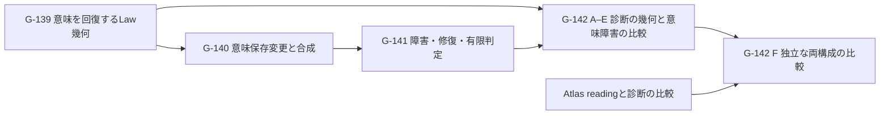

# SHIGUREの多項式特殊化 — 有限局所自由実現と診断

[n1019](n1019_shigure_representability_design.md)の一般構成に接続する、有限局所自由加群の
実現、Law値診断、台帳分割の設計を定める。各特殊化はG-139・G-140・G-141・G-142の
固定targetへ対応づける。任意担体の意味再構成と一般のLaw幾何はn1019で定め、
本ノートは同じ構成の具体的な対象・射・評価を与える。
§1–16の定義・命題・例は数学的な原始表示とその実現について述べる。
[§16の台帳例](n1020_shigure_ledger_example.md)は分冊に収める。
ArchSigによるソフトウェアへの解釈と、その処理系の検証は§17にまとめる。

## 1. 特殊化の入力と表現定理

型は有限個、各型のmoduleは有限局所自由とする。演算とLawの添字集合は任意の小さい集合、
各演算の引数と各式は有限とする。全可換係数環と全環射を量化する。
一般構成のmodule sortをこの条件で特殊化する。集合上の任意のoperationとcartesian意味は、
n1019 §2のcopying coalgebraで保持する。

原始表示を$`P`$、名前付き生成元を保持する実現の集合を$`\mathrm{Sem}`$、生成元を忘れた同型のgroupoidを
$`\mathrm{Real}`$と書く。ここで構成する表現は

```math
\mathop{\mathrm{Sem}}\nolimits _P(R)\simeq\mathop{\mathrm{Hom}}\nolimits _k(\mathop{\mathrm{Spec}}\nolimits R,M_P),\qquad\text{(S)}
```

```math
\mathop{\mathrm{Real}}\nolimits _P(R)\simeq\mathcal X_P(\mathop{\mathrm{Spec}}\nolimits R).\qquad\text{(G)}
```

である。$`M`$、普遍実現、chartの接着、$`\mathrm{Real}`$のdescent、商stackとの同値を構成し、
生成元を忘れる$`M\to \mathcal{X}`$を証明する。さらにn1019の独立な意味圏と比較し、同じ対象・射・
Law評価を回復することがSHIGUREへの接続義務である。

この実現族上で、Law値の合流、実際の意味保存変更、平方零liftの障害、十分な検査次数、
局所adapterの組立てと既存診断の比較を研究する。台帳分割を一貫した具体例に用い、
保存条件と評価条件から、許された変換式の族の中で修正式を導く探索まで接続する。

## 2. 既存成果との接続

以下では、Lean source `3f92a13e63ed1866a3a106dca91dc15cc9709431` に記された
対象・仮定・結論と、新しく構成する比較を対応づける。
[Rising Seaの数学棚卸し](../../outreach/paper/rising-sea/mathematics-inventory.md)の
第1〜2章、第3章、第5章、第8章を対応の入口にする。

| 既存対象・宣言 | 実際の入力と結論 | SHIGUREでの使用と追加義務 |
| --- | --- | --- |
| [ArchitecturalEquationSystem](../../Formal/AG/Equation/Basic.lean) | Observable環、restriction、Atom別のsymbolic violationとobject別residualをそれぞれ保持 | Lawの式から両者を生成し、評価による一致を証明する。既存equation systemの多項式表示は、個々のresidualの式と評価から判定する |
| [FreeTypedCommAlg](../../Formal/AG/LawAlgebra/AmbientAlgebra.lean)、[witnessIdeal / obstructionIdeal](../../Formal/AG/LawAlgebra/LawEquation.lean) | 任意の可換係数上の多項式環、選択されたviolation座標が生成するidealとrestriction写像 | chartの変数・関係・Law residualから直接使う。幾何側の生成idealと元のLawの意味の一致をG-139 Pで構成 |
| [StructuralRelationFamily](../../Formal/AG/LawAlgebra/StructuralRelation.lean) | 任意の多項式関係族とその生成idealによるambient quotientを持つ | 本草案ではこのAPIの関係族を空にし、個別の方程式を全てrequired Lawに置く。加群・tensor積の標準等式は成分計算で証明する |
| [StandardArchitectureScheme / EquationObservableRealization](../../Formal/AG/LawAlgebra/StandardScheme.lean) | 前者はscheme・atlas・overlapと妥当性を入力に持つ。後者の`representingEquiv`、`EquationRepresentingGeometry.representation`は表現同値を入力に持つ | SHIGUREで構成・証明するscheme、atlas、表現同値を格納・利用する。既存のcontextと新しいmoduli chartの比較も構成する |
| [FlatCoefficientChange / raw.baseChange / baseChangePresheafIso](../../Formal/AG/ReadingFunctoriality/Coefficient.lean) | rawの座標・関係の係数変更。flatな環射の型と、sheafification比較のAPIがある | rawの係数変更は再利用。任意の環射による解の移送と、flatnessを使うコホモロジー同型を区別する |
| [StandardArchitectureScheme.baseChange](../../Formal/AG/ReadingFunctoriality/StandardSchemeCoefficient.lean) | 実際のscheme pullback、atlas・overlap、恒等・合成の同型。flatness、両側のHasSheafify、site依存のHasSheafComposeが必要 | 既存の装飾つきschemeとの比較に用いる。新しい$`M`$の任意base changeは独立に証明し、必要なinstanceも構成する |
| [CoefficientGeometry](../../Formal/AG/ReadingFunctoriality/CoefficientGeometry.lean) | 普遍点のpullbackからresidual・idealを運ぶ。`BaseChangeRepresentation.baseChangeMap_isIso`は、変更後schemeが同じ絶対点関手を指定方法で表現するなら射が同型になると示す | $`k'`$への変更後は$`\mathrm{CAlg}_{k'}`$上の相対関手を使う。係数変更前後の関手を、それぞれの係数圏上で比較する |
| [StandardGeometryReference.CoefficientChange](../../Formal/AG/Examples/StandardGeometryReference/CoefficientChange.lean) | 整数から多項式環への変更、chart pullback、Law idealのstrictな包含、係数・Law比較の可換性 | 元の仮定を伴う既存の非恒等例。新しい$`\mathrm{Sem}`$の例への同定は追加義務 |
| [LawGeneratedComplex](../../research/lean/ResearchLean/AG/ResolutionInvariance/LawGeneratedComplex.lean) | K1はchart台の交差、K0はcell・Law・相異なる評価値。有限source等の下で`ThreeCochainComplex ℚ`を生成し、$`d^{1}d^{0}=0`$を証明 | 同じlabelを保つ整数モデルと任意係数への拡張をG-142で構成。Lawの評価値の再同定は別の操作 |
| [G124MainTheorem.aatLocalSemanticReconstruction_abc](../../research/lean/ResearchLean/AG/LocalSemanticReconstruction/G124MainTheorem.lean) | [Parameter / NativeCategory / LocalCategory](../../research/lean/ResearchLean/AG/LocalSemanticReconstruction/IndependentAATPrimitiveReconstruction.lean)はgeometry、lens、protocolを選ぶ。原始readingのHom組立て、対象再構成、比較を扱う | 対象の再構成と係数代数にわたる自然性は異なる義務。新しい加群実現とこれらの圏との関手・射・評価の対応を示した範囲で使う |
| [LocalReading.homEquiv](../../research/lean/ResearchLean/AG/LocalSemanticReconstruction/LocalModelCategory.lean) | 一般形はMorphismSeparates / MorphismAssembles等を仮定する | 新しい実現の分離・組立てを§3の操作から証明して適用する |
| [IndependentPolynomialExpressions](../../research/lean/ResearchLean/AG/LocalSemanticReconstruction/IndependentPolynomialExpressions.lean)、[points_iff_map](../../research/lean/ResearchLean/AG/LocalSemanticReconstruction/IndependentPolynomialCoefficientPoints.lean) | 有限式の原始評価と、固定座標の係数点からMvPolynomial.mapへの同定 | scalar式の評価・係数自然性を再利用。加群のdescentやscheme表現は新規 |
| [TrueSemanticRepairSheaf / sagaGroundedGluing](../../Formal/AG/SemanticRepair/Saga/TrueSheafDescent.lean) | 実際のsheaf条件、局所repairの所属、relation / generator completeness等の下で大域repairの存在と障害の零性を比較 | 新しい実現とのrepair・被覆・係数の対応を作り、$`\mathrm{Sem}`$のdescentを原始入力から証明して適用する |
| [LawGeneratedConormalFirstOrderDescentPackage](../../Formal/AG/SemanticRepair/Conormal/LawGeneratedConormalFirstOrderDescentPackage.lean) | $`O/I`$のsectionを$`O/I^{2}`$のsectionへ持ち上げる問題とsemantic repairを比較し、$`H^{0}`$作用の自由推移性等を示す | 実現の係数環拡大へのliftとは型が異なる。§13で元のsource・係数・比較写像を構成した場合にだけ接続する |
| [AtlasのConditionC](../../research/lean/ResearchLean/AG/ResolutionInvariance/ResolutionInvarianceConditions.lean)、[generatedComparisonH1Map_bijective](../../research/lean/ResearchLean/AG/ResolutionInvariance/LawValueBlockComparisonBijectivity.lean) | 同じfinite Source・Law評価、両readingのadequacy、supported nerve morphism、C0–C6から既存$`\mathbb{Q}`$比較の全単射を得る | G-142のadapter細分化で同じ入力とC0–C6を生成する。値が変わる§14の合流とは別の比較 |
| [G-125のactual Čech・診断比較](../../research/reports/G-125-aat-obstruction-diagnostic-bridge.md) | relationから生成した整数係数、局所定数Ob、実mismatchと診断類を比較。既存反映定理はReflectionConditionとCommonLabelChartSupportを要求 | G-142では$`\ker p`$とadapterから既存比較写像へ同定する。cycleでは後者の支持条件が偽なので、spanning treeから反映性を新たに証明する。SAGAとの比較に使うsite・被覆・制限写像を、有限空間と実交差から生成する |

[#3446](https://github.com/iroha1203/AlgebraicArchitectureTheoryV2/issues/3446)、
[#3451](https://github.com/iroha1203/AlgebraicArchitectureTheoryV2/issues/3451)、
[#3526](https://github.com/iroha1203/AlgebraicArchitectureTheoryV2/issues/3526)、
[#3567](https://github.com/iroha1203/AlgebraicArchitectureTheoryV2/issues/3567)の係数変更系列は
この表のFormal側に対応する。[n1004 §10](n1004_aat_denotational_semantics_of_architecture.md#10-帰結と後続候補)で
構想した係数変更を、これらの成果を使って独立な実現へ接続する。

[G-111](../../research/goals/G-111-aat-indexed-base-change-schema.md)の
indexed diagramのbase changeは係数環のtensor積とは異なる。
SAGAのsemantic repair gluingは選択された係数・atlas・completeness等の下の主張であり、
conormalのfirst-order descentは一次の問題である。(S)を原始入力から構成した上で、
これらと比較する写像・係数・被覆を明記する。G-106・G-111・G-124からは、その比較に使う結果を依存先に選ぶ。

[OperationRepair.behavior](../../research/lean/ResearchLean/AG/OperationRepair/Endpoints.lean)は
名前付き操作の全有限語を量化した観測同値を定義する。§12では新しい加群実現から
同じ型の操作系・観測を構成する。
[LawValueBlockDecomposition](../../research/lean/ResearchLean/AG/ResolutionInvariance/LawValueBlockDecomposition.lean)と
[LawValueBlockCohomology](../../research/lean/ResearchLean/AG/ResolutionInvariance/LawValueBlockCohomology.lean)は
固定値blockの分解、[MayerVietoris](../../research/lean/ResearchLean/AG/AtlasGluingWidth/MayerVietoris.lean)は
cell選択からの完全列を扱う。§14の新しい義務は、値block自体が変わる代数的な族へ
これらを接続することである。

## 3. 原始入力と独立な実現

<a id="primitive-input"></a>
### 3.1 入力P

量化順は、$`k`$、原始表示$`P=(A,r)`$、$`k`$代数$`R`$、$`R`$上の実現、環射・reading射とする。
$`P`$は次のデータを持つ。これらから$`M`$、schemeへの射、表現同値、atlas、descentを構成・証明する。

1. 有限な型集合$`V`$、各$`v`$の自然数$`n_v\le m_v`$。$`A`$のAtomは型、名前付き生成元、演算の
   入出力、Lawの各有限式の出現を識別する。configurationの関係は入出力と式の参照を記録する。
2. 小さい演算添字集合$`E`$。各$`e`$は有限の入力型列と出力型を持つ。0引数も許す。
   解釈は対応する加群のtensor積から出力加群への線形写像である。
3. 小さいLaw添字集合$`L`$とrequired / optional / derivedの指定。各Lawは同じ入出力型を
   持つ二つのtensor式の等式。式は演算、恒等、tensor積、置換、合成、有限和、$`k`$の
   scalar倍から生成する。各式はこれらの構成子だけからなる有限構文である。
4. 文脈は原始宣言の部分集合である。型$`v`$を含む場合は、その階数と$`m_v`$個の名前付き
   生成元を全て同時に含む。演算の型とLawの式の参照についても閉じている。
   被覆はその合併が対象文脈になる族。制限はこの条件を満たす宣言を忘れる操作、
   交差は集合の交差とする。全ての局所Law・演算がどの文脈に属するかを保持する。

式の等式計算には、加群・tensor積の結合、単位、対称性、線形性の標準等式を用いる。
$`P`$ごとの追加条件は全てrequired Lawとして宣言する。例えば演算$`T`$に$`T=0`$を要求する場合は
required Lawを一つ追加し、実現の充足条件とreading射の保存対象の両方に含める。

この入力から、型付きAtomの五座標、configuration、`ArchitectureObject`への解釈、
chart別の`ArchitecturalEquationSystem`を構成する。Atomには演算の型と式の各出現を記録し、
原始宣言を読み戻せるようにする。
§8のW1・W2・W3・W8について同じ構成を通すことをG-139 Pの必須条件とする。

### 3.2 SemとReal

$`\mathrm{Sem}_P(R)`$の元は、各$`v`$の部分加群$`K_v\subseteq R^{m_v}`$と、$`Q_v=R^{m_v}/K_v`$上の演算の族である。
$`Q_v`$は有限局所自由かつ一定階数$`n_v`$、演算は入力型に合い、全required Lawを満たす。
$`K_v`$は単なる提示のkernelとして保持し、同じ$`K`$と同じ演算を同じ元とする。
同値な記述は、全射$`q_v:R^{m_v}\to Q_v`$を持つ実現を、$`q`$と演算を保つ同型で同一視したもの。
この同値は証明する。$`q`$を保つ自己同型の自明性は全射性から導く。

$`\mathrm{Real}_P(R)`$は$`q`$を持たない有限局所自由加群$`Q_v`$と同じ演算・Lawのgroupoidである。
射は全ての演算を保つ加群同型の族。比較用には$`q`$を持たず非可逆な演算保存写像も持つ圏を
別に作り、その最大部分groupoidを$`\mathrm{Real}`$とする。この独立な定義から、§7で群作用と商stackを構成する。

環射$`f:R\to S`$はtensor積により作用する。$`\mathrm{Sem}`$では$`K_v\otimes _R S`$の$`S^{m_v}`$内の像を取る。
$`Q_v`$がprojectiveなので短完全列が分裂し、この像から得る商は$`Q_v\otimes _R S`$に一致する。
flatでない$`f`$も含め、Lawの保存、恒等・合成、quotient表示との整合を証明する。
$`\mathrm{Real}`$ではtensor積の結合・単位同型を含む擬関手のcoherenceを証明する。

### 3.3 二種類の局所性

| 被覆 | 局所データ | 構成・証明すること |
| --- | --- | --- |
| AATの文脈被覆 | 部分的な型・演算・Lawの実現 | 同じ生成元を持つ共有型の$`K`$と演算が一致する局所族の組立て。文脈を忘れる射との整合 |
| $`\mathrm{Spec}\,R`$のZariski被覆 | 加群の局所基底、生成元の局所表示、演算 | 加群・写像・Lawのdescent。$`\mathrm{Sem}`$の等化子条件と、$`\mathrm{Real}`$の同型を含むdescent |
| 係数側のfppf被覆 | tensor積と同型のcocycleを持つ実現 | $`\mathrm{Real}`$のeffective descent。§7のstack構成で使用 |

前二行の制限が可換になることも証明する。AATの文脈は原始宣言の部分集合で添字づけ、
§5のmoduliのopen chartは名前付き生成元から選ぶ局所基底で添字づける。
G-124の再構成を係数側のdescentへ移すには、この二つの添字と制限の比較が必要になる。

### 3.4 宣言の制限と係数siteの向き

宣言$`V\subset W`$を忘れる$`\mathrm{Sem}_W\to \mathrm{Sem}_V`$は、座標環では$`B_V\to B_W`$となる。
既存`ArchitecturalEquationSystem`の$`\mathrm{Observable} W\to \mathrm{Observable} V`$とは方向が異なる。
G-139 Pでは全表示$`P`$と基底chartを固定し、ambient $`\mathrm{Spec}\,B`$のprincipal openと、
その局所化を保持するAAT contextへの関手を構成する。open $`V\subseteq W`$の環射は$`\Gamma (W,O)\to \Gamma (V,O)`$。
全required Lawの残差と生成idealを同じ局所化で運び、既存raw conormal列を
principal-open基底へ制限してからZariski層へ延長する。関手・被覆・係数の比較は構成義務である。

普遍equation system $`E_B`$のObservableは$`B_s`$であり、その残差$`f_i`$と評価後の$`f_i(x)`$は別の元である。
Lawを課さない構造定数tupleからAtomの値のgraphを作り、encode/decodeの片側逆を証明する。
その同じ原式評価で、普遍object $`a_{\mathrm{univ}}`$と任意のraw ambient点$`x:B\to R`$のobject $`a_x`$を構成する。
$`x`$では別のequation system $`E_x`$を作り、評価先を逆像open $`D(x(s))`$上の$`R_{x(s)}`$とする。

```math
B_s\longrightarrow R_{x(s)},\quad b/s^n\longmapsto x(b)/x(s)^n,
\qquad \mathrm{res}_{E_B}(a_{\rm univ})\longmapsto\mathrm{res}_{E_x}(a_x).
```

$`D(1)`$を含むので、$`E_x`$での全residualの零性と原式の全Law成立を同値にできる。
例えば$`k=\mathbb{Q}`$、$`t\mapsto \varepsilon \in k[\varepsilon ]/(\varepsilon ^{2})`$では、普遍$`t^{2}`$は非零でも評価後は零であり、$`D(t)`$の逆像は空になる。
既存`EquationArchitecturePoint.evaluation`は全contextから$`\Gamma (T,\top )`$への環射を要求する。
G-139 Pでは、上の例を含む評価を逆像open上で生成する。conormalは$`E_B`$の$`J/J^{2}`$を作ってから$`x`$で引き戻す。
Lawfulな$`x`$で零となる$`E_x`$のidealから作り直すと、残すべき変形情報を失う。

例えば宣言$`V=\{X\}`$、$`W=\{X,Y,XY=\mathrm{id}\}`$では、忘却の環射は$`\mathbb{Q}[x]\to \mathbb{Q}[x,y]/(xy-1)`$。
共有$`x`$を保ちLaw idealを0へ送る逆向きの$`\mathbb{Q}[x,y]\to \mathbb{Q}[x]`$は、$`x\varphi (y)=1`$を要求するため存在しない。
この反例を残し、宣言descentと係数層のdescentを、向きを揃えた写像を持つ場合に比較する。

## 4. 係数変更とK0/K1

基礎環$`k`$は可換環とし、整数係数の式は$`\mathbb{Z}`$からの構造射で解釈する。
$`k`$に固有の定数を使う式は$`k`$代数上で解釈し、$`k\to k'`$ではその定数も移す。
$`\mathbb{Q}`$上の結果と正標数上の結果は、整数から生成した対象のそれぞれへの特殊化として比較する。

K0/K1については、既存の有限source・Law族・adequate reading・supported nerveを固定し、
cellと相異なるLaw値のlabel集合$`I^{0},I^{1},I^{2}`$をそのまま用いる。
$`C^i_{\mathbb{Z}}=\mathbb{Z}^{I^i}`$、$`d^{0}`$は右−左、$`d^{1}`$は三辺の交代和とし、整数上で$`d^{1}d^{0}=0`$を導く。
任意の$`k`$について$`k\otimes_{\mathbb{Z}} C_{\mathbb{Z}}\cong C_k`$、$`k=\mathbb{Q}`$で既存の微分・比較射との同定を要求する。
係数変更はlabelを固定する。評価値を別の値域へ写して同じ値をまとめる操作は、
新しいK0 indexを作るreading変更であり、scalar extensionとは分ける。

複体のbase change同型を構成し、flatnessの下で$`H^{i}(C)`$のbase change同型を導く。
W4でflatnessを外した場合の非同型を示す。
個々のコホモロジー類が零になることを反映する十分条件にはfaithful flatnessを使う。
flatな係数変更による比較同型と、元の類の零性の反映は区別する。
無限積とtensor積を交換する箇所では、比較同型の成立条件を証明する。既存の
`CechCoefficientBaseChangeCompatible`は次数別の比較同型を要求する述語であり、
`cechCoefficientBaseChangeCompatible_of_finite_raw_isSheaf`の有限被覆・raw sheafの
仮定を保持してdiagnosticへ接続する。(S)は全$`R`$について構成する。

## 5. affine表示から大域schemeへ

各$`v`$で$`m_v`$個の生成元から$`n_v`$個を選ぶ組$`I`$をchart添字とする。
$`\mathrm{Sem}_{P,I}`$は、選んだ生成元が$`Q_v`$の基底になる実現の部分関手である。
この条件の成立部分はtest scheme上でopenになることを証明する。
その基底で$`q_v`$の選択列を単位行列にし、残りの列と演算の係数を変数にする。
各Lawの残差の全成分を式から生成し、

```math
B_I=k[x_{v,ab},y_{e,\mathbf a b}]/J_I,
\qquad U_I=\mathop{\mathrm{Spec}}\nolimits B_I
```

とする。$`J_I`$はrequired Lawの残差から生成するideal。
加群・tensor積の標準等式は成分多項式の恒等式になることを証明する。
既存の`StructuralRelationFamily`を介する場合は関係族を空にして$`J_{\mathrm{struct}}=0`$とし、
個別の方程式は全て$`J_I`$に含める。
有限階数により一つのtensor等式は有限個の成分等式になる。任意の小さいLaw族から$`J_I`$を生成する。

ここで証明する局所対応は、基底での独立な実現からmatrixを読む写像とその逆である。
多項式環・商環の普遍性は標準数学として使い、AATの仕事はAtom・演算・Lawの式と
その変数・生成ideal・実現の対応に置く。symbolic violationの零性とobject residualの
零性の一致を、chart上の評価式として証明する。

$`I`$と$`J`$の共通部分では、$`J`$列から作る基底変換行列の行列式$`d_{IJ}`$をinvertする。
基底変換から$`B_J[d_{JI}^{-1}]\to B_I[d_{IJ}^{-1}]`$を生成する。
基底変更は残差の成分を混合する。tensor残差の変換式を導き、そこから
生成idealの一致を証明する。この写像の両逆、三重交差のcocycle、係数自然性を示す。

これにより$`U_I`$を貼り合わせて$`M`$を構成する。任意の$`\mathrm{Sem}_P(R)`$の生成元は局所的に基底を
含むので、その条件のopen集合が$`\mathrm{Spec}\,R`$を覆うことを原始データから示す。
$`R`$上の各実現をこの$`I`$の族で覆い、局所解からschemeへの射を貼り合わせる。
逆に普遍商加群・演算を引き戻すことで(S)を証明する。普遍実現は全chartを通じて構成する。

一般の「Zariski sheafにrepresentableなopen部分関手の被覆があれば表現可能」という
結果には[Stacks Project, Tag 01JJ](https://stacks.math.columbia.edu/tag/01JJ)を用いる。
局所基底の選択は[Grassmannianの構成, Tag 089T](https://stacks.math.columbia.edu/tag/089T)を
参照する。G-139 Pでは、上の独立な実現から被覆・open性・descent・cocycleを構成・証明する。

## 6. readingの射と自然性

同じ型・階数・生成元数を持つ表示間の射$`u:P\to P'`$は、$`P`$の各演算を$`P'`$の同じ入出力型の
tensor式へ送る代入とする。型の全単射による改名も許す。$`P`$のrequired Lawが$`P'`$の
required Lawと§3.1の加群・tensor積の標準等式から従うことは、等式計算による導出を持つ。
derived Lawを使う場合も、required Lawと標準等式を前提とする導出を伴う。optional Lawは追加可能な条件として保持する。
射の等号は型の対応が同じで、各演算の代入式がこの同じ理論で等しいこととする。
この構文上の代入から、$`\mathrm{Sem}`$間の写像とscheme射を構成する。

この代入を、型を追加する包含へも拡張する。sourceの型は同じ階数・生成元数のtarget型へ
単射で対応させ、source演算の式とLaw導出を与える。追加型・演算を忘れる作用を生成する。
階数の異なるbefore/afterの比較は§12のcomparison presentationに置く。

解釈の向きは

```math
u^*: \mathop{\mathrm{Sem}}\nolimits _{P'}(R)\longrightarrow\mathop{\mathrm{Sem}}\nolimits _P(R),
\qquad M(u):M_{P'}\longrightarrow M_P.
```

Lawの強化は「強いLawの解→弱いLawの解」の向きになる。代入から$`u^*`$を生成し、
$`\eta_R(u^*x)=M(u)\circ\eta_R(x)`$、恒等、合成、係数変更との正方形を証明する。
同じ式で$`\mathrm{Real}`$の関手と2-cellを構成する。

reading射は任意の代入とLaw導出を扱い、互いに逆な代入がある場合に同値を証明する。
文脈被覆の細分化については、同じ大域実現への組立てを介して同値を示す。解像度やLaw評価値を忘れる既存のreading変更は、その射から上記の
代入または追加の比較構成が得られるかを個別に照合する。
Atlasの$`H^{1}`$比較と$`M`$の比較を結ぶ可換図式も構成し、それぞれの同型条件を証明する。

基礎環の射$`k\to k'`$については$`P_{k' }`$を式の係数変更から作り、

```math
M_{P_{k'}}\cong M_P\times_{\mathrm{Spec}\,k}\mathrm{Spec}\,k'
```

を全$`k'`$代数上の同じ実現と比較する。
この同型の恒等・合成と$`u`$との交換も、任意の基礎環の射について証明する。

## 7. 自己同型を保持する場合

全$`Q_v`$に基底を選んだ演算係数の方程式からaffine scheme$`X_P`$を構成する。
$`G=\prod _v \mathrm{GL}_{n_v}`$の作用は、tensor演算の入力・出力の基底変更から生成する。
$`\mathrm{Real}`$と$`[X_P/G]`$の同値は、実現のframe torsorを作る方向と、torsor上の演算を
descentする方向で証明する。これにより§3.2で定義した$`\mathrm{Real}`$と商stackを結ぶ。
$`G`$は有限個のGLの積でありsmoothかつ有限表示。この条件を商stackの代数性で使う。
一般の商stackの代数性条件は[Tag 06PI](https://stacks.math.columbia.edu/tag/06PI)に従う。

$`q`$を付け加えると、各frame上で全射行列$`R^{m_v}\to R^{n_v}`$のopen部分が生じる。
これを用いて$`M\to \mathcal{X}`$がrepresentable、smooth、surjectiveになることを構成・証明する。
$`m=n`$では$`q`$は基底、$`m>n`$では一般に複数のchartが要る。
$`M`$は生成元数$`m`$にも依存し、同じ$`\mathcal{X}`$に対する$`M`$同士も一般に同型とは限らない。
例えばrank1、$`T=0`$では$`m=1`$で$`\mathrm{Spec}\,k`$、$`m=2`$で$`\mathbb{P}^{1}_k`$となる。一方、全階数が零なら、
演算・Lawが空な場合の$`M`$は生成元数によらず$`\mathrm{Spec}\,k`$になる。

各実現の自己同型群は$`\prod _v \mathrm{GL}(Q_v)`$の演算保存部分群として計算する。frame上では$`G`$の
stabilizerとなり、局所frameを変えた共役作用によって大域へ降下する。
$`q`$を保持すると自己同型が自明になることを証明する。
$`H^{0}`$が修復解に自由推移的に作用することと、一つの対象の自己同型群が
非自明であることは区別する。特に自由な作用のstabilizerは自明である。

[n1005 §6](n1005_aat_semantic_geometry_route_after_g107.md#6-発展提案の記録--universal-comparison-family-構想)の
実現空間の構想を、次の二段階で具体化する。
代数stackのinertiaが自明ならalgebraic spaceになることは
[Tag 04SZ](https://stacks.math.columbia.edu/tag/04SZ)であり、schemeには§5のopen chartが要る。
点ごとの同型類$`\pi _{0}`$、そのsheafification、coarse moduliは、それぞれの定義と比較写像で扱う。
coarse moduliの存在条件と高次の2-morphismを保持する構成を後続課題とする。

## 8. 固定する具体例

以下の期待判定を後続GOALの構成・証明targetとする。
W1〜W3・W8は§3.1の同じAtom生成・Law解釈から作る。各例の型名・演算名・生成元名を
Atomのsubject / predicate / payloadへ写し、式の有限構文から残差を生成する。

| 例 | 固定データ | 期待判定と使用先 |
| --- | --- | --- |
| W1 名前付き可逆操作 | $`k=\mathbb{Z}`$、型$`p,q`$、各$`n=m=1`$、演算$`f:p\to q`$・$`g:q\to p`$、Law $`gf=\mathrm{id}_p`$・$`fg=\mathrm{id}_q`$ | $`\mathrm{Sem}(R)=\{(a,b):ab=1\}`$。$`M\cong \mathrm{Spec}\,\mathbb{Z}[a,b]/(ab-1)`$。$`R=\mathbb{Z}`$で$`(1,1),(-1,-1)`$は別の実現、$`(0,0)`$は不成立。演算の意味、Lawの有効性、非恒等なreading改名$`f\leftrightarrow g`$を検査 |
| W2 二生成元の局所表示 | $`k=\mathbb{Z}`$、型$`v`$、$`n=1,m=2`$、演算$`T:v\to v`$、Law $`T=0`$ | $`M\cong \mathbb{P}^{1}_{\mathbb{Z}}`$。$`R=\mathbb{Z}`$の$`q=(2,3):\mathbb{Z}^{2}\to \mathbb{Z}`$は全射だがどちらの列も大域基底でない。$`D(2),D(3)`$で$`\frac32,\frac23`$を読み、重なりで逆数変換。複数chartによる大域実現を検査 |
| W3 冪零な変形 | $`k=\mathbb{Z}`$、型$`v`$、$`n=m=1`$、演算$`T:v\to v`$、Law $`T^{2}=0`$ | $`M\cong \mathrm{Spec}\,\mathbb{Z}[t]/(t^{2})`$。$`R=\mathbb{Z}[\varepsilon ]/(\varepsilon ^{2})`$では$`T=0`$と$`T=\varepsilon`$は別。体値点への制限、冪等関係の追加、radical化による冪零変形の情報損失を検査 |
| W4 係数の変化 | (a) cochain複体$`\mathbb{Z}\to \mathbb{Z}`$を$`\times 2`$、次数$`0\to 1`$に置く。(b)二source、一Law、値域$`\mathbb{Z}`$、値0,2。readingは恒等、単一chartに全sourceを置き、edge・faceは空にする | (a)$`H^{0}(C)=0`$だが$`\mathbb{F}_{2}`$へのtensor後の$`H^{0}`$は$`\mathbb{F}_{2}`$。$`H^{1}(C)=\mathbb{Z}/2`$の非零類はflatな$`\mathbb{Z}\to \mathbb{Q}`$で零になる。(b)$`\mathbb{F}_{2}`$値で再生成したK0 labelは二つから一つへ減る。(a)は微分$`\times 2`$を指定した標準代数の対照例、(b)はK0のlabel生成の例 |
| W5 自己同型 | W2から$`q`$を忘れたrank1実現、$`T=0`$ | $`\mathrm{Real}\simeq B\mathbb{G}_m`$。$`R=\mathbb{Z}`$で$`-1`$は非恒等な自己同型。$`q`$を保持する自己同型は恒等。$`\mathbb{P}^{1}`$と$`B\mathbb{G}_m`$の差、生成元を忘れる射を検査 |
| W6 不整合な遷移 | $`\mathbb{Z}`$上の三つのaffine line、全体をpairwise overlapとし、$`0\to 1,1\to 2`$を$`t\mapsto t+1`$、$`0\to 2`$を恒等にする | 三重交差で合成は$`t\mapsto t+2`$となる。接着入力のcocycle不成立を示す対照例。§5では原始実現から生成した遷移のcocycleを証明する |
| W7 Law変更と係数自然性 | 型$`v`$、$`n=m=1`$、$`T`$にLawを課さない表示$`P`$と$`T^{2}=0`$を課す$`P'`$、および$`\mathbb{Z}\to \mathbb{F}_{2}`$ | $`M_{P' }\to M_P`$は$`\mathrm{Spec}\,\mathbb{Z}[t]/(t^{2})\to \mathbb{A}^{1}_{\mathbb{Z}}`$の真の閉埋め込み。係数変更の正方形を同じ$`t`$で比較。Law強化が生む非同型なreading射を検査 |
| W8 文脈での組立て | $`k=\mathbb{Q}`$、型$`p,q,r`$、全階数1、生成元数1,2,1。$`p\leftrightarrow q`$と$`q\leftrightarrow r`$の二組の可逆演算と各往復Lawを二文脈に分ける。共有型$`q`$の全生成元を交差に含める | 共有表示$`q_q=(2,3)`$、左右の可逆係数$`(2,\frac12)`$と$`(3,\frac13)`$は一つの実現へ組み立つ。右の$`q_q`$だけを$`(1,0)`$へ変えると、各文脈はlawfulでも共有kernelが$`\mathbb{Q}(3,-2)`$と$`\mathbb{Q}(0,1)`$で異なり、同じ生成元を保つ組立てはできない |

W1の宣言Atomの五座標を次のように取る。payloadの型は名前、自然数の組、
型付き有限式の直和とする。この宣言から実現とschemeを構成する。

| kind | axis | subject | predicate | payload |
| --- | --- | --- | --- | --- |
| sort | state | $`p`$ | ranks | $`(1,1)`$ |
| sort | state | $`q`$ | ranks | $`(1,1)`$ |
| generator | state | $`e_p`$ | type | $`p`$ |
| generator | state | $`e_q`$ | type | $`q`$ |
| operation | operation | $`f`$ | signature | $`(p;q)`$ |
| operation | operation | $`g`$ | signature | $`(q;p)`$ |
| equation | law | $`l_p`$ | required | $`g\circ f=\mathrm{id}_p`$ |
| equation | law | $`l_q`$ | required | $`f\circ g=\mathrm{id}_q`$ |

各Lawの部分式の出現には、Law名と構文木内のpathをsubjectに持つAtomを生成する。
configurationのrelationは型、入出力、Lawと部分式の参照から生成し、identificationは
同じ宣言・同じ出現の等号とする。これにより五座標から宣言と各出現を読み戻せる。
実現の係数$`a,b`$は`ArchitectureObject.structureMaps`に置き、Lawの評価は$`ba-1`$と$`ab-1`$になる。
W2は一型・二生成元・$`T=0`$、W3は一型・一生成元・$`T^{2}=0`$を同じ規則へ通す。
W8は二組のW1を型$`q`$で共有し、その生成元数を2にした入力から作る。

W1の改名が作用として非恒等になる証人は$`R=\mathbb{Q}`$、$`(a,b)=(2,1/2)`$とする。
W2の$`q`$の全射性は$`-2+3=1`$から検査でき、kernelは$`\mathbb{Z}(3,-2)`$。
三つ以上の型や零階数も一般定理の量化に含め、上の例では指定した型・階数と非退化性を検査する。

## 9. GOALの分割と証明経路

研究到達像は[n1019 §9](n1019_shigure_representability_design.md#9-研究分割と数学的な評価)の
四GOALで定める。本ノートの特殊化を、次の固定targetへ接続する。

| GOAL | 本ノートで構成する証明義務 | 参照箇所 |
| --- | --- | --- |
| [G-139](../../research/goals/G-139-aat-law-generated-relative-geometry.md) | 独立なSem / Real、Atomと残差の評価一致、係数descent、chart・scheme・stack、readingと任意基礎環変更の自然性 | §3・5–8・11。同じ原始入力をG-139 Pへ通す |
| [G-140](../../research/goals/G-140-aat-semantic-change-category.md) | 状態比較と操作語翻訳を持つ変更、階数変更、図式補完、phase不変量・状態移送と全経路の観測保存 | §12・16.1・16.3–4・16.7–9 |
| [G-141](../../research/goals/G-141-aat-coherent-repair-effectivity.md) | 全syzygy・conormal・相対lift、全Artin試験と鋭い次数上界、adapterから実State・SAGA・許容域付き全修復を生成、頑健判定と相互作用の有限特殊化 | §13・15・16.2・16.4–5・16.8–10 |
| [G-142](../../research/goals/G-142-aat-law-value-diagnostic-sheaf.md) | 同じlabelの整数係数、診断のétale層、合流の核・余核、構成可能関数の実現とpseudo-coherent実現の不存在、実障害のK0指定類とAtlasへの比較、判定を分離する追加観測 | §4・14・16.5–6・16.9 |



G-139では独立な意味、局所基底、残差式、descentを生成してから表現を証明する。
その同じ表現同値でreadingと係数の自然性を示す。schemeとstackは生成元を忘れる
比較を含めた一つの構成義務とする。
G-140はmatchingな変更の組立て、G-141は与えられた局所変更をmatchingへ補正する条件と
全修復を担う。G-141は原始操作とLawから実修復を構成し、G-142が同じ指定障害を診断へ送る。
Atlasはreadingと診断の比較を、SHIGUREは実現・変更・障害の幾何をそれぞれ構成する。
G-142 Fの比較定理が、独立に得られた両理論の結果を結ぶ。

各GOALは一般定理と指定例を要求し、係数拡張、cocycle、自然性の補題を含めて証明する。
任意constructible関数の実現、全Artin検出の上界、実修復と診断の零性反映も固定targetとする。
証明方法・補題分割・Leanの内部APIは後続の設計で選ぶ。

## 10. 論文で主張する貢献と既知の数学

想定読者は、moduli・層・コホモロジーを知り、AATの内部語彙は知らない研究者である。
問いは「観測を保つ実現と射の族、その変形をLawから構成した幾何で説明できるか」。
標準数学を適用する箇所と、同じ原始データ上の新しい比較を作る箇所を次のように分ける。

| 既知の結果・確認した箇所 | この設計の位置づけ |
| --- | --- |
| [Poonen, The moduli space of commutative algebras of finite rank, Prop. 1.1・§2–3](https://math.mit.edu/~poonen/papers/moduli.pdf) | 構造定数、基底付きscheme、GL作用とstackは先行構成。(S)(G)をこの方法で構成し、AATの意味・変更・診断への比較を新たに証明する |
| [Yalin, Moduli stacks of algebraic structures and deformation theory, §§4・6](https://arxiv.org/html/1411.5177v3) | moduliと変形複体の一般的接続がある。新しい義務はAATの原始Law・文脈・合法修復への同じ写像での接続 |
| [Ginot–Yalin, Derived deformation theory of algebraic structures, Theorems 0.2–0.3](https://arxiv.org/html/1910.07255v3) | 自己同型を含む変形比較の先行結果。原始Lawから生成した変形と、この比較を接続する |
| [Stacks 08S3](https://stacks.math.columbia.edu/tag/08S3)、[00S0](https://stacks.math.columbia.edu/tag/00S0) | 平方零liftとcotangentは標準定理。原式からの全syzygy、実際の残差、文脈の補正との比較を生成する |
| [Budur–Wang, Cohomology jump loci of differential graded Lie algebras, §2](https://arxiv.org/html/1309.2264v2) | 固定複体のjump locusと比較する。K0では値の一致により座標集合自体が変わるため、§14で別の幾何的実現を構成する |
| [de Fernex–Ein–Ishii, Jet closures and the local isomorphism problem](https://arxiv.org/abs/1704.07494) | 曲線jetによる識別と比較する。§15の試験対象は全局所Artin代数であり、その違いを明記する |
| [Abadi–Lamport, The existence of refinement mappings, §§1.2・2.4](https://www.microsoft.com/en-us/research/wp-content/uploads/2016/02/abadi-existence.pdf) | 初期状態、状態比較、stutteringによる振る舞い保存は先行する。ここでは有限操作語・許可phase経路について保存を証明する |
| [Goguen–Burstall, Institutions: Abstract model theory for specification and programming, Definition 1・Theorem 11](https://courses.grainger.illinois.edu/cs522/sp2016/InstitutionsAbstractModelTheory.pdf) | 構文代入、反変なモデル移送、充足の自然性を照合する。追加義務は同じ代入が生成するmoduli射・合法修復・値診断の比較 |
| [Frégier–Markl–Yau, The L∞-deformation complex of diagrams of algebras, Theorems 4.2・5.5](https://arxiv.org/pdf/0812.2981) | colored PROPによる演算・射の図式と変形に先行構成がある。任意可換基礎環上の本対象、許容変更域・文脈制限、K0/K1生成との対応を個別に示す |

主要な貢献候補は、原始表示からの「実現」「実際の変更・修復」「Law値診断」を比較する
写像と、その一致条件・不成立例を構成することにある。特に§14のK0/K1制約内での
constructible関数の実現と、§15の合成深さに対する鋭い検査次数を独立に証明する。
表現可能性・Mayer–Vietoris・cotangentの標準結果を使い、この比較軸に対する新規性を論文で論じる。

実修復はG-141のadapter族から構成し、G-142で同じ$`\ker p`$・指定障害類を診断へ比較する。G-142の
任意constructible関数の実現は、任意に選んだ値診断の次元だけでは意味保存を判定できない
ことを説明する。G-141 Eのsyzygy表示とG-141 Fの普遍Artin商の判定を、同じ原始操作・
許可変更・診断へ結び、成立条件・破れる条件・実際の修正を同じ実現上で決める。
この構成を比較定理群として評価する。

[n1005 §6](n1005_aat_semantic_geometry_route_after_g107.md#6-発展提案の記録--universal-comparison-family-構想)の
reading選択空間、実現moduli、comparisonの欠損を区別する構想を、次の二つで具体化する。
実現moduli上の値診断は§14の定数係数étale層で束ねる。実現の変形は§13のcotangent側で
扱う。両者を一つのperfect複体とする一般的な要求は、§14の下降例が反証するtargetである。

<a id="representation-scope"></a>
## 11. 表現の射程と情報の保持

| 対象 | 同じ意味を保持して表せる範囲 | 検査すべき追加条件・失われる情報 |
| --- | --- | --- |
| 線形read/write、有限個の数値状態 | 有限局所自由加群と線形写像。affine更新は加法・定数・単項演算から構成 | 加法は直積からの写像として扱い、単位・係数環・観測時点を固定 |
| 有限状態と単項操作表 | 非零環上の自由加群$`R[S]`$で基底を基底へ送る線形写像。操作合成と基底状態の識別を保持 | 全線形写像には基底状態を混合するものもある。基底保存条件を別に置く |
| 集合上の任意の有限arity演算 | n1019 §2のcoalgebraにより、任意担体で全cartesian Lawを保持 | 反復変数は$`\Delta`$で運ぶ。Bool ANDは$`m\Delta =\mathrm{id}`$を満たす。$`\Delta`$を捨てて$`m(v,v)=v`$を課す方法とは区別する |
| 整数affine・有理多面体 | 等式部分と有理係数の変数を扱える | ≥や非負性は、順序を持つ係数と許容領域を指定したreadingに保持 |
| 分岐・例外・可変長List・終了性 | 固定した有限状態や有限長の表示への接続を個別に構成 | 構文から有限表示への写像を個別に構成し、保持する識別と失われる識別を具体的に示す |

有限状態の単項写像の像をfield値点で特徴づけるには、matrix各列にidempotence、
相互直交、和1の式を課す。一般の環では互いに直交するidempotentによる局所的な分岐が
生じるため、一つの集合写像への復元には連結性等の条件が要る。これをG-139 Pの像の定理と
不成立例に含める。一般理論の全$`R`$量化と、特定の入力意味へ戻せる$`R`$の条件は別に述べる。

<a id="development-change"></a>
## 12. 実現間の射と観測相対の意味

三種類の変更を区別する。係数環の変更$`R\to S`$、readingの代入$`P\to P'`$、
独立な二つの実現を結ぶ意味保存射は、それぞれ異なる入力を持つ。

二つの原始表示$`P_{0}`$、$`P_{1}`$から比較表示$`P_{01}`$を作る。$`P_{01}`$は両側の型・演算に
加え、状態比較$`h`$、選んだ観測$`O`$、操作名の対応$`\tau`$と、その保存方程式を持つ。
型の階数は両側で異なってよい。宣言を忘れる二写像から

```math
M_{P_0}\longleftarrow M_{P_{01}}\longrightarrow M_{P_1}
```

を構成する。比較対象と意味保存射の組はこの対応の点、片側の実現を固定した比較の全体はそのfiberである。

選んだ名前付き操作を状態集合上の全域写像として解釈し、観測を$`O`$とする。
同じ系の二状態の意味同値は、全有限操作語$`w`$について$`O(\mathrm{eval}(s,w))=O(\mathrm{eval}(t,w))`$とする。
比較表示では、各生成操作$`e`$について

```math
h\circ\mathop{\mathrm{step}}\nolimits _1(e)
 =\mathop{\mathrm{step}}\nolimits _0(\tau(e))\circ h,
\qquad O_1=O_0\circ h
```

をLawとして課し、帰納法により全語での観測保存を導く。$`\tau (e)`$には有限語、特に空語を
許す。$`h`$は非単射な状態比較も含む。この保存方程式の十分性を証明し、必要性が成り立つ範囲も特定する。
G-126の`OperationSystem`と`behavior`へ同じ状態・操作・観測を構成して接続する。

これは選んだ操作言語に相対的な意味である。操作を細分化し、その途中に新しいreadを
入れる変更には別の保存方程式が必要になる。§16の途中readの反例を必須とする。

有限phase graphを使う場合は、phaseごとのambient加群に状態を表す0引数演算と
多項式不変量を加える。合法状態はその実現fiberであり、集合自体が有限局所自由とは限らない。
遷移式の不変量保存と観測式の保存を原始式から証明し、全ての許可された有限経路へ帰納する。
§16.4のBusyは$`\mu (h-C)=0`$を保持する。全$`R^{3}`$を合法状態と扱う変更は、別の強い要求になる。

<a id="semantic-lift"></a>
## 13. 原始Lawから実際の変更・修復を生成する

固定した表示の係数を少し変える問題を、次の独立なliftとして定義する。
平方零拡大$`R' \to R`$、kernel $`M`$、$`x\in \mathrm{Sem}_P(R)`$に対して、$`R'`$上でLawを満たし$`x`$へ還元される
実現の集合を取る。reading $`u:O\to P`$がある場合は、さらに指定された観測側のliftを保つ
実現を取る。$`\mathrm{Real}`$では還元同型と観測同型を保持したfiber groupoidにする。

affine chartで$`B=k[z_{1},\ldots ,z_n]`$、$`J=(f_{1},\ldots ,f_r)`$、$`A=B/J`$とする。
原始式から$`S=\ker(B^r\to J)`$、$`(s_i)\mapsto \sum s_i f_i`$、という全syzygy加群を生成する。
その生成族$`s^\alpha`$を使い、$`x`$と$`M`$に対して

```math
D^0=M^n\xrightarrow{\mathop{\mathrm{Jac}}\nolimits (f)(x)}
D^1=M^r\xrightarrow{(s^\alpha(x))_\alpha}D^2=M^{\{\alpha\}}
```

を作る。この節では演算・Lawを有限とし、有限計算には有効なNoetherian係数を指定する。
G-139 Pの小さい無限表示の表現定理とは量化を分ける。
syzygyは多項式上で生成してから$`x`$で評価する。

$`B\to R'`$への任意のambient liftで$`f_i`$を評価すると$`M`$値の残差が得られる。
これが$`\ker(d^{1})`$に入り、ambient liftを変えると$`d^{0}`$の像だけ変わることを証明する。
主張は、$`H^{1}(D)`$のその類が零であることと実際のlawful liftの存在が同値であり、
存在するとき全liftが$`H^{0}(D)`$のtorsorになることである。全syzygyにより
$`\ker(d^{1})=\mathrm{Hom}_A(J/J^{2},M)`$を構成し、低次数のcotangentによる分類へ同定する。
この三項による分類は平方零liftの存在とその全解を対象とする。

文脈での局所修復には、観測を固定し各局所Lawを保つderivationを係数にする。
このとき観測側の被覆$`O_i`$と実現側の被覆$`P_i`$を持つ局所reading $`O_i\to P_i`$を原始代入で指定し、
全参照の所属と交差上の可換性を要求する。$`T\mapsto X+Y`$を$`\{X\}/\{Y\}`$だけへ分ける被覆では、
大域補正$`(a,-a)`$を局所の観測固定係数へ制限できない。必要な観測方程式は、その全参照を
含む文脈へ配置してから局所修復を作る。
Law・変数の支持から局所残差と共有部分の差を生成し、補正と貼り合わせを実際に作る。
複数文脈にまたがるsyzygyも取り込む。全域の原式から作る$`D`$との比較を構成することが
G-141 Eの証明義務である。

検査例は、冗長な$`(t^{2},t^{3})`$と$`(t^{2})`$、三文脈の$`x_{1}-x_{0}`$、$`x_{2}-x_{1}`$、$`x_{0}-x_{2}`$という依存するLaw、
最後の式を$`x_{0}-x_{2}-t`$へ変更した族とする。評価後のJacobianだけでは、元の多項式関係の
有無を回収できない。$`t^{2}=0`$と$`t^{3}=0`$も同じ一次接空間を持つが、二次のliftは異なる。

SAGAの係数複体と実際の修復への正の比較はG-141のadapter族で固定し、
同じ指定類を診断へ送る比較はG-142で構成する。
conormalは§3.4の固定ambientとprincipal-open基底を使う。ambient lift $`B\to R'`$は$`J^{2}`$を消すので
$`B/J^{2}\to R'`$を与え、その$`J/J^{2}`$上の制限$`\kappa :J/J^{2}\to M`$が残差になる。同じambient liftが$`B/J`$を
経由する条件は$`\kappa =0`$であり、ambient liftの選択差を除いた$`[\kappa ]`$は上の$`o_P`$に一致する。
これが既存のconormal列との比較写像である。sectionそのもののliftとは型を分ける。
線形・affineなLawでは補正式が有限の変更にも厳密に成り立ち、§16の
修復へ特殊化する。許容変更部分加群を入力に取り、原始Lawから障害と全解を生成する。

<a id="diagnostic-family"></a>
## 14. 実現族上のLaw値診断と合流

有限source $`S`$、有限readout添字$`L`$、有限supported nerveを選ぶ。cell $`\sigma`$の支持$`S_\sigma`$は
chart支持とK1の交差から生成する。実現scheme $`B`$上で各$`f_{\ell ,s}`$を、選んだ原始式から
生成したregular scalar readoutとする。required Lawの残差はlawful locus上で零になる。
ここで読むのは、その残差とは別に指定した操作係数やscalar観測である。
readoutの構文は、$`k`$の定数、加法・乗法、有限tensor式で得た自己準同型のtraceから生成する。
名前付き生成元が基底になる型（$`n_v=m_v`$）では、その基底による演算成分も使える。
traceの基底不変性と成分の変換則からregular functionを構成する。chart成分を読む場合は、
そのchartを$`B`$として同じ構成を行う。
生成元を忘れた商stackに降ろす場合は、GL作用での不変性を別に証明する。

各cell・readoutについて有限root schemeを構成する。

```math
Z_{\sigma,\ell}
 =\mathop{\mathrm{Spec}}\nolimits _B\!\left(
 \mathcal O_B[z]/\prod_{s\in S_\sigma}(z-f_{\ell,s})\right),
\qquad p_{\sigma,\ell}:Z_{\sigma,\ell}\to B.
```

空支持では空schemeとする。支持包含から閉埋め込みと定数étale層の制限を作り、
診断係数環$`\Lambda`$に対して$`C_B^d=\bigoplus_{\dim\sigma=d,\ell}(p_{\sigma,\ell})_*\Lambda`$を交代制限で複体にする。
$`\Lambda`$と$`B`$の基礎環は別の指定である。

G-142の主張は、各幾何点でのstalkが、そこで相異なる値を再生成したK0/K1複体に
一致し、任意の$`B' \to B`$によるinverse imageと可換になることである。有限射のstalkと
base changeには[Stacks 03QN](https://stacks.math.columbia.edu/tag/03QN)を使う。
各stalkは対応する幾何点の等値partitionを読む。一般の$`R`$値で異なる0と冪零元$`\varepsilon`$も幾何点では一致する。
全$`R`$値の意味は$`\mathrm{Sem}`$が保持する。

普遍座標$`x_{\ell ,s}`$を持つaffine space上で一度構成し、全てのreadout族へのpullbackを
示す。等値partitionごとに、同じblock内の差の零性と異なるblock間の差の可逆性を
課したlocally closed stratumを作る。その上では同じ整数incidence複体を得る。

<a id="collision-geometry"></a>
### 14.1 合流の保存条件と跳躍の実現

値$`a`$のblock $`K_a`$を「値$`a`$のsourceを支持に含むcell」の部分複体とする。
二つの値が合流するとblockは$`U=K_a\cup K_b`$になる。$`I=K_a\cap K_b`$とし、原始cellから

```math
0\to C^\bullet(U)\xrightarrow{r}
 C^\bullet(K_a)\oplus C^\bullet(K_b)
 \xrightarrow{\rho}C^\bullet(I)\to0
```

を生成する。$`r`$は合流後から合流前への制限である。$`H^{1}(r)`$が同型である必要十分条件は
$`H^{0}(\rho )`$が全射かつ$`H^{1}(\rho )=0`$である。新しい類と失われる類をこの同じ完全列で説明する。
多数の合流には有限Mayer–Vietoris複体を使い、合流順序との整合を証明する。

さらに、任意の有限表示affine $`B`$と$`Z=V(g_{1},\ldots ,g_r)\cap D(h)`$に対し、固定K1支持と原始
scalar readoutから$`\beta _{1}=1_Z`$を構成する。$`n=\mathrm{max}(3,r+1)`$頂点のcycleの各辺にsourceを置き、
値を$`0,g_{1},\ldots ,g_r`$、残りを0とする。全頂点に属するsourceを一つ追加し値$`h`$を読む。
ambient nerveは全2-skeleton。値blockはcycleの部分グラフ、または全2-skeletonになり、
全辺値が0かつ$`h\ne 0`$の場合だけ$`H^{1}`$が一つ残る。有限直和で有限constructible関数へ拡張する。

K0/K1の指定された生成規則の中で、各constructible関数を実現する定理を目標とする。
rank1の演算とrequired多項式Lawで$`B`$自体も構成する。
§16では同じsmoothな意味保存族上で$`\beta _{1}`$が生じ、消えることを示す。下降する例は、
全fiberの$`\beta _{1}`$を回収するpseudo-coherent／perfectな$`O_B`$複体の存在を反証する。
その根拠はderived fiberのBetti数の上半連続性である
([Stacks 0BDI](https://stacks.math.columbia.edu/tag/0BDI))。

<a id="formal-reading"></a>
## 15. どの次数の変更から意味の実現を失うか

$`O`$に補助演算$`Y_j=F_j(O,Y_{1},\ldots ,Y_{j-1})`$を順に追加した表示$`P`$を考える。
残る追加Lawを同じ順序で代入し、$`O`$上の残差ideal $`K`$を生成する。
定義だけの追加では全$`R`$上で実現を保存し、追加Lawがある場合の像はこの残差の零点になる。
marked版の閉埋め込みとunmarked版のfull faithfulな射を同じ消去から構成する。

有限表示、体$`k`$、$`k`$値実現$`x`$を選び、観測点$`a`$の局所環$`A`$と極大ideal $`m`$を取る。
$`\nu`$を$`K\subseteq m^\nu`$となる最大次数とし、$`K=0`$なら$`\infty`$とする。G-141 Fでは任意の$`r\ge 0`$について

```math
\begin{aligned}
&\text{全ての局所Artin }k\text{代数 }R,\ \mathfrak n_R^{r+1}=0
 \text{ 上で原点変形の比較が同値}\\
&\qquad\Longleftrightarrow K\subseteq\mathfrak m^{r+1}
\Longleftrightarrow
 A/\mathfrak m^{r+1}\text{ の普遍観測変形がliftする}
\end{aligned}
```

を普遍的なArtin試験環を用いて証明する。
Noetherian局所環ではKrull交叉から全次数での一致と$`K=0`$を比較する。
$`\nu`$が有限なら$`A/m^{\nu +1}\to A/m^\nu`$が初回の失敗を与え、その残差を§13の同じ障害類へ送る。

自由な観測係数上では、原始式の積で加算、和で最大を取る次数上界を依存順序に沿って
計算する。消去後の上界$`B`$までの全Artin比較で追加制約の有無が決まることを証明する。
二次定義$`Y_{1}=T^{2}`$、$`Y_{j+1}=Y_j^{2}`$、$`Y_h=0`$は$`t^{2^h}=0`$へ消去され、上界の鋭い例になる。
この上界は自由な観測係数上で成り立つ。既存の関係$`y=x^N`$がある観測環では、
見かけの次数1の$`y`$でも消滅次数は$`N`$となる。

必須の二文脈例は、左$`Y=T^{2}`$、右$`Y=0`$、交差に$`T,Y`$を持つもの。
$`k[\varepsilon ]/(\varepsilon ^{2})`$上の$`T=\varepsilon ,Y=0`$は大域実現だが、$`k[\varepsilon ]/(\varepsilon ^{3})`$上では左$`Y=\varepsilon ^{2}`$、右$`Y=0`$となる。
観測$`T`$のliftを固定した合法な局所補正は零で、共有部$`(\varepsilon ^{2})`$に非零の障害が残る。
これは各局所liftが存在し、前段の大域実現も存在する状態からの組立て不能である。

無限入力の必須検査には$`T_i=T_{i+1}^{2}`$を使う。その原点局所環は$`m=m^{2}`$であり、全有限Artin
原点変形は定値になるが、$`T_{0}=0`$の追加はschemeを変える。表現可能性の無限入力を保ったまま、
全有限変形試験だけでは識別できない実現を具体的に残す。

<a id="ledger-example"></a>
## 16. 主例 — 単一台帳からbase＋delta台帳への移行

[台帳例の全文](n1020_shigure_ledger_example.md#ledger-example)を分冊に収める。
原始表示から実現・局所大域比較・変更後の意味保存までを、次の順に扱う。

| 箇所 | 内容 |
| --- | --- |
| [§16.1–16.4](n1020_shigure_ledger_example.md#ledger-example) | 原始表示、全操作語、状態比較、snapshot protocol |
| <a id="design-search"></a>[保存条件と評価条件](n1020_shigure_ledger_example.md#design-search) | 許容変換の全解と修復候補 |
| <a id="operational-descent"></a>[§16.5–16.6](n1020_shigure_ledger_example.md#operational-descent) | 局所adapter、実障害、診断類との比較 |
| <a id="diagram-completion"></a>[§16.7](n1020_shigure_ledger_example.md#diagram-completion) | 固定部分を持つ図式の補完 |
| <a id="paths-and-state-transfer"></a>[§16.8](n1020_shigure_ledger_example.md#paths-and-state-transfer) | 許容変更の経路と状態移送 |
| <a id="reading-robustness"></a>[§16.9](n1020_shigure_ledger_example.md#reading-robustness) | 観測に適合する全実現と追加観測 |
| <a id="interaction-support"></a>[§16.10](n1020_shigure_ledger_example.md#interaction-support) | 相互作用に参加する変更と無限小次数 |

<a id="archsig-route"></a>
<a id="archsig-application"></a>
## 17. ArchSig側の解釈と応用

本節は、独立に定義されたAATの対象・射・定理を、ArchSigがソフトウェアへ適用するための設計である。
依存は、ArchSig側の解釈から、G-139–142の数学的構成と有限計算の定理へ向かう。
理論の定義と証明義務は§1–16およびn1019に置き、コード観測・処理系・PRとの対応は本節の責務とする。

### 17.1 コード観測と数学的入力の対応

現行の主実装は`tools/archsig_v0.6.0`。入力の意味上の三役はAtom定義・Law・ArchMapであり、
[Term](../tool/archsig_v0_6_0_io/inputs.md)は自由変数をparamsに限る純粋な有限式である。
[object algebraのnaturality](../../tools/archsig_v0.6.0/crates/computation/src/construction/maps/transport.rs)は
共通の有限FactPointer集合上で合成を比べる。台帳状態$`R^{2}`$上のsimulationへ接続するには、
FactPointerの値と状態・操作を対応づける解釈を構成する。

必要な解釈は、source ref付きの式・係数・型・操作名を、独立に定義された原始表示へ移す写像である。
G-140 Pは一般の型付きaffine termの評価定理を目標に置く。その定理を使うために、ArchSig側で
自身の`Term`構文と評価を同じ数学的termへ対応づけ、評価の一致を検証する。
observed値はArchMap、保持条件と観測言語はLaw、型と単位はAtom定義に置く。
コードの名前・位置・参照は観測の由来として保持する。コードと観測の対応、transaction等の
原子性の解釈は観測を生成する側で裏付け、数学的な観測写像の十分性とは分けて扱う。

観測の由来には、静的解析が得た構文・型・参照、実行から得た値や順序、LLMが提案した
操作の役割や用途、人間が採用した解釈を区別して記録する。それぞれの根拠から複数の
整合する解釈が残る場合は、§16.9の実現族 $`U_b`$ として候補を保持する。
観測同士の矛盾は充足不能の証拠へ、判定が分かれる候補対は追加観測の要求へ対応づける。
Atlasによるadequacyの検査と、各観測がソースの使用を表していることの検証を別々に記録する。

台帳例へ適用するなら、同じ数値型でも公開read、deltaへの書込み、snapshot取得、
現在値とsnapshot値のどちらを差し引くかを区別して記録する。
n1019 §8.1のreadingの反例は、その区別を落とすと選んだLawを評価できないことを数学として示す。
Atlasの定理は、こうして提示した数学的readingと評価の比較へ適用する。
この役割でAtlasは、型・署名の一致だけでは区別できない使用上の意味を読むために、
どの観測成分が必要か、粗化・細分化で何が保存されるかを検査する支えになる。
観測者はその問いに応じたAtomと由来を記録し、観測と法をSHIGUREの原始入力へ解釈する。
両者を結ぶデータはreading、Law評価、support、比較写像である。Atlasは独立に観測を支え、
SHIGUREは観測方法によらず同じ数学的入力へ適用できる。
ArchSigは、型・署名を越えて使用上の意味をAtomとLawで記録し、
それを保つ変更の全体を、理論の解空間として計算する能力を広げる。
意味論を扱う静的解析には
[Abstract Interpretation](https://www.di.ens.fr/~cousot/AI/IntroAbsInt.html)などがあり、
ここでは指定したreading・Law・保存する観測を使って変更の解空間を構成する。

### 17.2 PRの解釈と条件付き解空間の利用

PRを扱うとき、ArchSig側で変更前後の観測と指定された法から原始表示・状態・操作・Lawを構成する。
法で定めた比較規則を観測値へ適用し、状態比較$`h`$、操作語の翻訳$`\tau`$、
初期状態対応の候補と保存方程式を生成する。n1019 §5.2の因子分解条件と操作・観測の
保存方程式を検査し、成立する候補を§12の比較対応の点として返す。
PRはこの解釈を通じて代数幾何的な計算の対象になる。
PR番号・commit・レビュー状態は由来の記録に属し、計算に用いる数学的データと区別して保持する。

PRの時間方向$`0\to1`$に対し、状態比較が$`h:X_1\to X_0`$を向く解釈もある。
その場合は反対圏のnerveを使い、$`h_{02}=h_{01}h_{12}`$と語翻訳の合成へ接続する。
状態射、量の空間への反変な引戻し、比較moduliの点は、それぞれの型を保つ。
出力には、比較射を生成した解釈とその来歴を残す。

設計支援では、守る意味、維持するAPI、変更可能箇所、達成したい目的を、
n1019 §5.3の固定部分表示・許容変換仕様$`H`$・評価写像・部分関手$`P\hookrightarrow T`$へ解釈する。
観測側は現在の操作・phase・変更対象の値と由来、法側は保存条件・変換規則・評価規則を与え、
ArchSigが候補・方程式・解・証拠を生成する。project固有の値と一般の変換規則を分ける。
理論の条件付きfiberが許された変更の全体を分類し、有限算法の適用条件の下で探索へ降りる。
返した解をコードへ反映するには、変換式とsource上の操作の対応および適用後の観測を検査する。

### 17.3 有限出力とArchSig側の検証義務

以下の有限出力は、G-141 Dの有効な有限還元とその停止性・評価同値を適用できる場合に得る。
観測と法からその条件を満たす数学的表示を生成する対応を、ArchSig側で検証する。

| 追加される問い | 必要な入力・構成 | 有限出力と現在の計算との関係 |
| --- | --- | --- |
| 同じAPIを保つPRは何か | before/afterの観測・比較表示・操作対応・観測写像・初期状態対応 | 比較fiberの方程式と意味保存の根拠。有限候補はその指定された部分集合 |
| 守る意味と目的を同時に満たす変更は何か | 固定部分・許す編集から数学的な変換仕様を構成し、目的を評価条件へ移す | 条件付きfiberの全解・空性・自由と、具体的な変更への復元。§16.4の非線形な修正式の族が例 |
| 固定部分を保って修復できるか | 原始Law・係数・許容変更域・文脈支持 | affineなら全解・kernel・不存在証拠。$`a,b`$固定の台帳例は既存Z/Q計算への接続候補 |
| この変形を次段へ延ばせるか | 現実現・有限次元Artin係数代数・有限次元kernel・有効な乗法表・Law多項式・全syzygy・観測lift | 残差類、補正方程式、全補正の自由。$`Q`$等の計算可能体上で有限linear algebraへ特殊化 |
| 低次検査はどこまで十分か | reading代入・補助演算の依存順序・追加Law | 消去ideal、構文次数上界、最初に失敗するArtin witness。一般の非線形整数可解性は別問題 |
| 診断が変わった理由は何か | scalar readout・支持・変化前後の等値partition | 合流block、Mayer–Vietorisの核/余核、意味の障害との区別 |
| 局所adapterを一つの実装へ組み立てられるか | 同じ台帳の比較式・interface支持・adapter値・許容変更域 | G-141のcycle和・全修復・自由と、G-142の指定class。整数incidenceと既存診断比較への接続 |
| 複数の変更を同時に保持できるか | 固定部分図式、各変更の実際の比較、合成条件、許容変換 | 図式補完の全解と障害。相互作用の参加変数数と無限小次数を別々に返す |
| 目的の変更までどう移行できるか | 一段の許容変更、端点、各phaseの許容状態と状態移送 | 全中間条件を満たす変更列と状態移送。台帳例ではIdle切替の四順序 |
| 残った解釈の全てで同じ変更を採れるか | 観測に整合する実現族、共有候補、原始式からの保存判定 | 指定候補の全称判定、実現ごとの可解性、共通候補の存在を区別した結果 |
| 判定を定めるために何を追加で読むか | 異なる判定を持つ整合候補対、有限の追加観測候補 | 候補対を分離する包含極小の観測集合と、その分離証拠 |

既存の有限候補、[整数fiber](../../tools/archsig_v0.6.0/crates/computation/src/observed/integer_fiber.rs)、
有理多面体の計算は、固定readingの有限特殊化として接続する。
全修復・線形な実像・指定Čech類・共通修復の既存計算は再利用する。
追加の接続義務は、PRから解釈した原始構造を理論の変更族へ通し、
非線形な制約・高次の干渉・無限diagramに対する有限証拠を同じ意味比較で利用することである。
構文と評価の対応、方程式生成と既存エンジンの対応、有限解のコードへの復元は、
ArchSig側のartifact・fixture・処理系の検証として扱う。
[現行の決定範囲](../tool/archsig_v0_6_0_io/computations.md)を出発点に、非線形表示・syzygy・
étale層への接続に必要な入力・出力と正しさの証明義務をここで定める。
機能の実装と性能は、この接続を備えた処理系とfixtureに対して検証する。

### 17.4 複数PRと移行手順への接続

単一PR、共通の起点を持つ複数PR、段階的な移行を、それぞれ辺、四角形、多段の図式へ解釈する。
固定部分には保持するAPI・操作・観測を置き、各PRで維持する変更内容を原始条件へ移す。
組合せの計算では、同じ終点を持つ比較だけでなく、その内容を保持する全補完を返す。
§16.7の図式同値を使うため、各辺の状態比較、操作翻訳、読みの一致をArchSig側で対応づける。
共有データ形式の利点は、その対応に必要な入力と比較写像を同じartifactへ記録できることである。

解空間から移行手順を得る際は、一段で許す操作、各段の条件、移行時の許容状態を与える。
feature flagはBoolean係数、実行途中の状態はphase付き実現として記録し、§16.8の経路と状態移送へ移す。
台帳例では、係数の四順序に加えてIdleでの切替を出力する。
この結果を実行可能な手順へ戻すには、Idleの観測、切替の原子性、状態移送、切替後の再観測を検証する。
相互作用に関する出力には、指定した変更の参加数、残差、修復候補、許した変換規則を残す。
§16.10の座標面の定理を使う検査と、§15の無限小次数による検査を、別々の根拠として提示する。

### 17.5 用途別の探索条件と追加観測

ArchSig側の用途別設定は、固定部分・許容変換 $`H`$・評価条件 $`P`$ の組を生成する。
APIを保つ内部変更、操作の細分化、状態形式の移行、複数変更の組合せは、
それぞれ保持する対象、許す射、観測するphaseを持つ。
同じ数学的解空間の構成にこれらを入力し、何を変えれば解が生じるかと、残る自由を返す。
保存Lawと達成したい評価条件を区別して入力することで、目的を満たす候補の探索を支える。

過去の不具合・変更・レビューからは、LLM等がLawや観測項目の候補を提案する。
候補には事例と反例、原始式への解釈、採用したLawPolicyを対応づける。
追加観測の候補についても、どの候補対を分離するかと、そのソース上の確認方法を記録する。
§16.9の有限算法は、この宣言済み観測候補から包含極小の集合を返す。
観測の取得に費用を付ける場合は、費用を応用側の入力とし、分離条件を満たす集合の間で比較する。

複数解釈が残る場合の結果は、指定候補が全てで成立する、各解釈にそれぞれ候補がある、
全解釈で共有できる候補がある、という量化ごとに表示する。
判定が混在するときは成立例と不成立例を対で返し、追加観測によって同じ結果へ収束するかを検査する。
観測から原始表示を作る手順、Atlasのreading比較、SHIGUREの解・障害の計算は、
それぞれの入力と対応写像を保って接続する。

### 17.6 TLA+への対応

TLA+との接続は、ArchSigが生成した状態・phase・原子遷移の解釈から、
TLA+の変数割当、Init、Next、観測式への写像を構成する課題である。
対応の定理は、状態の関係、初期状態の対応、各遷移の意味、観測値の一致を含む。
[Lamport, Proving Safety Properties](https://lamport.azurewebsites.net/tla/proving-safety.pdf)
の安全性仕様とrefinement mappingに沿い、対象仕様を

```math
\mathrm{Spec}=\mathrm{Init}\land\Box[\mathrm{Next}]_v,\qquad
[\mathrm{Next}]_v=\mathrm{Next}\lor(v'=v)
```

とする。§16.8のbegin・finish・切替を公開側の空語へ送る比較は、
公開変数を保つstuttering stepへの対応を要求する
([Lamport, Stuttering Steps](https://lamport.azurewebsites.net/tla/stuttering.html))。
一般の操作語翻訳では、一つの具体遷移の像が抽象側の一遷移またはstutteringを満たす条件を確認し、
複数遷移へ展開する翻訳には中間状態と対応関係を追加する。
これらから具体仕様のbehaviorを抽象仕様へ送るrefinementを証明する。

対応づける性質ごとに証明義務を分ける。状態不変量は初期成立と一段保存、
安全性は全behaviorの対応、進行性は公平性・enabledness・無限実行の対応を必要とする。
台帳例の許可有限語でのread保存は、状態不変量と一段保存の入力になる。
TLA+へ生成した有限モデルの探索結果には、状態域・引数域・公平性条件を記録し、
その探索範囲での反例をArchSigの原始操作とsourceへ戻す。
この生成・読戻しと対応定理を、応用側の独立した検証対象にする。

## 18. 数学的成果の検証

投稿する論文の自分たちの数学的主張・具体例は、[論文ガイドライン](../paper/guideline.md)に従い、
同じ量化・仮定・結論のLean宣言へ対応させる。本ノートと全GOALはその前段の設計である。
