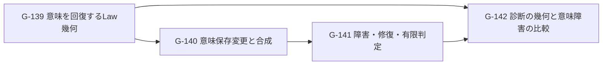

# SHIGUREの多項式特殊化 — 有限局所自由実現と診断

[n1019](n1019_shigure_representability_design.md)の一般構成に接続する、有限局所自由加群の
実現、Law値診断、台帳分割の設計を定める。各特殊化はG-139・G-140・G-141・G-142の
固定targetへ対応づける。任意担体の意味再構成と一般のLaw幾何はn1019で定め、
本ノートは同じ構成の具体的な対象・射・評価を与える。

## 1. 特殊化の入力と表現定理

型は有限個、各型のmoduleは有限局所自由とする。演算とLawの添字集合は任意の小さい集合、
各演算の引数と各式は有限とする。全可換係数環と全環射を量化する。
これは一般構成におけるmodule sortの一つの特殊化であり、任意集合のoperationを
このmoduleへ移す方法ではない。集合上のcartesian意味はn1019 §2のcopying coalgebraで保持する。

原始表示を$`P`$、名前付き生成元を保持する実現の集合を$`\mathrm{Sem}`$、生成元を忘れた同型のgroupoidを
$`\mathrm{Real}`$と書く。ここで構成する表現は

```math
\mathop{\mathrm{Sem}}\nolimits _P(R)\simeq\mathop{\mathrm{Hom}}\nolimits _k(\mathop{\mathrm{Spec}}\nolimits R,M_P),\tag{S}
```

```math
\mathop{\mathrm{Real}}\nolimits _P(R)\simeq\mathcal X_P(\mathop{\mathrm{Spec}}\nolimits R).\tag{G}
```

である。$`M`$、普遍実現、chartの接着、$`\mathrm{Real}`$のdescent、商stackとの同値を構成し、
生成元を忘れる$`M\to \mathcal{X}`$を証明する。さらにn1019の独立な意味圏と比較し、同じ対象・射・
Law評価を回復することがSHIGUREへの接続義務である。

この実現族上で、Law値の合流、実際の意味保存変更、平方零liftの障害、十分な検査次数、
局所adapterの組立てと既存診断の比較を研究する。台帳分割を一貫した具体例に用い、
守る意味と目的から、許された編集式の族の中で修正式を導く探索まで接続する。

## 2. 既存成果との接続

以下の対象・仮定はLean sourceを読んで照合したもの。参照版は草案作成時の
`3f92a13e63ed1866a3a106dca91dc15cc9709431`であり、証明の再実行結果ではない。
[Rising Seaの数学棚卸し](../../outreach/paper/rising-sea/mathematics-inventory.md)の
第1〜2章、第3章、第5章、第8章を対応の入口にする。

| 既存対象・宣言 | 実際の入力と結論 | SHIGUREでの使用と追加義務 |
| --- | --- | --- |
| [ArchitecturalEquationSystem](../../Formal/AG/Equation/Basic.lean) | Observable環、restriction、Atom別のsymbolic violationとobject別residualを保持。両者の一致はfieldにない | Lawの式から両者を生成し、評価による一致を証明する。任意の既存equation systemが多項式表示を持つとは置かない |
| [FreeTypedCommAlg](../../Formal/AG/LawAlgebra/AmbientAlgebra.lean)、[witnessIdeal / obstructionIdeal](../../Formal/AG/LawAlgebra/LawEquation.lean) | 任意の可換係数上の多項式環、選択されたviolation座標が生成するidealとrestriction写像 | chartの変数・関係・Law residualから直接使う。幾何側の生成idealと元のLawの意味の一致をG-139 Pで構成 |
| [StructuralRelationFamily](../../Formal/AG/LawAlgebra/StructuralRelation.lean) | 任意の多項式関係族とその生成idealによるambient quotientを持つ | 本草案ではこのAPIの関係族を空にし、個別の方程式を全てrequired Lawに置く。加群・tensor積の標準等式は成分計算で証明する |
| [StandardArchitectureScheme / EquationObservableRealization](../../Formal/AG/LawAlgebra/StandardScheme.lean) | 前者はscheme・atlas・overlapと妥当性を入力に持つ。後者の`representingEquiv`、`EquationRepresentingGeometry.representation`は表現同値を入力に持つ | SHIGUREの結論を格納・利用する候補。これらを受け取ることは(S)の構成証明にならない。既存のcontextと新しいmoduli chartの比較も別に構成する |
| [FlatCoefficientChange / raw.baseChange / baseChangePresheafIso](../../Formal/AG/ReadingFunctoriality/Coefficient.lean) | rawの座標・関係の係数変更。flatな環射の型と、sheafification比較のAPIがある | rawの係数変更は再利用。任意の環射による解の移送と、flatnessを使うコホモロジー同型を区別する |
| [StandardArchitectureScheme.baseChange](../../Formal/AG/ReadingFunctoriality/StandardSchemeCoefficient.lean) | 実際のscheme pullback、atlas・overlap、恒等・合成の同型。flatness、両側のHasSheafify、site依存のHasSheafComposeが必要 | 既存の装飾つきschemeとの比較に用いる。新しい$`M`$の任意base changeは独立に証明し、必要なinstanceを自動充足と扱わない |
| [CoefficientGeometry](../../Formal/AG/ReadingFunctoriality/CoefficientGeometry.lean) | 普遍点のpullbackからresidual・idealを運ぶ。`BaseChangeRepresentation.baseChangeMap_isIso`は、変更後schemeが同じ絶対点関手を指定方法で表現するなら射が同型になると示す | $`k'`$への変更後は$`\mathrm{CAlg}_{k'}`$上の相対関手を使う。同じ絶対関手を再表現するという誤った要求を避ける |
| [StandardGeometryReference.CoefficientChange](../../Formal/AG/Examples/StandardGeometryReference/CoefficientChange.lean) | 整数から多項式環への変更、chart pullback、Law idealのstrictな包含、係数・Law比較の可換性 | 元の仮定を伴う既存の非恒等例。新しい$`\mathrm{Sem}`$の例への同定は追加義務 |
| [LawGeneratedComplex](../../research/lean/ResearchLean/AG/ResolutionInvariance/LawGeneratedComplex.lean) | K1はchart台の交差、K0はcell・Law・相異なる評価値。有限source等の下で`ThreeCochainComplex ℚ`を生成し、$`d^{1}d^{0}=0`$を証明 | 同じlabelを保つ整数モデルと任意係数への拡張をG-142で構成。Lawの評価値の再同定は別の操作 |
| [G124MainTheorem.aatLocalSemanticReconstruction_abc](../../research/lean/ResearchLean/AG/LocalSemanticReconstruction/G124MainTheorem.lean) | [Parameter / NativeCategory / LocalCategory](../../research/lean/ResearchLean/AG/LocalSemanticReconstruction/IndependentAATPrimitiveReconstruction.lean)はgeometry、lens、protocolを選ぶ。原始readingのHom組立て、対象再構成、比較を扱う | 対象の再構成と係数代数にわたる自然性は異なる義務。新しい加群実現とこれらの圏との関手・射・評価の対応を示した範囲で使う |
| [LocalReading.homEquiv](../../research/lean/ResearchLean/AG/LocalSemanticReconstruction/LocalModelCategory.lean) | 一般形はMorphismSeparates / MorphismAssembles等を仮定する | 新しい実現の分離・組立てを§3の操作から証明して初めて適用できる |
| [IndependentPolynomialExpressions](../../research/lean/ResearchLean/AG/LocalSemanticReconstruction/IndependentPolynomialExpressions.lean)、[points_iff_map](../../research/lean/ResearchLean/AG/LocalSemanticReconstruction/IndependentPolynomialCoefficientPoints.lean) | 有限式の原始評価と、固定座標の係数点からMvPolynomial.mapへの同定 | scalar式の評価・係数自然性を再利用。加群のdescentやscheme表現は新規 |
| [TrueSemanticRepairSheaf / sagaGroundedGluing](../../Formal/AG/SemanticRepair/Saga/TrueSheafDescent.lean) | 実際のsheaf条件、局所repairの所属、relation / generator completeness等の下で大域repairの存在と障害の零性を比較 | 新しい実現とのrepair・被覆・係数の対応を別に作る。$`\mathrm{Sem}`$のdescentをこの仮定へ言い換えるだけでは済ませない |
| [LawGeneratedConormalFirstOrderDescentPackage](../../Formal/AG/SemanticRepair/Conormal/LawGeneratedConormalFirstOrderDescentPackage.lean) | $`O/I`$のsectionを$`O/I^{2}`$のsectionへ持ち上げる問題とsemantic repairを比較し、$`H^{0}`$作用の自由推移性等を示す | 実現の係数環拡大へのliftとは型が異なる。§13で元のsource・係数・比較写像を構成した場合にだけ接続する |
| [AtlasのConditionC](../../research/lean/ResearchLean/AG/ResolutionInvariance/ResolutionInvarianceConditions.lean)、[generatedComparisonH1Map_bijective](../../research/lean/ResearchLean/AG/ResolutionInvariance/LawValueBlockComparisonBijectivity.lean) | 同じfinite Source・Law評価、両readingのadequacy、supported nerve morphism、C0–C6から既存$`\mathbb{Q}`$比較の全単射を得る | G-142のadapter細分化で同じ入力とC0–C6を生成する。値が変わる§14の合流とは別の比較 |
| [G-125のactual Čech・診断比較](../../research/reports/G-125-aat-obstruction-diagnostic-bridge.md) | relationから生成した整数係数、局所定数Ob、実mismatchと診断類を比較。既存反映定理はReflectionConditionとCommonLabelChartSupportを要求 | G-142では$`\ker p`$とadapterから既存比較写像へ同定する。cycleでは後者の支持条件が偽なので、spanning treeから反映性を新たに証明する。SAGAの全Atom occurrenceも自動供給しない |

[#3446](https://github.com/iroha1203/AlgebraicArchitectureTheoryV2/issues/3446)、
[#3451](https://github.com/iroha1203/AlgebraicArchitectureTheoryV2/issues/3451)、
[#3526](https://github.com/iroha1203/AlgebraicArchitectureTheoryV2/issues/3526)、
[#3567](https://github.com/iroha1203/AlgebraicArchitectureTheoryV2/issues/3567)の係数変更系列は
この表のFormal側に対応する。古い[n1004 §10](n1004_aat_denotational_semantics_of_architecture.md#10-帰結と後続候補)の
「係数変更が未着手」という素描から、全体を再実装する計画にはしない。

[G-111](../../research/goals/G-111-aat-indexed-base-change-schema.md)の
indexed diagramのbase changeは係数環のtensor積とは異なる。
SAGAのsemantic repair gluingは選択された係数・atlas・completeness等の下の主張であり、
conormalのfirst-order descentは一次の問題である。いずれも(S)の代用にせず、
後で比較する写像・係数・被覆を明記する。G-106・G-111・G-124全体を必須依存にはしない。

[OperationRepair.behavior](../../research/lean/ResearchLean/AG/OperationRepair/Endpoints.lean)は
名前付き操作の全有限語を量化した観測同値を定義する。§12では新しい加群実現から
同じ型の操作系・観測を構成する。
[LawValueBlockDecomposition](../../research/lean/ResearchLean/AG/ResolutionInvariance/LawValueBlockDecomposition.lean)と
[LawValueBlockCohomology](../../research/lean/ResearchLean/AG/ResolutionInvariance/LawValueBlockCohomology.lean)は
固定値blockの分解、[MayerVietoris](../../research/lean/ResearchLean/AG/AtlasGluingWidth/MayerVietoris.lean)は
cell選択からの完全列を扱う。§14の新しい義務は、値block自体が変わる代数的な族へ
これらを接続することである。

## 3. 原始入力と独立な実現

<a id="primitive-input"></a>
### 3.1 入力P

量化順は、$`k`$、原始表示$`P=(A,r)`$、$`k`$代数$`R`$、$`R`$上の実現、環射・reading射とする。
$`P`$は次のデータを持つ。$`M`$、schemeへの射、表現同値、atlas、descentの証明は含めない。

1. 有限な型集合$`V`$、各$`v`$の自然数$`n_v\le m_v`$。$`A`$のAtomは型、名前付き生成元、演算の
   入出力、Lawの各有限式の出現を識別する。configurationの関係は入出力と式の参照を記録する。
2. 小さい演算添字集合$`E`$。各$`e`$は有限の入力型列と出力型を持つ。0引数も許す。
   解釈は対応する加群のtensor積から出力加群への線形写像である。
3. 小さいLaw添字集合$`L`$とrequired / optional / derivedの指定。各Lawは同じ入出力型を
   持つ二つのtensor式の等式。式は演算、恒等、tensor積、置換、合成、有限和、$`k`$の
   scalar倍から生成する。各式は有限であり、完成済みの関数を定数として埋め込まない。
4. 文脈は原始宣言の部分集合である。型$`v`$を含む場合は、その階数と$`m_v`$個の名前付き
   生成元を全て同時に含む。演算の型とLawの式の参照についても閉じている。
   被覆はその合併が対象文脈になる族。制限はこの条件を満たす宣言を忘れる操作、
   交差は集合の交差とする。全ての局所Law・演算がどの文脈に属するかを保持する。

式の等式計算には、加群・tensor積の結合、単位、対称性、線形性の標準等式を用いる。
$`P`$ごとの追加条件は全てrequired Lawとして宣言する。例えば演算$`T`$に$`T=0`$を要求する場合は
required Lawを一つ追加し、実現の充足条件とreading射の保存対象の両方に含める。

この入力から、型付きAtomの五座標、configuration、`ArchitectureObject`への解釈、
chart別の`ArchitecturalEquationSystem`を構成する。Atomへ関数やschemeを丸ごと
格納して由来を済ませず、演算の型と式の各出現を読み戻せるようにする。
§8のW1・W2・W3・W8について同じ構成を通すことをG-139 Pの必須条件とする。

### 3.2 SemとReal

$`\mathrm{Sem}_P(R)`$の元は、各$`v`$の部分加群$`K_v\subseteq R^{m_v}`$と、$`Q_v=R^{m_v}/K_v`$上の演算の族である。
$`Q_v`$は有限局所自由かつ一定階数$`n_v`$、演算は入力型に合い、全required Lawを満たす。
$`K_v`$は単なる提示のkernelとして保持し、同じ$`K`$と同じ演算を同じ元とする。
同値な記述は、全射$`q_v:R^{m_v}\to Q_v`$を持つ実現を、$`q`$と演算を保つ同型で同一視したもの。
この同値は証明する。$`q`$を保つ自己同型の自明性は全射性から導く。

$`\mathrm{Real}_P(R)`$は$`q`$を持たない有限局所自由加群$`Q_v`$と同じ演算・Lawのgroupoidである。
射は全ての演算を保つ加群同型の族。比較用には$`q`$を持たず非可逆な演算保存写像も持つ圏を
別に作り、その最大部分groupoidを$`\mathrm{Real}`$とする。群作用や同型類を先に選んで実現を定義しない。

環射$`f:R\to S`$はtensor積により作用する。$`\mathrm{Sem}`$では$`K_v\otimes _R S`$の$`S^{m_v}`$内の像を取る。
$`Q_v`$がprojectiveなので短完全列が分裂し、この像から得る商は$`Q_v\otimes _R S`$に一致する。
flatでない$`f`$も含め、Lawの保存、恒等・合成、quotient表示との整合を証明する。
$`\mathrm{Real}`$ではtensor積の結合・単位同型を含む擬関手のcoherenceを証明する。

### 3.3 二種類の局所性

| 被覆 | 局所データ | 構成・証明すること |
| --- | --- | --- |
| AATの文脈被覆 | 部分的な型・演算・Lawの実現 | 同じ生成元を持つ共有型の$`K`$と演算が一致する局所族の組立て。文脈を忘れる射との整合 |
| $`\mathrm{Spec}\,R`$のZariski被覆 | 加群の局所基底、生成元の局所表示、演算 | 加群・写像・Lawのdescent。$`\mathrm{Sem}`$の等化子条件と、$`\mathrm{Real}`$の同型を含むdescent |
| 係数側のfppf被覆 | tensor積と同型のcocycleを持つ実現 | $`\mathrm{Real}`$のeffective descent。§7のstack構成で使用 |

前二行の制限が可換になることも対象とする。AATの文脈をmoduliのopen chartと
同一視せず、§5のchartは名前付き生成元から選ぶ局所基底で添字づける。
G-124の再構成を係数側のdescentへ移すには、この二つの添字と制限の比較が必要になる。

### 3.4 宣言の制限と係数siteの向き

宣言$`V\subset W`$を忘れる$`\mathrm{Sem}_W\to \mathrm{Sem}_V`$は、座標環では$`B_V\to B_W`$となる。
既存`ArchitecturalEquationSystem`の$`\mathrm{Observable} W\to \mathrm{Observable} V`$とは方向が異なる。
G-139 Pでは全表示$`P`$と基底chartを固定し、ambient $`\mathrm{Spec}\,B`$のprincipal openと、
その局所化を保持するAAT contextへの関手を構成する。open $`V\subseteq W`$の環射は$`\Gamma (W,O)\to \Gamma (V,O)`$。
全required Lawの残差と生成idealを同じ局所化で運び、既存raw conormal列を
principal-open基底へ制限してからZariski層へ延長する。関手・被覆・係数の比較は構成義務である。

普遍equation system $`E_B`$のObservableは$`B_s`$であり、その残差$`f_i`$と評価後の$`f_i(x)`$は別の元である。
Lawを課さない構造定数tupleからAtomの値のgraphを作り、encode/decodeの片側逆を証明する。
その同じ原式評価で、普遍object $`a_{\mathrm{univ}}`$と任意のraw ambient点$`x:B\to R`$のobject $`a_x`$を構成する。
$`x`$では別のequation system $`E_x`$を作り、評価先を逆像open $`D(x(s))`$上の$`R_{x(s)}`$とする。

```math
B_s\longrightarrow R_{x(s)},\quad b/s^n\longmapsto x(b)/x(s)^n,
\qquad \mathrm{res}_{E_B}(a_{\rm univ})\longmapsto\mathrm{res}_{E_x}(a_x).
```

$`D(1)`$を含むので、$`E_x`$での全residualの零性と原式の全Law成立を同値にできる。
例えば$`k=\mathbb{Q}`$、$`t\mapsto \varepsilon \in k[\varepsilon ]/(\varepsilon ^{2})`$では、普遍$`t^{2}`$は非零でも評価後は零であり、$`D(t)`$の逆像は空になる。
全contextから$`\Gamma (T,\top )`$への環射を要求する既存`EquationArchitecturePoint.evaluation`は使わず、
逆像open上の評価をG-139 Pで生成する。conormalは$`E_B`$の$`J/J^{2}`$を作ってから$`x`$で引き戻す。
Lawfulな$`x`$で零となる$`E_x`$のidealから作り直すと、残すべき変形情報を失う。

例えば宣言$`V=\{X\}`$、$`W=\{X,Y,XY=\mathrm{id}\}`$では、忘却の環射は$`\mathbb{Q}[x]\to \mathbb{Q}[x,y]/(xy-1)`$。
共有$`x`$を保ちLaw idealを0へ送る逆向きの$`\mathbb{Q}[x,y]\to \mathbb{Q}[x]`$は、$`x\varphi (y)=1`$を要求するため存在しない。
この反例を残し、宣言descentと係数層のdescentを、向きを揃えた写像を持つ場合に比較する。

## 4. 係数変更とK0/K1

基礎環$`k`$は可換環とし、整数係数の式は$`\mathbb{Z}`$からの構造射で解釈する。
$`k`$に固有の定数を使う式は$`k`$代数上で解釈し、$`k\to k'`$ではその定数も移す。
$`\mathbb{Q}`$の結果を正標数へ送る射は置かず、整数から生成した対象の別々の特殊化として比較する。

K0/K1については、既存の有限source・Law族・adequate reading・supported nerveを固定し、
cellと相異なるLaw値のlabel集合$`I^{0},I^{1},I^{2}`$をそのまま用いる。
$`C^i_{\mathbb{Z}}=\mathbb{Z}^{I^i}`$、$`d^{0}`$は右−左、$`d^{1}`$は三辺の交代和とし、整数上で$`d^{1}d^{0}=0`$を導く。
任意の$`k`$について$`k\otimes_{\mathbb{Z}} C_{\mathbb{Z}}\cong C_k`$、$`k=\mathbb{Q}`$で既存の微分・比較射との同定を要求する。
係数変更はlabelを固定する。評価値を別の値域へ写して同じ値をまとめる操作は、
新しいK0 indexを作るreading変更であり、scalar extensionとは分ける。

複体のbase change同型と、$`H^{i}(C)`$のbase change同型は別に述べる。
後者の十分条件としてflatnessを使い、無条件の主張はW4で検査する。
個々のコホモロジー類が零になることを反映する十分条件にはfaithful flatnessを使う。
flatな係数変更による比較同型と、元の類の零性の反映は区別する。
無限積とtensor積の交換も自動には使わない。既存の
`CechCoefficientBaseChangeCompatible`は次数別の比較同型を要求する述語であり、
`cechCoefficientBaseChangeCompatible_of_finite_raw_isSheaf`の有限被覆・raw sheafの
仮定を保持する。これらはdiagnosticへの接続条件であり、(S)の全$`R`$量化を狭めない。

## 5. affine表示から大域schemeへ

各$`v`$で$`m_v`$個の生成元から$`n_v`$個を選ぶ組$`I`$をchart添字とする。
$`\mathrm{Sem}_{P,I}`$は、選んだ生成元が$`Q_v`$の基底になる実現の部分関手である。
この条件の成立部分はtest scheme上でopenになることを証明する。
その基底で$`q_v`$の選択列を単位行列にし、残りの列と演算の係数を変数にする。
各Lawの残差の全成分を式から生成し、

```math
B_I=k[x_{v,ab},y_{e,\mathbf a b}]/J_I,
\qquad U_I=\mathop{\mathrm{Spec}}\nolimits B_I
```

とする。$`J_I`$はrequired Lawの残差から生成するideal。
加群・tensor積の標準等式は成分多項式の恒等式になることを証明する。
既存の`StructuralRelationFamily`を介する場合は関係族を空にして$`J_{\mathrm{struct}}=0`$とし、
個別の方程式は全て$`J_I`$に含める。
有限階数により一つのtensor等式は有限個の成分等式になるが、$`J_I`$全体の有限生成性は仮定しない。

ここで証明する局所対応は、基底での独立な実現からmatrixを読む写像とその逆である。
多項式環・商環の普遍性は標準数学として使い、AATの仕事はAtom・演算・Lawの式と
その変数・生成ideal・実現の対応に置く。symbolic violationの零性とobject residualの
零性の一致を、chart上の評価式として証明する。

$`I`$と$`J`$の共通部分では、$`J`$列から作る基底変換行列の行列式$`d_{IJ}`$をinvertする。
基底変換から$`B_J[d_{JI}^{-1}]\to B_I[d_{IJ}^{-1}]`$を生成する。
残差の成分は一般に混合するので、個々の成分の恒等保存ではなく、tensor残差の変換式と
生成idealの一致を証明する。この写像の両逆、三重交差のcocycle、係数自然性を示す。

これにより$`U_I`$を貼り合わせて$`M`$を構成する。任意の$`\mathrm{Sem}_P(R)`$の生成元は局所的に基底を
含むので、その条件のopen集合が$`\mathrm{Spec}\,R`$を覆うことを原始データから示す。
$`R`$上の実現全体が一つの$`I`$に入るとは要求しない。局所解からschemeへの射を貼り合わせ、
逆に普遍商加群・演算を引き戻すことで(S)を証明する。普遍実現は全chartを通じて構成する。

一般の「Zariski sheafにrepresentableなopen部分関手の被覆があれば表現可能」という
結果には[Stacks Project, Tag 01JJ](https://stacks.math.columbia.edu/tag/01JJ)を用いる。
局所基底の選択は[Grassmannianの構成, Tag 089T](https://stacks.math.columbia.edu/tag/089T)を
参照する。被覆・open性・descent・cocycleをSHIGUREの入力に追加して済ませず、上の
実現から作ることがG-139 Pの義務になる。

## 6. readingの射と自然性

同じ型・階数・生成元数を持つ表示間の射$`u:P\to P'`$は、$`P`$の各演算を$`P'`$の同じ入出力型の
tensor式へ送る代入とする。型の全単射による改名も許す。$`P`$のrequired Lawが$`P'`$の
required Lawと§3.1の加群・tensor積の標準等式から従うことは、等式計算による導出を持つ。
derived Lawを使う場合も同じ前提からの導出を伴い、optional Lawは導出の前提にしない。
射の等号は型の対応が同じで、各演算の代入式がこの同じ理論で等しいこととする。
構成済みの$`\mathrm{Sem}`$間の写像やscheme射をreading射の入力にしない。

この代入を、型を追加する包含へも拡張する。sourceの型は同じ階数・生成元数のtarget型へ
単射で対応させ、source演算の式とLaw導出を与える。追加型・演算を忘れる作用を生成する。
階数の異なるbefore/afterの比較は§12のcomparison presentationに置く。

解釈の向きは

```math
u^*: \mathop{\mathrm{Sem}}\nolimits _{P'}(R)\longrightarrow\mathop{\mathrm{Sem}}\nolimits _P(R),
\qquad M(u):M_{P'}\longrightarrow M_P.
```

Lawの強化は「強いLawの解→弱いLawの解」の向きになる。代入から$`u^*`$を生成し、
$`\eta_R(u^*x)=M(u)\circ\eta_R(x)`$、恒等、合成、係数変更との正方形を証明する。
同じ式で$`\mathrm{Real}`$の関手と2-cellを構成する。

基本の同値判定には互いに逆な代入・そのLaw導出を使う。一般のreading射に
同型性は要求しない。文脈被覆の細分化については、同じ大域実現への組立てを介して
同値を示す。解像度やLaw評価値を忘れる既存のreading変更は、その射から上記の
代入または追加の比較構成が得られるかを個別に照合する。
Atlasの$`H^{1}`$不変性だけから$`M`$の同型を結論せず、診断との可換図式は別の接続義務にする。

基礎環の射$`k\to k'`$については$`P_{k' }`$を式の係数変更から作り、

```math
M_{P_{k'}}\cong M_P\times_{\mathrm{Spec}\,k}\mathrm{Spec}\,k'
```

を全$`k'`$代数上の同じ実現と比較する。
この同型の恒等・合成と$`u`$との交換も含める。ここでflatnessは要求しない。

## 7. 自己同型を保持する場合

全$`Q_v`$に基底を選んだ演算係数の方程式からaffine scheme$`X_P`$を構成する。
$`G=\prod _v \mathrm{GL}_{n_v}`$の作用は、tensor演算の入力・出力の基底変更から生成する。
$`\mathrm{Real}`$と$`[X_P/G]`$の同値は、実現のframe torsorを作る方向と、torsor上の演算を
descentする方向で証明する。$`\mathrm{Real}`$の定義を商stackに置き換えて同値を済ませない。
$`G`$は有限個のGLの積でありsmoothかつ有限表示。この条件を商stackの代数性で使う。
一般の商stackの代数性条件は[Tag 06PI](https://stacks.math.columbia.edu/tag/06PI)に従う。

$`q`$を付け加えると、各frame上で全射行列$`R^{m_v}\to R^{n_v}`$のopen部分が生じる。
これを用いて$`M\to \mathcal{X}`$がrepresentable、smooth、surjectiveになることを構成・証明する。
$`m=n`$では$`q`$は基底、$`m>n`$では一般に複数のchartが要る。
$`M`$は生成元数$`m`$にも依存し、同じ$`\mathcal{X}`$に対する$`M`$同士も一般に同型とは限らない。
例えばrank1、$`T=0`$では$`m=1`$で$`\mathrm{Spec}\,k`$、$`m=2`$で$`\mathbb{P}^{1}_k`$となる。一方、全階数が零なら、
演算・Lawが空な場合の$`M`$は生成元数によらず$`\mathrm{Spec}\,k`$になる。

各実現の自己同型群は$`\prod _v \mathrm{GL}(Q_v)`$の演算保存部分群として計算する。frame上では$`G`$の
stabilizerとなり、frameを変えた共役作用によって降下する。大域の基底は仮定しない。
$`q`$を保持すると自己同型が自明になることを証明する。
$`H^{0}`$が修復解に自由推移的に作用することと、一つの対象の自己同型群が
非自明であることは区別する。特に自由な作用のstabilizerは自明である。

[n1005 §6](n1005_aat_semantic_geometry_route_after_g107.md#6-発展提案の記録--universal-comparison-family-構想)の
「trivial inertiaからscheme」という案は、そのまま採用しない。
代数stackのinertiaが自明ならalgebraic spaceになるという条件は
[Tag 04SZ](https://stacks.math.columbia.edu/tag/04SZ)であり、schemeには§5のopen chartが要る。
点ごとの同型類$`\pi _{0}`$、sheafification、coarse moduliも同一視しない。
coarse moduliの存在条件と高次の2-morphismを保持する問題は後続課題とする。

## 8. 固定する具体例

以下の期待判定は後続GOALで構成・証明するtargetであり、Leanの実行結果ではない。
W1〜W3・W8は§3.1の同じAtom生成・Law解釈から作る。各例の型名・演算名・生成元名を
Atomのsubject / predicate / payloadへ写し、式の有限構文から残差を生成する。

| 例 | 固定データ | 期待判定と使用先 |
| --- | --- | --- |
| W1 名前付き可逆操作 | $`k=\mathbb{Z}`$、型$`p,q`$、各$`n=m=1`$、演算$`f:p\to q`$・$`g:q\to p`$、Law $`gf=\mathrm{id}_p`$・$`fg=\mathrm{id}_q`$ | $`\mathrm{Sem}(R)=\{(a,b):ab=1\}`$。$`M\cong \mathrm{Spec}\,\mathbb{Z}[a,b]/(ab-1)`$。$`R=\mathbb{Z}`$で$`(1,1),(-1,-1)`$は別の実現、$`(0,0)`$は不成立。演算の意味、Lawの有効性、非恒等なreading改名$`f\leftrightarrow g`$を検査 |
| W2 二生成元の局所表示 | $`k=\mathbb{Z}`$、型$`v`$、$`n=1,m=2`$、演算$`T:v\to v`$、Law $`T=0`$ | $`M\cong \mathbb{P}^{1}_{\mathbb{Z}}`$。$`R=\mathbb{Z}`$の$`q=(2,3):\mathbb{Z}^{2}\to \mathbb{Z}`$は全射だがどちらの列も大域基底でない。$`D(2),D(3)`$で$`\frac32,\frac23`$を読み、重なりで逆数変換。単一chartへの誤った制限を検査 |
| W3 冪零な変形 | $`k=\mathbb{Z}`$、型$`v`$、$`n=m=1`$、演算$`T:v\to v`$、Law $`T^{2}=0`$ | $`M\cong \mathrm{Spec}\,\mathbb{Z}[t]/(t^{2})`$。$`R=\mathbb{Z}[\varepsilon ]/(\varepsilon ^{2})`$では$`T=0`$と$`T=\varepsilon`$は別。全ての体値点だけを見ること、Lawにない冪等関係やradical化で情報を消すことを検査 |
| W4 係数の変化 | (a) cochain複体$`\mathbb{Z}\to \mathbb{Z}`$を$`\times 2`$、次数$`0\to 1`$に置く。(b)二source、一Law、値域$`\mathbb{Z}`$、値0,2。readingは恒等、単一chartに全sourceを置き、edge・faceは空にする | (a)$`H^{0}(C)=0`$だが$`\mathbb{F}_{2}`$へのtensor後の$`H^{0}`$は$`\mathbb{F}_{2}`$。$`H^{1}(C)=\mathbb{Z}/2`$の非零類はflatな$`\mathbb{Z}\to \mathbb{Q}`$で零になる。(b)$`\mathbb{F}_{2}`$値で再生成したK0 labelは二つから一つへ減る。(a)は標準代数の対照例、(b)はK0生成の例であり、$`\times 2`$をK0微分と偽って同定しない |
| W5 自己同型 | W2から$`q`$を忘れたrank1実現、$`T=0`$ | $`\mathrm{Real}\simeq B\mathbb{G}_m`$。$`R=\mathbb{Z}`$で$`-1`$は非恒等な自己同型。$`q`$を保持する自己同型は恒等。$`\mathbb{P}^{1}`$と$`B\mathbb{G}_m`$の差、生成元を忘れる射を検査 |
| W6 不整合な遷移 | $`\mathbb{Z}`$上の三つのaffine line、全体をpairwise overlapとし、$`0\to 1,1\to 2`$を$`t\mapsto t+1`$、$`0\to 2`$を恒等にする | 三重交差で合成は$`t\mapsto t+2`$となる。これは接着入力を検査する対照例。§5が生成する遷移のcocycleを入力fieldに逃がす誤りを検査 |
| W7 Law変更と係数自然性 | 型$`v`$、$`n=m=1`$、$`T`$にLawを課さない表示$`P`$と$`T^{2}=0`$を課す$`P'`$、および$`\mathbb{Z}\to \mathbb{F}_{2}`$ | $`M_{P' }\to M_P`$は$`\mathrm{Spec}\,\mathbb{Z}[t]/(t^{2})\to \mathbb{A}^{1}_{\mathbb{Z}}`$の真の閉埋め込み。係数変更の正方形を同じ$`t`$で比較。一般reading射を同型と呼ぶ誤りを検査 |
| W8 文脈での組立て | $`k=\mathbb{Q}`$、型$`p,q,r`$、全階数1、生成元数1,2,1。$`p\leftrightarrow q`$と$`q\leftrightarrow r`$の二組の可逆演算と各往復Lawを二文脈に分ける。共有型$`q`$の全生成元を交差に含める | 共有表示$`q_q=(2,3)`$、左右の可逆係数$`(2,\frac12)`$と$`(3,\frac13)`$は一つの実現へ組み立つ。右の$`q_q`$だけを$`(1,0)`$へ変えると、各文脈はlawfulでも共有kernelが$`\mathbb{Q}(3,-2)`$と$`\mathbb{Q}(0,1)`$で異なり、同じ生成元を保つ組立てはできない |

W1の宣言Atomの五座標を次のように取る。payloadの型は名前、自然数の組、
型付き有限式の直和であり、schemeや実現そのものを格納しない。

| kind | axis | subject | predicate | payload |
| --- | --- | --- | --- | --- |
| sort | state | $`p`$ | ranks | $`(1,1)`$ |
| sort | state | $`q`$ | ranks | $`(1,1)`$ |
| generator | state | $`e_p`$ | type | $`p`$ |
| generator | state | $`e_q`$ | type | $`q`$ |
| operation | operation | $`f`$ | signature | $`(p;q)`$ |
| operation | operation | $`g`$ | signature | $`(q;p)`$ |
| equation | law | $`l_p`$ | required | $`g\circ f=\mathrm{id}_p`$ |
| equation | law | $`l_q`$ | required | $`f\circ g=\mathrm{id}_q`$ |

各Lawの部分式の出現には、Law名と構文木内のpathをsubjectに持つAtomを生成する。
configurationのrelationは型、入出力、Lawと部分式の参照から生成し、identificationは
同じ宣言・同じ出現の等号とする。これにより五座標から宣言と各出現を読み戻せる。
実現の係数$`a,b`$は`ArchitectureObject.structureMaps`に置き、Lawの評価は$`ba-1`$と$`ab-1`$になる。
W2は一型・二生成元・$`T=0`$、W3は一型・一生成元・$`T^{2}=0`$を同じ規則へ通す。
W8は二組のW1を型$`q`$で共有し、その生成元数を2にした入力から作る。

W1の改名が作用として非恒等になる証人は$`R=\mathbb{Q}`$、$`(a,b)=(2,1/2)`$とする。
W2の$`q`$の全射性は$`-2+3=1`$から検査でき、kernelは$`\mathbb{Z}(3,-2)`$。
三つ以上の型や零階数も一般定理の量化に含め、例の非退化性の代わりにしない。

## 9. GOALの分割と証明経路

研究到達像は[n1019 §9](n1019_shigure_representability_design.md#9-研究分割と数学的な評価)の
四GOALで定める。本ノートの特殊化を独立したGOALへ増やさず、次の固定targetへ接続する。

| GOAL | 本ノートで構成する証明義務 | 参照箇所 |
| --- | --- | --- |
| [G-139](../../research/goals/G-139-aat-law-generated-relative-geometry.md) | 独立なSem / Real、Atomと残差の評価一致、係数descent、chart・scheme・stack、readingと任意基礎環変更の自然性 | §3・5–8・11。同じ原始入力をG-139 Pへ通す |
| [G-140](../../research/goals/G-140-aat-semantic-change-category.md) | 状態比較と操作語翻訳を持つ変更、階数変更、比較の合成、phase不変量と全経路の観測保存 | §12・16.1・16.3–4 |
| [G-141](../../research/goals/G-141-aat-coherent-repair-effectivity.md) | 全syzygy・conormal・相対lift、全Artin試験と鋭い次数上界、adapterから実State・SAGA・許容域付き全修復を生成 | §13・15・16.2・16.4–5 |
| [G-142](../../research/goals/G-142-aat-law-value-diagnostic-sheaf.md) | 同じlabelの整数係数、診断のétale層、合流の核・余核、構成可能関数の実現とpseudo-coherent実現の不存在、実障害のK0指定類とAtlasへの比較 | §4・14・16.5–6 |



G-139では独立な意味、局所基底、残差式、descentを生成してから表現を証明する。
その同じ表現同値でreadingと係数の自然性を示す。schemeとstackは生成元を忘れる
比較を含めた一つの構成義務であり、それぞれを別の到達像にはしない。
G-140はmatchingな変更の組立て、G-141は与えられた局所変更をmatchingへ補正する条件と
全修復を担う。G-141の実修復はK0を使わずに構成し、G-142が同じ指定障害を診断へ送る。

各GOALは一般定理と指定例を要求する。係数拡張、cocycle、自然性を補題に位置づけても、
その証明義務を省略しない。任意constructible関数の実現、全Artin検出の上界、
実修復と診断の零性反映は、単なる検算例へ格下げせず固定targetに残す。
証明方法・補題分割・Leanの内部APIは後続の設計で選ぶ。

## 10. 論文で主張する貢献と既知の数学

想定読者は、moduli・層・コホモロジーを知り、AATの内部語彙は知らない研究者である。
問いは「観測を保つ実装の族と、その変更可能性をLawから構成した幾何で説明できるか」。
標準数学を適用する箇所と、同じ原始データ上の新しい比較を作る箇所を次のように分ける。

| 既知の結果・確認した箇所 | この設計の位置づけ |
| --- | --- |
| [Poonen, The moduli space of commutative algebras of finite rank, Prop. 1.1・§2–3](https://math.mit.edu/~poonen/papers/moduli.pdf) | 構造定数、基底付きscheme、GL作用とstackは先行構成。(S)(G)だけに新規性を置かない |
| [Yalin, Moduli stacks of algebraic structures and deformation theory, §§4・6](https://arxiv.org/html/1411.5177v3) | moduliと変形複体の一般的接続がある。新しい義務はAATの原始Law・文脈・合法修復への同じ写像での接続 |
| [Ginot–Yalin, Derived deformation theory of algebraic structures, Theorems 0.2–0.3](https://arxiv.org/html/1910.07255v3) | 自己同型を含む変形比較にも先行結果がある。derivedという語の追加を貢献としない |
| [Stacks 08S3](https://stacks.math.columbia.edu/tag/08S3)、[00S0](https://stacks.math.columbia.edu/tag/00S0) | 平方零liftとcotangentは標準定理。原式からの全syzygy、実際の残差、文脈の補正との比較を生成する |
| [Budur–Wang, Cohomology jump loci of differential graded Lie algebras, §2](https://arxiv.org/html/1309.2264v2) | 固定複体のjump locusと比較する。K0では値の一致により座標集合自体が変わるため、§14で別の幾何的実現を構成する |
| [de Fernex–Ein–Ishii, Jet closures and the local isomorphism problem](https://arxiv.org/abs/1704.07494) | 曲線jetによる識別と比較する。§15の試験対象は全局所Artin代数であり、その違いを明記する |
| [Abadi–Lamport, The existence of refinement mappings, §§1.2・2.4](https://www.microsoft.com/en-us/research/wp-content/uploads/2016/02/abadi-existence.pdf) | 初期状態、状態比較、stutteringによる振る舞い保存は先行する。ここでは有限操作語・許可phase経路を使い、無限実行・livenessの完全なrefinement判定へ拡張しない |
| [Goguen–Burstall, Institutions: Abstract model theory for specification and programming, Definition 1・Theorem 11](https://courses.grainger.illinois.edu/cs522/sp2016/InstitutionsAbstractModelTheory.pdf) | 構文代入、反変なモデル移送、充足の自然性を照合する。追加義務は同じ代入が生成するmoduli射・合法修復・値診断の比較 |
| [Frégier–Markl–Yau, The L∞-deformation complex of diagrams of algebras, Theorems 4.2・5.5](https://arxiv.org/pdf/0812.2981) | colored PROPによる演算・射の図式と変形に先行構成がある。任意可換基礎環上の本対象、許容変更域・文脈制限、K0/K1生成との対応を個別に示す |

主要な貢献候補は、原始表示からの「実現」「実際の変更・修復」「Law値診断」を比較する
写像と、その一致条件・不成立例を構成することにある。特に§14のK0/K1制約内での
constructible関数の実現と、§15の合成深さに対する鋭い検査次数を独立に証明する。
この比較軸に対する新規性を論文で論じ、表現可能性・Mayer–Vietoris・cotangentの
標準結果自体を新しい結果として数えない。

実修復はG-141のadapter族から構成し、G-142で同じ$`\ker p`$・指定障害類を診断へ比較する。G-142の
任意constructible関数の実現は、任意に選んだ値診断の次元だけでは意味保存を判定できない
ことを説明する。G-141 Eのsyzygy表示やG-141 Fの普遍Artin商の判定は、それだけで新規な一般
障害理論ではない。貢献候補は、これらを同じ原始操作・許可変更・診断へ結ぶ構成と、
成立条件・破れる条件・実際の修正を同じ実現上で決める比較定理群として評価する。

[n1005 §6](n1005_aat_semantic_geometry_route_after_g107.md#6-発展提案の記録--universal-comparison-family-構想)の
reading選択空間、実現moduli、comparisonの欠損を区別する構想を、次の二つで具体化する。
実現moduli上の値診断は§14の定数係数étale層で束ねる。実現の変形は§13のcotangent側で
扱う。両者を一つのperfect複体とする一般的な要求は、§14の下降例が反証するtargetである。

<a id="representation-scope"></a>
## 11. 表現の射程と情報の保持

| 対象 | 同じ意味を保持して表せる範囲 | 検査すべき追加条件・失われる情報 |
| --- | --- | --- |
| 線形read/write、有限個の数値状態 | 有限局所自由加群と線形写像。affine更新は加法・定数・単項演算から構成 | 二引数の加法をtensor上の双線形演算と呼ばない。単位・係数環・観測時点を固定 |
| 有限状態と単項操作表 | 非零環上の自由加群$`R[S]`$で基底を基底へ送る線形写像。操作合成と基底状態の識別を保持 | 全線形写像には基底状態を混合するものもある。基底保存条件を別に置く |
| 集合上の任意の有限arity演算 | n1019 §2のcoalgebraにより、任意担体で全cartesian Lawを保持 | 反復変数は$`\Delta`$で運ぶ。Bool ANDは$`m\Delta =\mathrm{id}`$を満たす。$`\Delta`$を捨てて$`m(v,v)=v`$を課す方法とは区別する |
| 整数affine・有理多面体 | 等式部分と有理係数の変数を扱える | ≥や非負性はschemeの零点条件だけでは保持しない。順序を持つ係数と許容領域を別のreadingに保持 |
| 分岐・例外・可変長List・終了性 | 固定した有限状態や有限長の表示への接続を個別に構成 | 一般の構文を有限階数へ自動変換する関手は本入力にない。失われる識別を具体的に示す |
| 観測されたコードの名前・位置・参照 | Atomとsource refとして保持し、解釈の由来へ戻れる | 同じ名前から事業上の意味やruntime原子性を推定しない |

有限状態の単項写像の像をfield値点で特徴づけるには、matrix各列にidempotence、
相互直交、和1の式を課す。一般の環では互いに直交するidempotentによる局所的な分岐が
生じるため、一つの集合写像への復元には連結性等の条件が要る。これをG-139 Pの像の定理と
不成立例に含める。一般理論の全$`R`$量化と、特定の入力意味へ戻せる$`R`$の条件は別に述べる。

<a id="development-change"></a>
## 12. 開発変更と観測相対の意味

三種類の変更を区別する。係数環の変更$`R\to S`$、readingの代入$`P\to P'`$、一つの実装から別の
実装への変更は、それぞれ異なる入力を持つ。

実装変更にはbefore表示$`P_{0}`$、after表示$`P_{1}`$、比較表示$`P_{01}`$を作る。$`P_{01}`$は両側の型・演算に
加え、状態比較$`h`$、選んだ観測$`O`$、操作名の対応$`\tau`$と、その保存方程式を持つ。
型の階数は両側で異なってよい。宣言を忘れる二写像から

```math
M_{P_0}\longleftarrow M_{P_{01}}\longrightarrow M_{P_1}
```

を構成する。開発変更はこの対応の点、固定beforeから可能な変更全体はそのfiberである。
異なる点を結ぶ代数的な族と、実行可能なコード編集手順は個別に対応づける。

選んだ名前付き操作を状態集合上の全域写像として解釈し、観測を$`O`$とする。
同じ系の二状態の意味同値は、全有限操作語$`w`$について$`O(\mathrm{eval}(s,w))=O(\mathrm{eval}(t,w))`$とする。
比較表示では、各生成操作$`e`$について

```math
h\circ\mathop{\mathrm{step}}\nolimits _1(e)
 =\mathop{\mathrm{step}}\nolimits _0(\tau(e))\circ h,
\qquad O_1=O_0\circ h
```

をLawとして課し、帰納法により全語での観測保存を導く。$`\tau (e)`$には有限語、特に空語を
許す。$`h`$の単射性は要求しない。この十分条件が必要条件にもなる範囲は個別に述べる。
G-126の`OperationSystem`と`behavior`へ同じ状態・操作・観測を構成して接続する。

これは選んだ操作言語に相対的な意味である。操作を細分化し、その途中に新しいreadを
入れる変更には別の保存方程式が必要になる。§16の途中readの反例を必須とする。

有限phase graphを使う場合は、phaseごとのambient加群に状態を表す0引数演算と
多項式不変量を加える。合法状態はその実現fiberであり、集合自体が有限局所自由とは限らない。
遷移式の不変量保存と観測式の保存を原始式から証明し、全ての許可された有限経路へ帰納する。
§16.4のBusyは$`\mu (h-C)=0`$を保持する。全$`R^{3}`$を合法状態と扱う変更は、別の強い要求になる。

<a id="semantic-lift"></a>
## 13. 原始Lawから実際の変更・修復を生成する

固定した表示の係数を少し変える問題を、次の独立なliftとして定義する。
平方零拡大$`R' \to R`$、kernel $`M`$、$`x\in \mathrm{Sem}_P(R)`$に対して、$`R'`$上でLawを満たし$`x`$へ還元される
実現の集合を取る。reading $`u:O\to P`$がある場合は、さらに指定された観測側のliftを保つ
実現を取る。$`\mathrm{Real}`$では還元同型と観測同型を保持したfiber groupoidにする。

affine chartで$`B=k[z_{1},\ldots ,z_n]`$、$`J=(f_{1},\ldots ,f_r)`$、$`A=B/J`$とする。
原始式から$`S=\ker(B^r\to J)`$、$`(s_i)\mapsto \sum s_i f_i`$、という全syzygy加群を生成する。
その生成族$`s^\alpha`$を使い、$`x`$と$`M`$に対して

```math
D^0=M^n\xrightarrow{\mathop{\mathrm{Jac}}\nolimits (f)(x)}
D^1=M^r\xrightarrow{(s^\alpha(x))_\alpha}D^2=M^{\{\alpha\}}
```

を作る。この節では演算・Lawを有限とし、有限計算には有効なNoetherian係数を指定する。
G-139 Pの小さい無限表示の表現定理とは量化を分ける。
syzygyは多項式上で生成してから$`x`$で評価する。

$`B\to R'`$への任意のambient liftで$`f_i`$を評価すると$`M`$値の残差が得られる。
これが$`\ker(d^{1})`$に入り、ambient liftを変えると$`d^{0}`$の像だけ変わることを証明する。
主張は、$`H^{1}(D)`$のその類が零であることと実際のlawful liftの存在が同値であり、
存在するとき全liftが$`H^{0}(D)`$のtorsorになることである。全syzygyにより
$`\ker(d^{1})=\mathrm{Hom}_A(J/J^{2},M)`$を構成し、低次数のcotangentによる分類へ同定する。
この三項だけで高次の全障害を分類するとは置かない。

文脈での局所修復には、観測を固定し各局所Lawを保つderivationを係数にする。
このとき観測側の被覆$`O_i`$と実現側の被覆$`P_i`$を持つ局所reading $`O_i\to P_i`$を原始代入で指定し、
全参照の所属と交差上の可換性を要求する。$`T\mapsto X+Y`$を$`\{X\}/\{Y\}`$だけへ分ける被覆では、
大域補正$`(a,-a)`$を局所の観測固定係数へ制限できない。必要な観測方程式は、その全参照を
含む文脈へ配置してから局所修復を作る。
Law・変数の支持から局所残差と共有部分の差を生成し、補正と貼り合わせを実際に作る。
複数文脈にまたがるsyzygyも取り込む。全域の原式から作る$`D`$との比較を構成することが
G-141 Eの義務であり、Čechという名称だけでその比較を済ませない。

検査例は、冗長な$`(t^{2},t^{3})`$と$`(t^{2})`$、三文脈の$`x_{1}-x_{0}`$、$`x_{2}-x_{1}`$、$`x_{0}-x_{2}`$という依存するLaw、
最後の式を$`x_{0}-x_{2}-t`$へ変更した族とする。評価後のJacobianだけでは、元の多項式関係の
有無を回収できない。$`t^{2}=0`$と$`t^{3}=0`$も同じ一次接空間を持つが、二次のliftは異なる。

SAGAの係数複体と実際の修復への正の比較はG-141のadapter族で固定し、
同じ指定類を診断へ送る比較はG-142で構成する。
conormalは§3.4の固定ambientとprincipal-open基底を使う。ambient lift $`B\to R'`$は$`J^{2}`$を消すので
$`B/J^{2}\to R'`$を与え、その$`J/J^{2}`$上の制限$`\kappa :J/J^{2}\to M`$が残差になる。同じambient liftが$`B/J`$を
経由する条件は$`\kappa =0`$であり、ambient liftの選択差を除いた$`[\kappa ]`$は上の$`o_P`$に一致する。
これが既存のconormal列との比較写像である。sectionそのもののliftとは型を分ける。
線形・affineなLawでは補正式が有限の変更にも厳密に成り立ち、§16の
修復へ特殊化する。許容変更部分加群は入力として保持し、全解や障害を入力にしない。

<a id="diagnostic-family"></a>
## 14. 実現族上のLaw値診断と合流

有限source $`S`$、有限readout添字$`L`$、有限supported nerveを選ぶ。cell $`\sigma`$の支持$`S_\sigma`$は
chart支持とK1の交差から生成する。実現scheme $`B`$上で各$`f_{\ell ,s}`$を、選んだ原始式から
生成したregular scalar readoutとする。required Lawの残差はlawful locus上で零になる。
ここで読むのは、その残差とは別に指定した操作係数やscalar観測である。
readoutの構文は、$`k`$の定数、加法・乗法、有限tensor式で得た自己準同型のtraceから生成する。
名前付き生成元が基底になる型（$`n_v=m_v`$）では、その基底による演算成分も使える。
traceの基底不変性と成分の変換則からregular functionを構成する。一般のchart成分を
大域関数とは置かず、chartを選ぶ場合はそのchartを$`B`$とする。後者の族も同じ構成へ通る。
生成元を忘れた商stackに降ろす場合は、GL作用での不変性を別に証明する。

各cell・readoutについて有限root schemeを構成する。

```math
Z_{\sigma,\ell}
 =\mathop{\mathrm{Spec}}\nolimits _B\!\left(
 \mathcal O_B[z]/\prod_{s\in S_\sigma}(z-f_{\ell,s})\right),
\qquad p_{\sigma,\ell}:Z_{\sigma,\ell}\to B.
```

空支持では空schemeとする。支持包含から閉埋め込みと定数étale層の制限を作り、
診断係数環$`\Lambda`$に対して$`C_B^d=\bigoplus_{\dim\sigma=d,\ell}(p_{\sigma,\ell})_*\Lambda`$を交代制限で複体にする。
$`\Lambda`$と$`B`$の基礎環は別の指定である。

G-142の主張は、各幾何点でのstalkが、そこで相異なる値を再生成したK0/K1複体に
一致し、任意の$`B' \to B`$によるinverse imageと可換になることである。有限射のstalkと
base changeには[Stacks 03QN](https://stacks.math.columbia.edu/tag/03QN)を使う。
幾何点はnilpotentを識別しないため、一般の$`R`$値で異なる0と$`\varepsilon`$をこのstalkから復元する
主張にはしない。全$`R`$値の意味は$`\mathrm{Sem}`$が保持する。

普遍座標$`x_{\ell ,s}`$を持つaffine space上で一度構成し、全てのreadout族へのpullbackを
示す。等値partitionごとに、同じblock内の差の零性と異なるblock間の差の可逆性を
課したlocally closed stratumを作る。その上では同じ整数incidence複体を得る。

<a id="collision-geometry"></a>
### 14.1 合流の保存条件と跳躍の実現

値$`a`$のblock $`K_a`$を「値$`a`$のsourceを支持に含むcell」の部分複体とする。
二つの値が合流するとblockは$`U=K_a\cup K_b`$になる。$`I=K_a\cap K_b`$とし、原始cellから

```math
0\to C^\bullet(U)\xrightarrow{r}
 C^\bullet(K_a)\oplus C^\bullet(K_b)
 \xrightarrow{\rho}C^\bullet(I)\to0
```

を生成する。$`r`$は合流後から合流前への制限である。$`H^{1}(r)`$が同型である必要十分条件は
$`H^{0}(\rho )`$が全射かつ$`H^{1}(\rho )=0`$である。新しい類と失われる類をこの同じ完全列で説明する。
多数の合流には有限Mayer–Vietoris複体を使い、合流順序との整合を証明する。

さらに、任意の有限表示affine $`B`$と$`Z=V(g_{1},\ldots ,g_r)\cap D(h)`$に対し、固定K1支持と原始
scalar readoutから$`\beta _{1}=1_Z`$を構成する。$`n=\mathrm{max}(3,r+1)`$頂点のcycleの各辺にsourceを置き、
値を$`0,g_{1},\ldots ,g_r`$、残りを0とする。全頂点に属するsourceを一つ追加し値$`h`$を読む。
ambient nerveは全2-skeleton。値blockはcycleの部分グラフ、または全2-skeletonになり、
全辺値が0かつ$`h\ne 0`$の場合だけ$`H^{1}`$が一つ残る。有限直和で有限constructible関数へ拡張する。

これは一般のconstructible層の存在の言い換えではなく、K0/K1の指定された生成規則の
中で実現する定理を目標とする。rank1の演算とrequired多項式Lawで$`B`$自体も構成する。
§16では同じsmoothな意味保存族上で$`\beta _{1}`$が生じ、消えることを示す。下降する例は、
全fiberの$`\beta _{1}`$を回収するpseudo-coherent／perfectな$`O_B`$複体の存在を反証する。
その根拠はderived fiberのBetti数の上半連続性である
([Stacks 0BDI](https://stacks.math.columbia.edu/tag/0BDI))。

<a id="formal-reading"></a>
## 15. どの次数の変更から意味の実現を失うか

$`O`$に補助演算$`Y_j=F_j(O,Y_{1},\ldots ,Y_{j-1})`$を順に追加した表示$`P`$を考える。
残る追加Lawを同じ順序で代入し、$`O`$上の残差ideal $`K`$を生成する。
定義だけの追加では全$`R`$上で実現を保存し、追加Lawがある場合の像はこの残差の零点になる。
marked版の閉埋め込みとunmarked版のfull faithfulな射を同じ消去から構成する。

有限表示、体$`k`$、$`k`$値実現$`x`$を選び、観測点$`a`$の局所環$`A`$と極大ideal $`m`$を取る。
$`\nu`$を$`K\subseteq m^\nu`$となる最大次数とし、$`K=0`$なら$`\infty`$とする。G-141 Fでは任意の$`r\ge 0`$について

```math
\begin{aligned}
&\text{全ての局所Artin }k\text{代数 }R,\ \mathfrak n_R^{r+1}=0
 \text{ 上で原点変形の比較が同値}\\
&\qquad\Longleftrightarrow K\subseteq\mathfrak m^{r+1}
\Longleftrightarrow
 A/\mathfrak m^{r+1}\text{ の普遍観測変形がliftする}
\end{aligned}
```

を証明する。有限のサンプル点を十分性の証拠にせず、普遍的なArtin試験環自体を使う。
Noetherian局所環ではKrull交叉から全次数での一致と$`K=0`$を比較する。
$`\nu`$が有限なら$`A/m^{\nu +1}\to A/m^\nu`$が初回の失敗を与え、その残差を§13の同じ障害類へ送る。

自由な観測係数上では、原始式の積で加算、和で最大を取る次数上界を依存順序に沿って
計算する。消去後の上界$`B`$までの全Artin比較で追加制約の有無が決まることを証明する。
二次定義$`Y_{1}=T^{2}`$、$`Y_{j+1}=Y_j^{2}`$、$`Y_h=0`$は$`t^{2^h}=0`$へ消去され、上界の鋭い例になる。
既存の関係$`y=x^N`$がある観測環では見かけの次数1の$`y`$でも消滅次数$`N`$となるため、
この上界を自由観測係数以外へ無条件に広げない。

必須の二文脈例は、左$`Y=T^{2}`$、右$`Y=0`$、交差に$`T,Y`$を持つもの。
$`k[\varepsilon ]/(\varepsilon ^{2})`$上の$`T=\varepsilon ,Y=0`$は大域実現だが、$`k[\varepsilon ]/(\varepsilon ^{3})`$上では左$`Y=\varepsilon ^{2}`$、右$`Y=0`$となる。
観測$`T`$のliftを固定した合法な局所補正は零で、共有部$`(\varepsilon ^{2})`$に非零の障害が残る。
これは各局所liftが存在し、前段の大域実現も存在する状態からの組立て不能である。

無限入力の必須検査には$`T_i=T_{i+1}^{2}`$を使う。その原点局所環は$`m=m^{2}`$であり、全有限Artin
原点変形は定値になるが、$`T_{0}=0`$の追加はschemeを変える。表現可能性の無限入力を保ったまま、
全有限変形試験だけでは識別できない実現を具体的に残す。

<a id="ledger-example"></a>
## 16. 主例 — 単一台帳からbase＋delta台帳への移行

### 16.1 原始表示から全操作語の意味保存へ

beforeの状態は$`D=R`$、公開操作$`\mathrm{apply}_u(x)=x+u`$、$`\mathrm{read}(x)=x`$とする。
afterの状態は$`B\oplus C=R^{2}`$で、$`B`$がbase、$`C`$がdelta。生成元を固定したrank1型$`D,B,C`$と
単項演算$`p_B,p_C,i_B,i_C,j_B,j_C`$をAtomから生成する。

```math
p(v_B,v_C)=av_B+bv_C,\quad i(u)=(cu,du),\quad j(t)=(rt,st),
\qquad ac+bd=1,\quad ar+bs=0.
```

applyは$`v\mapsto v+i(u)`$、compactは$`v\mapsto v+j(t)`$。加法と単項演算から作用を作る。
初期状態で$`p(v_{0})=x_{0}`$とし、compactをbeforeの空語へ送れば、生成Lawからapply/compactの
全有限語でreadが一致する。非零環$`R`$では$`p`$は非単射であり、内部の状態をそのまま識別する同値ではない。

係数実現のmoduliは、$`(p,i)\mapsto\begin{pmatrix}c&-b\\d&a\end{pmatrix}`$により$`\mathrm{SL}_{2}`$と同定する。
さらに$`\ker p=R(b,-a)`$から$`j=\mu (b,-a)`$を一意に得て、全体は$`\mathrm{SL}_{2}\times \mathbb{A}^{1}`$になる。
$`p=(1,1)`$を固定した族は$`i=(\lambda ,1-\lambda )`$、$`j=\mu (1,-1)`$で、$`B_0=\mathbb{A}^2_{(\lambda,\mu)}`$である。
設計係数$`\lambda ,\mu`$の自由と、一実現の状態fiber $`p^{-1}(x)`$の自由は別の対象として保持する。

この固定$`p`$は、名前付き生成元で読んだmarked fiberである。異なる型の$`p_B,p_C`$をidへ
等置するtensor Lawでは定義しない。別にrank 1・生成元数1の一型$`D`$と単項$`\lambda ,\mu`$だけの
係数表示$`O`$を作る。$`D`$の三つのコピー上で$`p=(\mathrm{id},\mathrm{id})`$、$`i=(\lambda ,\mathrm{id}-\lambda )`$、$`j=(\mu ,-\mu )`$を生成すると、
$`\mathrm{Sem}_O`$とこのmarked fiberの自然同型を構成できる。以下の消去はこの$`O`$に対して行う。
この同型だけから、生成元を忘れた三型のgroupoidとの同値は主張しない。
このコピー同定の下で、現在のdeltaを引数に取る派生原子操作を

```math
\mathrm{compact}_{\mathrm{all}}(B,C)=\mathrm{compact}_{C}(B,C)=(B+\mu C,(1-\mu )C)
```

と定める。
これは$`p`$を保つが、固定引数のtranslation $`\mathrm{compact}_t`$とは別の操作である。

### 16.2 局所開発と修復

共有型$`D`$に演算$`\lambda`$を置き、base文脈には$`p_Bi_B=\lambda`$、delta文脈には$`p_Ci_C=\mathrm{id}-\lambda`$を置く。
各文脈は式の全参照を含み、共有実現$`\lambda`$が一致すれば合成Law $`pi=\mathrm{id}`$を導ける。
$`R=\mathbb{Q}`$、$`p_B=p_C=\mathrm{id}`$の下でbase担当が$`c=0,\lambda _B=0`$、delta担当が$`d=0,\lambda _C=1`$を選ぶと、各局所Lawは
成立しても組立て不能になる。両担当が相手側へ書込みを任せた変更である。

許容変更を係数の加法として指定すると、修復は$`\Delta c+\Delta d=1`$。
両係数を変更できるとき全解は$`(t,1-t)`$、自由方向は$`(1,-1)`$。base固定なら$`(0,1)`$だけ、
両方固定なら不存在となる。修復の許容域・残差・全解を同じ原始表示から生成し、
G-141 Eのaffine特殊化として比較する。

### 16.3 観測を細かくすると失敗する

上の意味はapply/compact完了点のreadに相対的である。
$`R=\mathbb{Q}`$でwriteBとwriteCの間にもreadを許すと、$`\lambda =1/2,u=2`$で途中値は$`x+1`$になり、beforeの
atomic $`\mathrm{apply}(2)`$が許す$`x`$または$`x+2`$と一致しない。compactも二書込みの間には非零の値を
見せ得る。コード上のtransaction等をこの原子操作へ解釈する義務、または細粒度操作を
含めたprotocolのLawが必要になる。$`pi=\mathrm{id},pj=0`$だけから原子性を導かない。

### 16.4 独立には安全な二変更が更新を失う

compactをsnapshot取得とcommitへ分ける。$`\delta =1-\lambda`$をdeltaへの書込み係数とし、
Idleは$`(B,C)`$、Busyは$`(B,C,h)`$で$`h`$がsnapshotを保持する。一つのcompactorだけを許す。

```math
\begin{aligned}
\mathop{\mathrm{begin}}\nolimits (B,C)&=(B,C,C),\\
\mathop{\mathrm{apply}}\nolimits ^{\rm Busy}_u(B,C,h)&=(B+(1-\delta)u,C+\delta u,h),\\
\mathop{\mathrm{finish}}\nolimits (B,C,h)&=(B+\mu h,(1-\mu)C).
\end{aligned}
```

applyは両phaseで可能、beginは$`\mathrm{Idle}\to \mathrm{Busy}`$、finishは$`\mathrm{Busy}\to \mathrm{Idle}`$の原子操作とする。
readは$`B+C`$。begin・finishをbeforeの空語へ送る。snapshot後のapplyの総和$`U`$について、
finish後の公開値の誤差は$`-\mu \delta U`$となる。従って全ての許可有限経路で意味を保つ条件は
$`\mu \delta =0`$である。十分性はBusyの不変量$`\mu (h-C)=0`$、必要性は$`\mathrm{begin};\ \mathrm{apply}_1;\ \mathrm{finish}`$から得る。

deltaへの書込みだけを導入する変更（$`\mu =0`$）と、集約だけを導入する変更（$`\delta =0`$）は安全だが、
組合せには積の制約が生じる。同じ原始操作から意味保存族$`\mathrm{Spec}\,k[\delta ,\mu ]/(\mu \delta )`$を生成する。
体上では二つの座標軸の合併で、原点の接空間は二次元だが、二次の条件が同時変更を妨げる。
$`\delta =\mu =\varepsilon`$は$`k[\varepsilon ]/(\varepsilon ^{2})`$では合法、$`k[\varepsilon ]/(\varepsilon ^{3})`$ではどの二次補正を加えても残差$`\varepsilon ^{2}`$が残り、
公開readは$`1-\varepsilon ^{2}`$になる。G-141 Fの初回次数$`\nu =2`$と、この失われた更新を同じ式で同定する。
左文脈$`E=\mu \delta`$と右文脈$`E=0`$の局所liftの差も、共有部の同じ$`\varepsilon ^{2}`$である。

実装修正$`\mathrm{finish}_{\mathrm{snap}}(B,C,h)=(B+\mu h,C-\mu h)`$では、Busyの状態Law $`\mu (h-C)=0`$も除き、
全$`R^{3}`$を状態とする。比較関係$`x=B+C`$でreadを厳密に保存し、全$`\delta ,\mu`$が許される。
$`R=\mathbb{Q}`$で旧状態Lawを残すと$`\delta =\mu =1`$の$`\mathrm{begin};\ \mathrm{apply}_1`$が閉じないので、遷移と状態表示の両方を変更する。
旧合法Busy上では両finish自体が一致し、旧状態の包含が遷移と可換になる。
applyを挟まないbeginとの合成は、両finishとも$`\mathrm{compact}_{\mathrm{all}}`$に一致する。
$`R=\mathbb{Q}`$、$`\mu =1`$で$`\mathrm{compact}_{\mathrm{all}}`$は非単射なので、固定引数$`\mathrm{compact}_t`$やその固定有限語とは同一視できない。
係数の閉埋め込み
$`V(\mu \delta )\to \mathbb{A}^{2}`$と状態の包含から、snapshot量だけを差し引く修正で制約が消えることを説明する。

<a id="design-search"></a>
#### 守る意味と目的から変更を選ぶ

原始式の代入からschemeの射を計算する過程も固定する。
Busyのideal生成元を$`g=\mu (h-C)`$と書くと、
$`\mathrm{begin}^*(g)=0`$、$`\mathrm{apply}_u^*(g)=g-\mu\delta u`$であり、finishによるread差は$`g`$になる。
従って$`k[\delta ,\mu ]/(\mu \delta )`$上では全遷移が指定された状態schemeを結び、
公開readと操作語の翻訳を保つ。必要性は同じ原始経路のread差$`-\mu \delta`$から従う。
このidealの計算が、状態の射・全操作語・係数の解空間を結ぶ。

基礎体$`k`$を固定し、beforeを§16.1の単一台帳、比較を$`p`$、語翻訳を§16.4のものに固定する。
移行候補の基準係数を$`\delta =\mu =0`$とし、許す編集をまず係数$`\delta ,\mu`$の変更とする。
目的「集約を有効にする」を$`D(\mu )`$、「deltaへ書き込む」を$`D(\delta )`$と読む。
この例での有効性は係数が非零であるという意味であり、性能指標ではない。
schemeの全$`R`$点では、これらは非零条件ではなく単元条件になる。

| 許す編集と目的 | 意味を保つ変更の全解 |
| --- | --- |
| 係数変更、目的の追加なし | $`V(\mu \delta )`$：二つの軸と原点のscheme構造 |
| 係数変更、集約を有効化 | $`V(\delta )\cap D(\mu )\cong \mathbb{G}_m`$：delta書込みを止める必要がある |
| 係数変更、delta書込みを有効化 | $`V(\mu )\cap D(\delta )\cong \mathbb{G}_m`$：集約を止める必要がある |
| 係数変更、両方を有効化 | 空。$`\mu ,\delta`$を可逆にすると$`\mu \delta =0`$から$`1=0`$ |
| 差し引く量とBusyの状態表示も変更可能にし、両方を有効化 | 下の編集族では$`\rho =1`$が強制され、全解は$`\mathbb{G}_m^{2}`$ |

最後の行では、差し引く量を現在値とsnapshot値のaffineな組合せに変更する規則を許す。
その係数$`\rho`$を探索変数とし、次を原始編集式にする。

```math
 \mathop{\mathrm{finish}}\nolimits _\rho(B,C,h)
   =\bigl(B+\mu h,\ C-\mu((1-\rho)C+\rho h)\bigr).
```

read差は$`g_\rho =\mu (1-\rho )(h-C)`$である。Busyの状態Lawをこの$`g_\rho =0`$として生成すると、
$`\mathrm{begin}^*(g_\rho)=0`$、$`\mathrm{apply}_u^*(g_\rho)=g_\rho-\mu\delta(1-\rho)u`$となる。
同じ必要性の経路から、全許可語を保つ係数族は正確に

```math
\mathrm{Spec}\,k[\delta ,\mu ,\rho ]/(\mu \delta (1-\rho ))
```

である。$`\rho =0`$のfiberは旧方式、$`\rho =1`$のfiberは$`\mathrm{finish}_{\mathrm{snap}}`$である。
目的$`D(\mu \delta )`$を課すと、座標環内で$`\rho =1`$が従う。従って許した編集式の族から、
両方を有効にする修正としてsnapshot値だけを差し引く式を導ける。
$`\mu ,\delta`$の自由は残り、全解は$`\mathbb{G}_m^{2}`$となる。

$`\rho =1`$では$`g_\rho =0`$が恒等式なのでBusyは全$`R^{3}`$になる。
旧合法状態からの包含と遷移の可換性は既述の$`g=0`$から証明する。
保護する意味は公開readと全許可語であり、Busy不変量は変更可能な実装表示に属する。
旧Busy Law自体を固定した編集域ではapplyの閉性が$`\mu \delta =0`$を要求し、
同じ目的$`D(\mu \delta )`$の解空間は空のままである。
この探索の完全性は宣言したaffine編集式について証明し、式の許容域を表示とともに残す。

解空間を出力する際は、係数点だけでなく公開状態への比較$`p`$とphase・操作語の翻訳を保持する。
原点の二つの一次方向は自由でも、同時方向には既述の二次障害がある。
二つの安全なfeature選択の併用と、同じ中間対象を持つ意味保存射の合成は異なるため、
この障害は射の合成の保存則と矛盾しない。

<a id="operational-descent"></a>
### 16.5 局所adapterから実際の障害と診断類を結ぶ

同じ台帳を複数の局所実装へ分ける。$`p=(1,1)`$、$`v=(1,-1)^{T}`$、$`i_\lambda =(\lambda ,1-\lambda )^{T}`$とし、
局所実装を結ぶadapterを$`g_b=I+bvp`$とする。$`pv=0`$から
$`g_cg_b=g_{b+c}`$、$`g_b^{-1}=g_{-b}`$、$`pg_b=p`$、$`g_bi_\lambda=i_{\lambda+b}`$、$`g_bj_\mu=j_\mu`$を導く。
公開read・$`\mathrm{apply}_u`$・$`\mathrm{compact}_t`$を、同じ外部引数$`u,t`$で保つ具体的な状態比較である。

この節の操作言語は§16.1の固定引数の原子操作とする。$`\mathrm{compact}_{\mathrm{all}}`$の引数選択とsnapshot phaseへの
輸送は追加の証明義務である。$`R=\mathbb{Q}`$、$`\mu =1`$では$`g_1\,\mathrm{compact}_{\mathrm{all}}(1,0)=(2,-1)`$だが、
$`\mathrm{compact}_{\mathrm{all}}\,g_1(1,0)=(1,0)`$なので、派生操作の可換性は固定引数の比較からは得られない。
例えば$`\lambda =\mu =1`$は§16.4で安全だが、$`g_1`$で移した$`\lambda' =2,\mu' =1`$では同じsnapshot protocolのreadが
$`\mathrm{begin};\ \mathrm{apply}_1;\ \mathrm{finish}`$で2となる。原子操作を保つadapterだけでは、$`h`$とphaseの比較は得られない。

三つの局所実装をcycleでつなぎ、固定したadapter値$`b_{01},b_{12},b_{20}`$を持たせる。
原始比較Lawは$`\lambda _j-\lambda _i=b_{ij}`$。各局所比較は作れても、一周の和$`b_{01}+b_{12}+b_{20}`$が
非零なら、同じ大域update $`i`$を組み立てられない。有限比較表示から局所系$`E_b`$と
$`0\to R\cdot v\to E_b\to R\to 0`$を構成し、操作$`i`$を$`p`$のsplittingとして読む。
underlyingな状態の図式と、操作$`i`$を追加した図式の実現を分ける。

局所splittingの修復係数は$`\ker p=R\cdot v`$であり、第1成分から$`R`$との同型を作る。
既存SAGAの増加pairからgraphの向きへ符号付きで移した残差は$`\lambda _j-\lambda _i-b_{ij}`$、指定類は$`[-b]`$。
三角形では$`(c_{01},c_{02},c_{12})\mapsto (c_{01},c_{12},-c_{02})`$を使い、SAGAの微分とgraphの微分を可換にする。
G-142では同じ被覆とinterface sourceをK0/K1へ送り、readoutを補正$`v`$の公開値$`p(v)=0`$
から生成する。整数上の指定障害類を既存$`\mathbb{Q}`$診断へ送り、cycleの$`H^{1}`$のtorsion-free性から
零性を反映する。次元$`H^{1}=1`$という数だけでなく、この指定類が零かどうかが組立てを判定する。
既存G-125の比較写像は使うが、既存反映定理の共通target支持条件はcycleでは満たされない。
各cellの同じlabelとspanning treeから、新しい反映証明を構成する。

和が零なら全splittingは共通の$`\lambda`$の平行移動を持ち、和が非零でもadapterを変更できれば
$`\sum \Delta b=-\sum b`$で修復できる。全adapter可変なら二つの自由、一本だけ可変なら一意、全固定なら
和が非零のとき不存在となる。零adapterの挿入による細分化では同じ実現と障害類を輸送し、
同じprimitive supportからAtlasのC0–C6を証明する。これをSAGA・既存G-125・Atlasへの
正の比較の必須例とする。

### 16.6 同じ意味保存族の上で診断が変わる

$`B_{0}`$上で三chart・三edge・一faceのnerveを固定し、次の有限readoutを指定する。

| source | chart支持 | 読む式 |
| --- | --- | --- |
| $`s_{01}`$ | 0,1 | 0 |
| $`s_{12}`$ | 1,2 | $`\lambda`$ |
| $`s_{20}`$ | 2,0 | 0 |
| $`s_*`$ | 0,1,2 | $`\mu`$ |

K1でedge/face支持を生成し、K0で同じ値をまとめると、$`\beta _{1}=1`$は$`\lambda =0`$かつ$`\mu \ne 0`$のときだけ。
$`\mu =1`$で$`\lambda`$を0へ動かすとcycleが生じ、$`\lambda =0`$で$`\mu`$を0へ動かすとcycleが消える。
全点でAPIの意味保存は同じで、$`B_{0}`$はsmoothである。したがってこの診断値だけから
意味の変形自由度や移行不能を判定することはできない。§14のétale診断層と§13の
実現liftを同じ入力から区別して返す必要がある。

<a id="archsig-route"></a>
## 17. ArchSigへの到達経路

現行の主実装は`tools/archsig_v0.6.0`。入力の意味上の三役はAtom定義・Law・ArchMapであり、
[Term](../tool/archsig_v0_6_0_io/inputs.md)は自由変数をparamsに限る純粋な有限式である。
[object algebraのnaturality](../../tools/archsig_v0.6.0/crates/computation/src/construction/maps/transport.rs)は
共通の有限FactPointer集合上で合成を比べる。これを台帳状態$`R^{2}`$上のsimulationと同一視しない。

必要な解釈は、source ref付きの式・係数・型・操作名を原始表示へ移し、元のTerm評価と
加群上の式評価の一致を証明する写像である。observed値はArchMap、保持条件と観測言語は
Law、型と単位はAtom定義に置く。原子性の抽象化と観測自体の正しさは、その入力を生成する
側で裏付ける。新しい理論の成立から抽出の正しさを逆算しない。

| 追加される問い | 必要な入力・構成 | 有限出力と現在の計算との関係 |
| --- | --- | --- |
| 同じAPIを保つ実装変更は何か | before/after・比較表示・操作対応・観測・初期状態対応 | 比較fiberの方程式と意味保存の根拠。有限候補はその指定された部分集合 |
| 固定部分を保って修復できるか | 原始Law・係数・許容変更域・文脈支持 | affineなら全解・kernel・不存在証拠。$`a,b`$固定の台帳例は既存Z/Q計算への接続候補 |
| この変形を次段へ延ばせるか | 現実現・有限次元Artin係数代数・有限次元kernel・有効な乗法表・Law多項式・全syzygy・観測lift | 残差類、補正方程式、全補正の自由。$`Q`$等の計算可能体上で有限linear algebraへ特殊化 |
| 低次検査はどこまで十分か | reading代入・補助演算の依存順序・追加Law | 消去ideal、構文次数上界、最初に失敗するArtin witness。一般の非線形整数可解性は別問題 |
| 診断が変わった理由は何か | scalar readout・支持・変化前後の等値partition | 合流block、Mayer–Vietorisの核/余核、意味の障害との区別 |
| 局所adapterを一つの実装へ組み立てられるか | 同じ台帳の比較式・interface支持・adapter値・許容変更域 | G-141のcycle和・全修復・自由と、G-142の指定class。整数incidenceと既存診断比較への接続 |

既存の有限候補、[整数fiber](../../tools/archsig_v0.6.0/crates/computation/src/observed/integer_fiber.rs)、
有理多面体の計算は、固定readingの有限特殊化として接続する。
[現行の決定範囲](../tool/archsig_v0_6_0_io/computations.md)と、新しい非線形表示・syzygy・
étale層の構成を区別する。ここで定めるのは追加の入力・出力と正しさの証明義務であり、
新しい機能の実装済み状態や性能の報告ではない。

投稿する論文の自分たちの数学的主張・具体例は、[論文ガイドライン](../paper/guideline.md)に従い、
同じ量化・仮定・結論のLean宣言へ対応させる。本ノートと全GOALはその前段の設計である。
