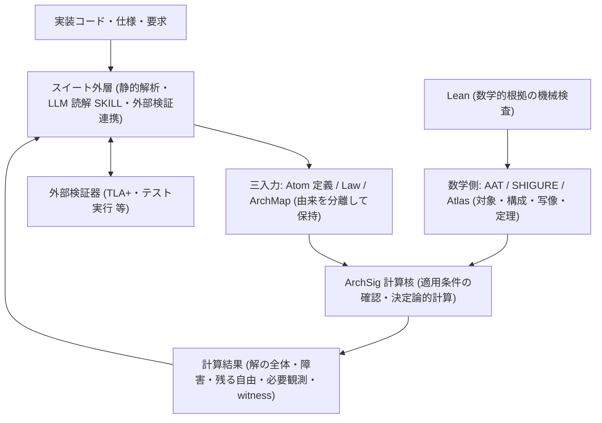
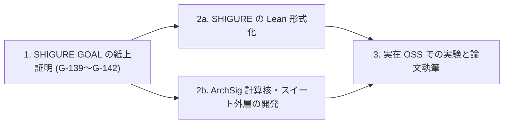

# 統合ツールスイート構想 — ソフトウェア工学の Rising Sea

静的解析、LLM による意味読解、テスト、TLA+ といった多様な手法と開発活動を、
ArchSig、SHIGURE、Atlas が支える一つの AAT 構造の上で接続する構想をまとめる。
議論の経緯は [Issue #6361](https://github.com/iroha1203/AlgebraicArchitectureTheoryV2/issues/6361)
（とくに[結論コメント](https://github.com/iroha1203/AlgebraicArchitectureTheoryV2/issues/6361#issuecomment-6985666182)）にある。

基礎論文 [*Foundations of Algebraic Architecture Theory: A Rising Sea of Geometry, Transport, Comparison, and Reconstruction*](../../outreach/paper/rising-sea/README.md)
は AAT の数学的基礎体系を扱う。このノートでは、同じ思想をツールスイートとソフトウェア開発の全体へ広げる枠組みを扱う。
基礎論文と区別するため、この構想を **統合ツールスイート構想 — ソフトウェア工学の Rising Sea** と呼ぶ。

> **AAT がつくる共通構造によって、幅広い手法と開発の問いが、海面の下に沈む。**

ここで言うのは、既存の道具や開発現場の実践が消えるということではない（[研究の全体目標](../research_goal.md)にあるとおり、現場は沈まない）。
理論の一般性を引き上げることで、個別に扱われてきた多様な手法と開発の問いが、共通構造の上での自然な構成と計算として位置づくことを目指す。
今ある手法を置き換えるのではなく、それぞれの知識と強みを取り込み、対象・問い・証拠に数学的な位置を与える。
共通構造の中で手法どうしを関係づければ、単独の道具からは出てこない新しい問いや解法も導ける。

以下では構想の枠組みを記述する。各構成・対応・計算の成立条件は証明および検証すべき研究課題であり、
§6 に述べる開発現場への変化は本構想が目指す目標である。

## 1. 共通構造と役割分担

### 1.1 出発点としての共通構造

Atom と Law を出発点に、実現、量、操作、変更、局所性、reading を備えた共通構造を設計する。
開発の現場に現れる要素は、この構造の上で次のように扱う。

| 開発上の要素 | 共通構造での扱い |
| --- | --- |
| 要求・仕様 | Law と評価条件 |
| 現状の実装 | 観測と対応づけた実現 |
| 変更（PR・移行・統合） | 射および比較図式 |
| 分担・モジュール・領域 | 局所の記述と重なり（全体への組立て条件） |
| 視点・抽象化・解析手段 | reading（語彙・操作・Law・局所性の選択） |

この共通構造に対して、条件が成り立つかという判定だけでなく、解の全体、全体へ組み立てられない障害、
障害を消す修復、制約の下で残る自由（選択の余地）、結論を定めるのに必要な情報までを同じ枠組みから導く。
Law や reading の変更自体も対象に含め、何を保つか、どの粒度で見るかを変えたときに
構造と結論がどう変わるかを比較できるようにする。

### 1.2 SHIGURE と Atlas の独立構成と接続

異なる理論を共通構造の中で結ぶ基本形は、SHIGURE と Atlas の接続にある。両者は現在の到達段階が異なるため、状態を区別して位置づける。

- **SHIGURE**（`draft`・これから証明および Lean 形式化を進める目標：[n1019](n1019_shigure_representability_design.md)・[n1020](n1020_shigure_polynomial_specializations.md)、GOAL カード [G-139](../../research/goals/G-139-aat-law-generated-relative-geometry.md)・[G-140](../../research/goals/G-140-aat-semantic-change-category.md)・[G-141](../../research/goals/G-141-aat-coherent-repair-effectivity.md)・[G-142](../../research/goals/G-142-aat-law-value-diagnostic-sheaf.md)）：
  実現と変更の族へ scheme や stack などの幾何を与え、条件付き解空間、局所からの組立て、障害、経路、状態の移送を構成することを目指す。
- **Atlas**（`ResearchLean` で証明済み・本体 `Formal/AG` へは `unported (Research-proved)`：[G-103](../../research/goals/G-103-aat-canonical-resolution.md)・[G-104](../../research/goals/G-104-aat-resolution-invariance.md)・[G-107](../../research/goals/G-107-aat-uniform-invariance-characterization.md)・[G-133](../../research/goals/G-133-aat-atlas-defect-composition.md)・[G-134](../../research/goals/G-134-aat-face-relation-subdivision.md)・[G-135](../../research/goals/G-135-aat-atlas-coefficient-fiber.md)・[G-136](../../research/goals/G-136-aat-atlas-gluing-width.md)・[G-137](../../research/goals/G-137-aat-safe-coarsening-order.md)）：
  Law 評価に十分な観測と、reading 間の比較を支える。

両者はそれぞれの入力から独立に構成し、reading、Law 評価、台（support）、比較写像を介して結ぶ（この接続を与える比較定理は [G-142](../../research/goals/G-142-aat-law-value-diagnostic-sheaf.md) F の証明課題である）。
片方の内部表現に他方を従属させず、比較定理によって接続することで、理論ごとの見通しと厳密さを保つ。

### 1.3 数学側・Lean・ArchSig 計算核・スイート外層の分担

[Tooling 編集ガイドライン](../tool/guideline.md)の入力トライアド（Atom 定義・Law・ArchMap）を守り、
決定論的な **ArchSig 計算核** と、コード観測・外部検証器との接続を担う **スイート外層（解析器・SKILL・連携変換）** を分けて設計する。

- **数学側**：対象、構成、写像、定理を定める。
- **Lean**：定義、仮定、定理、証明の連鎖を機械的に検査する。
- **ArchSig 計算核**：Atom 定義、Law、ArchMap の三入力から適用条件を確認し、決定論的な計算を実行する。言語固有の知識は持たず、外部で用意した結論相当のデータを入力へ注入しない。
- **スイート外層（観測・連携層）**：静的解析器や LLM 読解 SKILL によりコードの使用文脈から三入力を組み立て、必要に応じて計算結果を TLA+ 仕様などの外部検証器へ渡し、その反例や実行観測を対応づけて戻す。実コードと観測の対応の正しさは、この観測・応用側が担う。

## 2. 既存手法の位置づけと根拠の再利用

現行の [Tooling 編集ガイドライン](../tool/guideline.md) と [ArchSig v0.6.0 製品コンセプト](../tool/archsig_v0_6_0_concept.md) は、
ArchSig 本体の観測対象を「実装コードの構造」に限定し、テストコードや実行時の挙動・性能を対象外としている。
本構想では、この計算核の規律を壊さずに、**スイート外層** で以下の既存手法を共通構造へ接続・拡張する位置づけをとる
（テスト・実行観測や計算コストの Law 化を ArchSig 本体へ取り込む場合は、現行 v0.6.0 の対象範囲からの明示的な拡張・規律改訂として扱う）。

| 手法 | 共通構造の中で扱うもの | 接続する情報と根拠（核への扱い） |
| --- | --- | --- |
| 型検査・静的解析・Linter | 型、依存、副作用（effect）、構文上の事実 | 観測した原始事実（ArchMap）と、対応する制約（Law） |
| LLM 読解 | 使用文脈における意味の候補（値の役割、公開観測、原子性の範囲、Law 候補） | ソース箇所に結びついた読解候補と由来（採用・未決を区別して三入力へ供給） |
| テスト・実行観測（スイート外層拡張） | 指定した状態や操作列での挙動 | 実行の具体例（witness）、反例、観測値（外層での抽出検証および反例照合に用いる） |
| TLA+ 等の形式手法（スイート外層連携） | 対応づけた状態・遷移・不変量・安全性（safety）・活性（liveness） | 仮定と検証範囲を伴うモデル検査結果と反例トレース（生成・読戻しの独立検証として接続） |
| 定理証明 | 対象と計算についての数学的性質 | 仮定・結論・証明、および適用条件（計算核が依拠する根拠として参照） |

### 2.1 対応づけの規律

各手法の入力と結果を共通構造へ対応づける際は、元の判定と同値に対応するもの、
片方向（十分条件または必要条件）にだけ従うもの、特定の状態や操作列についての個別の観測として得られるものを分けて定める。
外部手法の結論相当データをそのまま ArchSig 計算核の入力へ混ぜず、読解候補、原始観測、計算結果、外部検証結果、定理証明は、それぞれの種類と由来を保ったまま接続する。

### 2.2 結果を再利用するための条件

異なる手法や局所の結論を翻訳せずに合成し、再利用するためには、次の三点を確かめる必要がある。

1. ある手法の結論が、別の計算の前提を満たしていること。
2. 異なる reading で得た結果が、同じ対象について述べていること。
3. 局所の証拠が、重なり（共有部分）の上で整合していること。

こうした比較と合成の条件そのものを、構想の数学的な内容に含める。

## 3. 枠組みの五つの発展方向

共通構造の上で、統合ツールスイート構想を次の五つの方向へ広げる。

### 3.1 問いから、必要な観測と検証を組み立てる

開発上の問いを受け取ったら、まずその問いを評価するのに必要な Law、reading、情報を求める。
その上で、静的解析、意味読解、モデル検査、定理の適用といった手段の組合せを組み立てる。

観測と整合する解釈が複数残るときは、その実現族をそのまま保持し、次の三つの量化を分けて問う。

| 問いの量化 | 意味 |
| --- | --- |
| 指定した変更が、すべての整合する解釈で成立する | 解釈が揺れても判定は変わらない |
| 解釈ごとに、成立する変更が存在する | 解釈を確かめれば対応する解を選べる |
| すべての整合する解釈に共通する一つの変更が存在する | 解釈を確定させずに安全へ進められる |

判定が分かれる実現の対が見つかれば、その対から必要な追加観測を求める。
十分な観測や検証の方法が複数あるときは、取得コストや実行時間を応用側の入力として比べる。
問いに答える方法を選ぶこと自体が、構造についての計算になる。

### 3.2 Law どうしの関係から、設計上の理由を扱う

要求や外部仕様から、内部規約、設計パターン、さらには構造から読める計算コストや出力規模の制約（v0.6.0 以降の拡張対象）までを、それぞれの対象についての Law として書く。
量に関する制約では、測る対象、観測方法、評価条件を明示する。
そして Law どうしの間に、含意、依存、両立、制限による対応を構成する。

こうしておくと、「ある内部規約はどの要求を支えているか」「別の構成でも同じ外部の Law を満たせるか」
「目的を実現するためにどの制約を選び直せるか」を計算で辿れる。
保存する外部の意味を固定したまま、内部の Law や許容変換を変えたときの解空間を比べれば、
設計の理由を要求から実装まで一続きの関係として持てる。
Law の発見、採用、変更も、工学の継続的な活動としてこの枠組みに置く。

### 3.3 変更に沿って、判定の根拠を維持する

すべての判定に、対象の版、reading、Law、観測の由来、適用した定理、根拠となる witness とその依存を結びつけておく。
コード、Law、reading のいずれかが変わったとき、そのまま再利用できる根拠と、
再確認が要る根拠を変更に沿って切り分ける。

観測が更新された箇所では、その観測に依存する結論を再計算する。
意味を保つ比較が得られたときは、その比較が保存する結論を新しい対象へ運ぶ（輸送）。
根拠の輸送と再計算の関係を整理しておくことで、検査や読解の成果を後続の変更や別の工程へ引き継げる。
AI エージェントの文脈づくりやセッション間の引き継ぎでも、会話の要約の代わりに、
作業に必要な Law、観測、対応、witness、未決の問いを渡す。

### 3.4 作業と工程を、同じ変更の構成としてつなぐ

作業は、次の四つ組で与える。

1. **起点**：reading と観測の根拠を結びつけた現在の実現
2. **守る Law**：変更をまたいで保存する Law
3. **許す変え方**：候補族を生成する許容変換仕様
4. **達成したい目的**：評価条件

要求から実装、レビュー、統合、移行までの各工程は、前の工程が作った対象・射・witness を引き継ぎながら、
同じ変更を具体化して根拠を積み上げていく流れになる。

| 工程 | 共通構造での構成と計算 |
| --- | --- |
| 着手前 | 解の存在、制約から必然的に決まる選択、残る自由を調べる |
| 分担 | 局所の対象と共有部分の条件を各担当へ渡す |
| 実装後 | 再観測によって、選んだ解との対応を確かめる |
| 統合 | 複数変更の図式の補完と障害を求める |
| 移行 | Law を満たす移行経路と、状態の移送条件を求める |

この流れの中で人間が担うのは、守る Law と目的を定めること、判定を左右する読解を確かめること、
解がないときに制約を選び直すこと、残る自由の中から選ぶことの四つである。
人間に返す certificate には、その判断に必要な対象・条件・根拠を載せる。

### 3.5 将来の変更に対して、設計が残す自由を比較する

想定する将来の変更族を先に与え、複数の設計案について、可能な変更、必要な変更範囲、追加観測、統合の障害を比べる。
実現できる変更の包含関係や、一方の設計でしか実現できない変更が、設計比較の証拠になる。
設計を選ぶときに、今の要求を満たせるかだけでなく、その後にどんな変更を受け入れられるかを一緒に扱える。

モジュール性、結合、互換性、技術的負債といった言葉も、選んだ変更族と観測に相対的な問いとして定める。
さらに先へ進めば、実現したい変更族から、それを可能にする局所構造、公開する関係、Law の置き方を求める
設計の逆問題になる。こうした変更と選択が連なる進化の力学を、[SFT](../sft/software_field_theory.md) と接続して研究する。

## 4. 中核となる五つの研究課題

この構想を支える中核の研究課題を五つに置く。

| 研究課題 | 明らかにすること・証明義務 |
| --- | --- |
| 1. 表現と比較 | 形式的な解析・検証手法が扱う対象・操作・性質を共通構造へ表現し、元の判定との一致・保存・反映を成立条件の下で証明する。LLM 読解や実行観測については、候補・個別観測としての接続条件と由来分離を定める。 |
| 2. 根拠の合成と局所からの組立て | 異なる手法や局所の検証結果から大域的な結論と witness を構成する条件を定める。構成を妨げる障害と修復も同じ対象から導く。 |
| 3. 観測の十分性 | Law 評価、診断、変更の判定、全解の復元について、それぞれに必要な reading と比較条件を求める。 |
| 4. 有限計算への接続 | 一般構造から計算できる表示を導き、停止性、探索の完全性、元の対象への witness の復元を証明する。計算範囲と結論の量化を対応づける。 |
| 5. 変更に沿う維持 | 実現・Law・reading の変更について、結論と証拠の輸送、再観測、再計算の関係を構成する。実コードと数学的入力の対応は応用側の検証対象として保持する。 |

## 5. 個別応用の位置づけ

議論の中で挙がった個別の応用は、どれもこの一般構造を使う応用として位置づけられる。
それぞれを「どの対象・射・局所性・reading に対する問いか」と「どの構成から答えが出るか」で整理する。

| 応用 | 一般構造での問いの対象 | 答えを与える主な構成 |
| --- | --- | --- |
| Law パッケージ | ライブラリや設計パターンに属する Law 族と許容変換 | 共通語彙、Law 間の対応、利用側への輸送 |
| エージェントの文脈と引き継ぎ | 作業に関わる対象・Law・観測・未決の問い | Law 評価に十分な reading の計算、根拠の維持と輸送 |
| 意味的なマージ | 共通の起点を持つ複数変更の併用 | 図式の補完、相互作用の障害と修復、許容される順序の経路 |
| 再計算できる ADR | 設計判断時の四つ組（起点・守る Law・許す変え方・目的） | 条件付き解空間の保存と、制約変更時の再計算 |
| 利用者ごとの互換性 | 利用者ごとに異なる操作族と観測 reading | 利用者 reading への制限、保存判定、破れを示す操作語 |

## 6. 目指す成果 — AI 時代のソフトウェア開発にもたらす変化

AI がコードを書くコストを大きく下げたことで、開発の制約は「速く書けるか」から
「人間が責任を持って扱える規模と複雑さの限界」へ移っている。
本構想が目指すのは、AI がどれほど速く書いても、人間がソフトウェアの意味と進化を引き受け続けられる構造である。
具体的には、次の五つの変化を目標に置く。

### 6.1 「全部読む」でも「任せきり」でもない品質の担保

生成量が人間の読解速度を超えると全行レビューは成り立たず、テストと AI レビューだけでは有限の視野と相関による見落としが残る。
人間の確認を §3.4 の四つの判断へ絞り、実コードと観測の対応を静的解析や独立確認で押さえた上で、
「選んだ reading と Law の下で計算が保証した範囲」「入力から決まっていない範囲（沈黙）」
「静的構造からは決まらず TLA+ 等で別に検証する並行性・活性の範囲」を切り分けて引き受けられる形を目指す。

### 6.2 並列エージェント開発の上限を押し広げる

複数エージェントを並列に走らせると、単独では安全な変更どうしが統合時に意図した振る舞いを壊しやすい。
§3.4 の着手前計算・分担・意味的な統合により、同じ AI 能力と人的資源のまま、完了できる変更の規模と複雑さの上限を広げることを目指す（[製品コンセプト](../tool/archsig_v0_6_0_concept.md) §6 が掲げる検証対象の目標）。

### 6.3 資産の重心を「コードの行」から「Law・観測・根拠の連鎖」へ移す

書き直しのコストが下がる時代には、コードの行そのものより「何を守り、なぜそうなっているか」のほうが長く残る資産になる。
§3.3 の根拠維持と引き継ぎにより、セッションごとに記憶が消えるエージェント運用や全面的な書き直しを経ても、
同じソフトウェアとしての連続性と再計算できる仕様・ADR を保ち続けられる状態を目指す。

### 6.4 「いま動くか」だけでなく「将来の変更に耐えられるか」で設計を選ぶ

動く試作を短時間で作れる時代には、設計の差はその後の要件変更・移行・バージョン混在に耐えられるかに現れる。
§3.5 の自由度比較と設計の逆問題により、モジュール性や技術的負債を経験則の議論から、将来の自由度をめぐる計算へ移すことを目指す。

### 6.5 「つくる人」の広がりを信頼性で支える

[研究の全体目標](../research_goal.md)「つくる人へ」が掲げるとおり、非エンジニアでも AI でソフトウェアをつくれる時代になったが、少し直すたびに別の場所が壊れて育て続けられない壁は残っている。
利用者が代数幾何や形式手法を学ばなくても、守る Law と目的を選び、判定を左右する確認に答えるだけで、
裏側の計算が整合・統合・移行を支え、誰もが引き受けて育て続けられる開発基盤を目指す。

AI が速く書くほど制御を失うのではなく、Law と計算を土台にしてより大きな構造を安全に動かせるようにする。
この変化を現場へ届ける上では、既存ツールからの観測取り込みで導入負荷を抑えることと、
日常の変更の中で Law と観測が自然に育つ循環をつくることが実務上の要になる。

## 7. 次に行うことと評価基準

### 7.1 今後の進め方

次の三段階で進める。

1. **SHIGURE の GOAL を紙上で証明する**
   [G-139](../../research/goals/G-139-aat-law-generated-relative-geometry.md)・[G-140](../../research/goals/G-140-aat-semantic-change-category.md)・[G-141](../../research/goals/G-141-aat-coherent-repair-effectivity.md)・[G-142](../../research/goals/G-142-aat-law-value-diagnostic-sheaf.md) を対象に、一般の対象・射・Law・局所性・reading を定め、それらの関係・構成・有限計算への接続を紙上で証明する。
   具体例は定義の明確化、構成の検証、反例の発見、説明に用い、研究の射程と到達点は一般構造から定める。
   既存手法（静的解析、テスト、TLA+ 等）との対応定理や接続条件は、G-139〜G-142 の範囲とは分けて、応用側・後続の証明義務として整理する（[n1020 §17](n1020_shigure_polynomial_specializations.md#archsig-application)）。
2. **SHIGURE の Lean 形式化と ArchSig・スイート開発を並列で進める**
   紙上で固まった SHIGURE の定理群の Lean 形式化と、ArchSig 計算核の拡張および観測・既存手法をつなぐスイート外層の開発を並列で進める。
3. **実際の OSS で実験し、論文を出す**
   実装したツールスイートを実在の OSS 開発に適用して検証し、理論・形式化・実装・実験の成果を論文としてまとめる。

### 7.2 構想の評価基準

構想の評価基準は、幅広い手法と開発活動が同じ構造の中でつながり、新しい問いを持ち込んだときにも、
解の全体・障害・残る自由・必要な情報を共通の数学から導けることに置く。

## 参照

- [研究の全体目標](../research_goal.md)
- [ソフトウェアの場の理論（SFT）](../sft/software_field_theory.md)
- [Rising Sea 基礎論文](../../outreach/paper/rising-sea/README.md)
- [ArchSig v0.6.0 製品コンセプト](../tool/archsig_v0_6_0_concept.md)
- [Tooling 編集ガイドライン](../tool/guideline.md)
- [核の標準構成と計算範囲](../tool/archsig_v0_6_0_io/computations.md)
- [n1018: ArchSig 実践検証の振り返りと共通構造の強み](n1018_archsig_practical_validation_retrospective.md)
- [n1019: SHIGURE — AAT の意味・量・変更から生成する代数幾何](n1019_shigure_representability_design.md)
- [n1020: SHIGURE の多項式特殊化 — 有限局所自由実現と診断（§17 ArchSig による解釈と応用）](n1020_shigure_polynomial_specializations.md#archsig-application)
- [Issue #6361](https://github.com/iroha1203/AlgebraicArchitectureTheoryV2/issues/6361)（[原理](https://github.com/iroha1203/AlgebraicArchitectureTheoryV2/issues/6361#issuecomment-6983610855)・[工程](https://github.com/iroha1203/AlgebraicArchitectureTheoryV2/issues/6361#issuecomment-6983611851)・[エージェントと既存手法](https://github.com/iroha1203/AlgebraicArchitectureTheoryV2/issues/6361#issuecomment-6983612696)・[結論](https://github.com/iroha1203/AlgebraicArchitectureTheoryV2/issues/6361#issuecomment-6985666182)）
