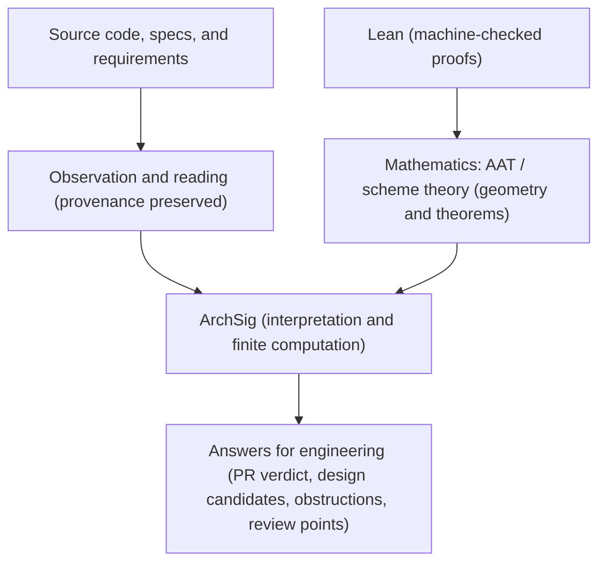

# Beyond "Read or Don't Read": Making Pull Requests Computable with the Rising Sea

*A research vision for connecting static analysis, LLM semantic reading, tests, and TLA+ on a single mathematical foundation.*

In the era of AI-generated code, engineering teams keep having the same argument: **should humans still read the code AI writes, or stop reading it altogether?**

The case for reading is clear: if you do not read the code, you cannot take responsibility for it, and quality will erode. The case against it is just as real: AI already writes code faster than humans can review it, and line-by-line review no longer scales.

Both sides have hit a wall.

- **Read everything**: reviews bottleneck as output grows, erasing the speed advantage of AI.
- **Stop reading (rely on tests and AI review)**: tests only verify the paths you chose to write, and AI reviewers share correlated blind spots. You end up shipping without knowing what is actually guaranteed and what remains unchecked.

We do not need to pick between reading every line and reading nothing. We need a **middle path**.

In this article, I introduce **a Rising Sea for software engineering**—a research vision for building that middle path. The idea is to place **Algebraic Architecture Theory (AAT)** underneath existing tools—static analysis, LLM semantic reading, tests, and formal methods like TLA+—so they share a single geometry and **make pull requests computable**.

I have published the mathematical foundations of AAT in [*Foundations of Algebraic Architecture Theory (Rising Sea)*](https://arxiv.org/abs/2609.27638) and am actively developing the computational tool ArchSig. Here, I lay out the broader vision built on top of that foundation: connecting multiple tools and the full development lifecycle through one shared geometry.

## Separating what you do not need to read from the one point that matters

The middle path between reading and not reading is not skimming code and hoping for the best. It is being able to **draw clear boundaries over the code you did not read, so you know exactly what is guaranteed and what is still undecided**.

Specifically, we want to partition every code change into three regions:

1. **Verified safe**: parts proven by computation to satisfy the rules you care about.
2. **Not yet decidable**: parts where current information is insufficient—and where the tool refuses to guess, explicitly staying silent instead.
3. **Delegated to specialized tools**: concerns such as concurrency or timing races, handed off to dedicated methods like TLA+.

Once those boundaries are explicit, humans no longer need to inspect every line. Human judgment narrows down to four responsibilities:

1. **Define the promises and goals that must hold.**
2. **Resolve the few small ambiguities in interpretation that actually change the outcome.**
3. **Decide which constraints to relax when no solution satisfies every rule at once.**
4. **Choose which design to adopt from the valid candidates that remain.**

Keep the decisions humans must own, and delegate the rest with explicit, backed boundaries. That is the middle path.

## Why today's tools cannot give us that middle path

Software engineering already has strong tools: type checkers, static analyzers, linters, tests, LLM code readers, and formal methods such as TLA+. Each excels at what it does.

Yet we remain trapped in the "read or don't read" binary because **the evidence each tool produces lives in separate worlds and does not compose**.

- Type checkers and static analyzers give reliable facts about syntax, types, dependencies, and side effects, but they cannot see business semantics or implicit requirements.
- Tests verify concrete behavior on chosen inputs and states, but they do not guarantee paths you never ran.
- LLMs can read intent and domain semantics broadly from context, but their interpretations fluctuate and cannot stand as guarantees on their own.
- Formal methods like TLA+ check concurrency properties rigorously, but writing an accurate model from real code is hard to begin with—and keeping that model faithful to the implementation is a separate problem.

Because every tool speaks a different language and offers a different kind of assurance, the work of combining them—asking *"taken together, does this change preserve our requirements, and where is the one place a human needs to look?"*—still happens **inside a human reviewer's head while reading code**. Adding yet another standalone tool does not break the binary as long as that integration burden stays on the reviewer.

We do not need another tool meant to replace existing ones. We need **a shared geometry underneath our tools and engineering workflows**.

## AAT as a shared sea: Atoms, Laws, and scheme theory

Mathematician Alexander Grothendieck described an approach he called the **Rising Sea** (*la mer qui monte*): instead of cracking a hard problem open with a hammer, raise the level of abstraction until the problem opens on its own.

**AAT (Algebraic Architecture Theory)** brings this idea to software engineering. Rather than piling up ad hoc checks for each language, framework, or verification technique, AAT places **one shared geometry** beneath them so diverse engineering questions become computations in the same setting.

Four properties give AAT its leverage here.

### 1. A simple starting point: Atoms and Laws

AAT starts from two primitives: **Atoms** and **Laws**.

- **Atom**: a typed, elementary architectural fact—what data or states exist, what operations exist, and how they relate.
- **Law**: a property that a system must satisfy, expressed as an equation or evaluation condition. **Laws generalize specifications and requirements as well as design principles and patterns (such as SOLID or layered architecture), coding conventions, and even performance or output-size constraints.**

External API requirements and internal design rules—such as *"dependencies flow in one direction across layers"* or *"all payment calls go through the dedicated payment module"*—live in the same formalism. We can also trace relationships between Laws: which requirement a design rule actually supports, or whether an alternative structure still satisfies the same external promises.

Here, **we first express the properties we want to preserve as Laws, use those Laws to guide the observation of Atoms from source code, and construct a geometry from those observations**. Within that geometry, we examine whether the Laws hold and explore the changes that satisfy them.

### 2. Independent of programming languages and frameworks

Atoms and Laws are abstracted away from concrete syntax and ecosystems. Extracting facts from source code depends on your stack, but the theory and calculations above it do not.

A Rust microservice, a TypeScript web app, or a polyglot distributed system can all be analyzed with the same geometry and theorems. You do not rebuild the theory every time a language or framework changes—and the promises and evidence you accumulate outlive any single stack.

### 3. Powered by algebraic geometry and scheme theory

Why reach for modern algebraic geometry—specifically **scheme theory**—instead of simple checklists or plain dependency graphs? Not as a metaphor: structural questions in software engineering correspond directly to geometric objects.

- **Solution spaces (schemes)**: viewing Laws as equations turns the set of all implementations or states that satisfy every constraint into a geometric "space" of solutions.
- **Pull requests as morphisms (morphisms of schemes)**: a pull request is not merely a text diff; it is a structure-preserving map (morphism) connecting the space before a change to the space after it. Whether a PR preserves existing Laws, or whether multiple PRs merge cleanly, becomes a computation on composition of morphisms and commuting diagrams.
- **Gluing and obstructions (sheaves and cohomology)**: parts often work individually yet break when combined. This corresponds directly to gluing local data across overlaps and computing the obstruction that prevents a global assembly.
- **Comparison and transport**: asking whether a coarser view preserves the same diagnosis, or whether guarantees carry forward across a change, becomes geometric comparison and transport.

Standing on this single geometry takes us far beyond binary pass/fail checks. **The full space of valid solutions, gluing obstructions and their repairs, the design freedom left open by constraints, the missing information needed to decide, and safe migration paths**—questions that once looked unrelated all emerge from the same calculations.

### 4. Grounded in the Rising Sea paper, hidden from the user

I laid out these mathematical foundations in [*Foundations of Algebraic Architecture Theory: A Rising Sea of Geometry, Transport, Comparison, and Reconstruction*](https://arxiv.org/abs/2609.27638). Starting from Atoms and Laws, the paper develops part-to-whole consistency, obstructions, comparison of changes, and global reconstruction, with machine-checked proofs developed in **Lean**.

One central result, the **Atlas Theorem**, characterizes when simplifying away fine-grained details preserves the diagnosis (whether an obstruction exists) for a chosen set of Laws. To verify whether an authentication code expires before delivery, you do not need to inspect the HTML styling of the email body. How much detail you can safely omit without missing an issue stops being guesswork and becomes a mathematical condition.

Crucially, **engineers using these tools never need to learn scheme theory or cohomology**. The mathematics and Lean proofs stay beneath the surface, while the tool layer (ArchSig) handles real-world code observation and finite computation.

## Connecting multiple tools through one geometry

Extending the ideas of the foundational paper across verification tools and the entire development workflow is what I call **a Rising Sea for software engineering**. Rather than replacing existing methods, we connect each tool's strengths onto one AAT geometry.

| Method | What it contributes to the shared geometry | Kind of evidence connected |
| --- | --- | --- |
| Type checking, static analysis, linters | Types, dependencies, side effects, syntactic facts | Observed facts, proven constraints, counterexamples |
| LLM semantic reading | Candidate meanings in usage context (roles of values, exposed behavior, transactional scope, candidate Laws) | Source-linked reading candidates with provenance |
| Tests and runtime observation | Behavior on specific states and operation sequences | Concrete execution examples, counterexamples, observed values |
| Formal methods (e.g., TLA+) | State transitions, concurrency safety, absence of deadlocks | Model-checking results with assumptions, scope, and counterexample traces |
| Theorem proving | Mathematical properties of structures and computations | Proofs with explicit applicability conditions |

One discipline is essential here: never flatten static-analysis facts, LLM hypotheses, test examples, and formal proofs into a single generic "verified" checkmark. We preserve the kind and provenance of every piece of evidence, composing and reusing results only where assumptions and shared boundaries genuinely align.

Moreover, this connection works in both directions. With formal methods like TLA+, writing an accurate model from production code has long been the biggest barrier to adoption. Once observed Atoms and Laws live in a shared AAT geometry, **ArchSig can generate TLA+ models directly for the parts that require concurrency checking**. The shared geometry anchors the model to the code, lowering the modeling burden so TLA+ can focus on what it does best: exploring concurrent executions.

### LLM semantic reading crosses the boundary of static analysis

**LLM reading** plays a pivotal role in this architecture.

Traditional static analysis and type checking are rigorous, but they stop at syntax and types. They cannot tell you what `status = "pending"` means in your business workflow, which operations form a single logical transaction, or whether a flag is part of an external API promise. Those semantics live in usage context, naming, and surrounding documentation.

LLMs excel at extracting this contextual meaning across large codebases. On their own, however, they are probabilistic and inconsistent, so their output cannot serve directly as a guarantee.

In this framework, the LLM is not the final judge. It is a **semantic reader that proposes source-linked candidate interpretations**. When multiple interpretations remain consistent with what has been observed, we do not force the LLM to guess one. We keep **all consistent interpretations** and compute over them inside the geometry.

As a result, **a pull request stops being just a text diff and becomes a computable object**. We can separate three distinct questions:

| Question | What it means in practice |
| --- | --- |
| Does the PR hold under **every possible consistent interpretation**? | Ambiguity does not affect the verdict—humans do not need to read this code. |
| Does each interpretation admit a valid change? | Confirming which interpretation is true lets you pick the matching solution. |
| Does a single common change hold under **every consistent interpretation**? | You can move forward safely without even resolving the ambiguity first. |

Only when two consistent interpretations lead to opposite verdicts does the system surface that exact pair and ask a human to resolve it. Making PRs computable is what finally separates what you do not need to read from the one point that demands human eyes.

### A concrete example: making an order-cancellation PR computable

To see how this works in practice, imagine a familiar backend task.

You ask an AI agent to refactor and extend **order cancellation in an e-commerce service**—canceling a paid order, issuing a refund, and releasing reserved inventory. The resulting PR touches 15 files and roughly 800 lines of code.

You want two Laws to hold:

- Canceling a paid order issues a refund exactly once and releases the inventory reservation.
- An already canceled order is never refunded twice.

Multiple tools cooperate over the shared geometry on this PR:

- **Type checking and static analysis**: establish as facts which functions the cancellation flow calls, where database transactions begin and end, and the input/output types of the payment client.
- **LLM semantic reading**: extracts source-linked candidate meanings—what `status = "pending"` represents in the database, and how `retry_token` acts as an idempotency key for the external payment API.
- **Tests**: supply concrete execution evidence for normal cancellation and for calling the cancel endpoint twice in a row without double refunding.
- **TLA+ (via ArchSig model generation)**: once those facts and Laws sit in the AAT geometry, ArchSig emits a TLA+ model to check concurrency races between a user's manual cancellation and a timeout-triggered automatic cancellation.

Now suppose two ambiguities remain in the LLM's reading:

1. **Logging and notification wording**: under every interpretation, the refund count and inventory release Laws still hold. Because every interpretation is safe, you do not need to read this code.
2. **External payment API behavior for `retry_token`**: the repository alone does not reveal whether the external gateway returns the previous refund result for the same order ID (*Interpretation A*), or creates a brand-new refund if a new token is generated after a timeout (*Interpretation B*). Computation shows that Interpretation A is safe, while Interpretation B allows a double refund on retry.

Instead of asking you to review all 800 lines, the system isolates **the single point where Interpretation A and Interpretation B split**, and hands you one clear decision:

- Confirm that the external payment gateway follows Interpretation A (or add an integration test to check it).
- Or pick a common change that stays safe under **both** interpretations—for example, persisting a unique refund-request record in the database before calling the gateway and using its ID as the fixed idempotency key.

Nearly all 800 lines are accounted for by computation, and your attention goes straight to the one point that actually determines correctness. That is the middle path between reading everything and reading nothing.

### Beyond verification: design exploration with ArchSig

AAT and ArchSig are not limited to checking a PR after it is written. Because a single geometry represents the whole space of valid designs, **ArchSig can explore that solution space before you write a single line of code**.

Pass your Laws and the scope of modules you are willing to change into ArchSig, and it computes the shape of the solution space. Up front, you can see:

- **Scope feasibility**: whether your current change boundary contains any valid solution at all, and how far you need to widen the scope before solutions appear.
- **Necessity vs. freedom**: which constraints every valid design must obey, versus which choices remain open for your team to decide freely.
- **Grounded design selection**: picking for simplicity or maintainability from candidates already proven to satisfy your Laws.

We have already seen this work in an experiment on **Saleor**, an open-source e-commerce platform. We examined a feature to release funds held on incomplete checkouts using declared candidate changes and Laws in ArchSig. Allowing edits only to the scheduled job (`task`) or even to payment processing (`payment`) yielded **zero** valid solutions. Widening the scope to include the boundary shared with order processing immediately produced **eight valid design candidates**. Having the order, payment, and fund-release flows share the same concurrency protocol was mandatory across all eight solutions. Meanwhile, three independent choices—including whether to use row locking or optimistic version checking—remained completely free (2 × 2 × 2 = 8 combinations).

ArchSig is not just a checker that flags mistakes; it is a **design assistant that maps out your options and narrows them down with mathematical backing**.

### Carrying evidence forward to the next change

For every verdict, the system records the code version, Laws, observation provenance, and dependencies of the evidence. When the code or requirements change next week, you do not start over from scratch.

Only conclusions affected by changed observations are recomputed. Wherever a meaning-preserving comparison holds, **evidence established on the previous version is carried directly forward to the new code (transport)**. Verification and semantic reading stop being disposable work and accumulate across changes and stages of development.

## How this middle path reshapes AI-era engineering

When multiple tools and development stages—design, task splitting, implementation, review, integration, and migration—connect through one shared geometry, four major shifts open up.

### 1. Parallel agent development and "semantic merge"

When multiple AI agents work in parallel, each branch often passes its own tests only to break system behavior the moment they merge. Endless generate-and-revert loops erase the gains of parallelism.

On a shared geometry, you can check before work starts whether a valid solution exists and distribute tasks with explicit compatibility conditions on shared boundaries. At integration time, rather than reconciling raw line diffs alone, you compute **merge orders that preserve Laws and identify semantic conflicts and repairs**. With the same AI capabilities, teams can safely push the scale and complexity of parallel changes much further.

### 2. Shifting long-term value from "lines of code" to "promises, observations, and evidence"

As AI drives the cost of writing code toward zero, raw lines of code matter less as a long-term asset. What endures is **what the software promises to preserve and why its structure works**.

Even when AI agents lose memory between sessions, you no longer rely on lossy chat summaries—you hand off **the exact Laws, observations, evidence, and open questions** for the task. Architecture Decision Records (ADRs) become live artifacts that can be recomputed whenever assumptions change. Even after a full rewrite of the implementation, the software keeps its continuity.

### 3. Choosing designs for future change freedom, not just "does it work today?"

When working prototypes take minutes to build, the real difference between designs shows up later: how well a design absorbs requirement changes, data migrations, and mixed versions.

By specifying families of anticipated future changes up front, you can compare candidate designs on **which changes remain possible, how far edits propagate, and where integration obstructions arise**. Concepts like modularity, coupling, compatibility, and technical debt move from gut feeling into **computations over future freedom**.

### 4. Backing the rise of new builders with real reliability

AI makes it possible for people outside traditional software engineering to build software. Yet the wall remains: getting a first version working is fast, while evolving it without breaking something else is still hard.

Users should not need to learn algebraic geometry or formal methods. They state the promises and goals they care about and answer a few decisive questions, while computation beneath the surface guards consistency, integration, and migration. Raising rapid AI creation into **engineering that anyone can stand behind and evolve** is the ultimate goal of this vision.

## Beyond the foundational paper: five research goals

To turn this vision into reality on top of the mathematical foundation established in the *Rising Sea* paper, I am pursuing five core research goals:

1. **Representation and correspondence**: map the objects and properties handled by static analysis, LLM reading, tests, and TLA+ into the shared geometry, and prove the exact conditions under which their verdicts correspond faithfully.
2. **Composing evidence from parts to wholes**: establish the conditions for assembling system-wide conclusions and evidence from multiple tools and local scopes—and derive obstructions and repairs from the same geometry.
3. **Sufficient observation**: characterize exactly how much information and which views are sufficient for Law evaluation, change verification, and design-space exploration.
4. **Bridging to finite computation**: derive computable finite presentations from general scheme-theoretic geometry, proving termination, completeness, and faithful reconstruction of answers.
5. **Maintaining evidence across change**: formalize how evidence is transported, re-observed, and recomputed as code and Laws evolve, while keeping the link between real code and mathematical inputs verifiable.

Alongside the theory, bringing this into daily practice requires low-friction ingestion from existing tools and a workflow where Laws and observations grow naturally as part of everyday changes.

## Closing thoughts

No matter how fast AI writes code, a binary choice between the exhaustion of reading every line and the gamble of not reading at all will not sustain software over the long run.

Place **one geometry built from Atoms and Laws** beneath the tools we already trust. Connect the rigor of static analysis, the semantic reach of LLMs, the concreteness of tests, and the concurrency power of formal methods—without erasing where each piece of evidence came from. Make PR verification and design exploration computable, and hand humans only the few decisions that truly belong to them.

Moving past "read or don't read" is how we make AI speed an asset rather than a liability—allowing humans to take responsibility for larger, more complex software with promises and computation underneath.

## References

- [Foundations of Algebraic Architecture Theory (Rising Sea)](https://arxiv.org/abs/2609.27638)
- [AAT / ArchSig Project Repository](https://github.com/iroha1203/AlgebraicArchitectureTheoryV2)
