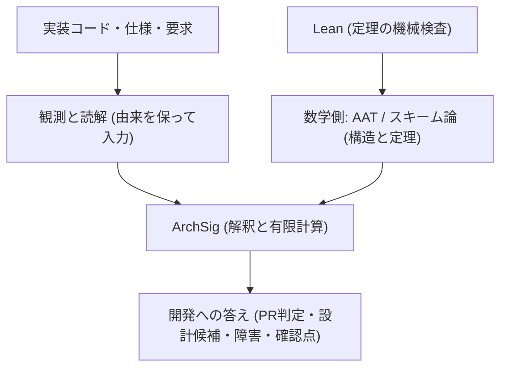

AIがコードを書く時代になり、開発現場では一つの論争が続いています。**AIが書いたコードを、人間は読むべきか、読まないでよいか**という論争です。

「読まなければ責任を持てない。品質が崩れる」という主張はもっともです。一方で、「AIが書く速度はすでに人間の読解速度を超えている。全行レビューを前提にしていては前に進めない」という実感もまた現実です。

しかし、どちらもすでに行き詰まっています。

- **全部読む**：変更の量が増えるほどレビューが詰まり、AIの速さを活かせない。
- **読まない（テストとAIレビューに任せきる）**：テストは選んだ経路しか確かめられず、AIレビューにも似た視点からの見落としが残る。何が保証されていて、何が未確認のままなのか分からない状態で進み続けることになる。

本当に必要なのは、「全部読む」と「読まない」のどちらかを選ぶことではありません。その間にある**中間の選択肢**をつくることです。

この記事では、その中間の選択肢を実現するための研究構想——**ソフトウェア工学の Rising Sea** を紹介します。**Algebraic Architecture Theory（AAT）** という数学的理論を共通の土台に置き、静的解析、LLMの意味読解、テスト、TLA+などの形式手法を一つの構造の上でつなぐことで、**PRを計算可能にする**取り組みです。

AATの数学的な基礎は論文『[Foundations of Algebraic Architecture Theory (Rising Sea)](https://arxiv.org/abs/2609.27638)』にまとめ、計算ツールArchSigの開発も進めています。今回はその先にある、複数のツールと開発工程の全体を一つの構造で結ぶ構想を語ります。

## 読まなくてもよい範囲と、人間が見るべき一点を分ける

「読む」と「読まない」の中間の選択肢とは、コードを流し読みして妥協することではありません。**読まなかったコードについても、どこまでが保証され、どこが未確認なのかをはっきり区切れる状態**をつくることです。

具体的には、変更されたコード全体を次の三つに分けられる状態を目指します。

1. **安全と確かめられた範囲**：守りたいルールを満たすことが、計算で保証された部分
2. **まだ判断できない範囲**：今ある情報だけでは結論が出ず、ツールが勝手に推測せずに「分からない」と示す部分
3. **別のツールに任せる範囲**：並行処理やタイミングの競合など、TLA+のような専用の手法で確かめる部分

この区切りがはっきりしていれば、人間はすべての行を目で追う必要がありません。人間が引き受ける判断は、次の四つに絞られます。

1. **守る約束と目的を決める**
2. **結論が分かれる、わずかな解釈の違いを確かめる**
3. **すべてのルールを同時に満たせないときに、どの制約を見直すか決める**
4. **ルールを満たす複数の設計案の中から、採用する案を選ぶ**

人間が責任を持って決めるべき判断だけを手元に残し、それ以外は根拠の範囲を区切って任せる。これが中間の選択肢です。

## なぜ今のツールだけでは、その中間がつくれないのか

ソフトウェア開発の現場には、すでに強力な道具が揃っています。型検査、静的解析、Linter、テスト、LLMによるコード読解、TLA+などの形式手法。どれも個々には優秀です。

それでも「読む／読まない」の二択から抜け出せないのは、**それぞれの道具が出す根拠の種類がバラバラで、互いにつながらないから**です。

- 型検査や静的解析は、構文・型・依存・副作用について確かな事実を出しますが、業務上の意味や暗黙の仕様までは分かりません。
- テストは、指定した入力と状態での具体的な挙動を確かめますが、試していない経路までは保証しません。
- LLMは、コードの文脈から仕様や意図を広く読み取れますが、解釈に揺れがあり、そのまま保証として扱うことはできません。
- TLA+のような形式手法は、並行処理の安全性などを厳密に検査できますが、そもそも現実のコードからモデルを書き起こすこと自体が難しく、モデルと実装が合っているかも別に確かめる必要があります。

道具ごとに言葉も保証の強さも違うため、「これらを総合して、今回の変更は本当に仕様を破っていないか」「人間が目視で確認すべき一点はどこか」という統合は、結局**人間がコードを読みながら頭の中で行う**ことになります。最後にまとめる負担が人間に残る限り、二択は解消されません。

必要なのは、新しいツールで既存手法を置き換えることではありません。**複数のツールと開発工程の下に、共通の構造を敷くこと**です。

## AATという共通の海 — Atom・Law・スキーム論の強み

数学者グロタンディークは、難問をハンマーで直接こじ開ける代わりに、理論の抽象度という「海面」を上げることで問題が自然に解ける形へ変える方法を **Rising Sea（上昇する海）** と呼びました。

私が進めている **AAT（Algebraic Architecture Theory）** は、この考え方をソフトウェア工学に持ち込む理論です。個別の言語やツールごとに場当たり的な対策を足すのではなく、**一つの数学的構造**を土台に据えることで、多様な開発の問題を同じ計算の上で扱えるようにします。

AATには、この構想を支える四つの強みがあります。

### 1. AtomとLawというシンプルな出発点

AATの出発点は、**Atom** と **Law** の二つです。

- **Atom**：型を持った、アーキテクチャ上の基本的な事実です。「どんなデータや状態があるか」「どんな操作があるか」「それらがどう関係しているか」といった最小単位を表します。
- **Law**：対象が満たすべき性質を、方程式や条件として表したものです。**仕様や要件だけでなく、SOLID原則やレイヤードアーキテクチャのような設計原則・デザインパターン、コーディングルール、計算コストや出力規模の約束まで**、すべてを同じLawとして扱えます。

たとえば、外部APIの振る舞いに関する要件も、「レイヤー間の依存を一方向に保つ」「決済処理は専用モジュール経由で呼ぶ」といった設計原則や内部規約も、同じLawとして記述できます。さらに、「この設計原則はどの要件を支えているか」「別の構成でも同じ外部仕様を満たせるか」といったLawどうしの関係も辿れます。

また、従来の形式仕様や設計文書は「先に仕様を書いてコードを従わせる」構造のため、実装との二重管理が起きがちでした。AATでは逆に、**ソースコードの観測（Atom）から構造を立ち上げ、そこに守りたいLawを当てて測る**ため、設計文書と実装が乖離していく問題を避けられます。

### 2. プログラミング言語やフレームワークに依存しない

AtomとLawは、特定のプログラミング言語の文法やフレームワークから抽象化された単位です。コードから事実を読み取る部分は技術スタックに依存しますが、その先の理論と計算は言語を選びません。

Rustのサービスでも、TypeScriptのWebアプリでも、複数言語が混在するマイクロサービスでも、同じ構造と定理で扱えます。技術スタックが変わるたびに道具をゼロから作り直す必要がなく、一度整理した「守るべき約束」と「根拠」は言語を越えて残ります。

### 3. 高度な代数幾何・スキーム論を応用する

なぜチェックリストやグラフ理論ではなく、高度な代数幾何、とりわけ**スキーム論**を応用するのでしょうか。比喩として名前を借りているわけではなく、ソフトウェア開発の構造的な問いが、そのまま幾何の対象に対応するからです。

- **解の空間（スキーム）**：守りたいルール（Law）を方程式として見ると、条件をすべて満たす実装や状態の全体が、解の集まりとして一つの「空間」をなします。
- **PRは空間を結ぶ写像（スキームの射）**：PR（変更）は単なるテキストの差分ではなく、変更前後の空間を結ぶ「構造を保つ写像（射）」として捉えられます。PRが元のルールを破らないことや、複数のPRを矛盾なくマージできるかが、射の合成や図式の整合として計算できるようになります。
- **貼り合わせと障害（層・コホモロジー）**：モジュールやチームごとに単体では正しく動くのに、組み合わせると全体が壊れる現象があります。これは、各部分のデータを共有部分でまとめる「貼り合わせ」と、それを妨げる「障害」の計算に対応します。
- **比較と輸送**：見る粒度や視点を変えたときに同じ結論が保たれるか、変更の前後で成立していた性質を新しいコードへ引き継げるか。こうした問いを、幾何の比較や輸送として扱います。

この一つの構造の上に立つと、単なる「違反か／違反でないか」のチェックにとどまりません。**条件を満たす解の全体、組み合わせたときの障害とその修復、残された設計の選択肢、判断に足りない情報、安全な移行経路まで**、これまで別々に見えていた開発の問いを同じ計算で扱えるようになります。

### 4. Rising Sea論文という土台と、使う側の負担

この数学的な土台は、基礎論文『[Foundations of Algebraic Architecture Theory: A Rising Sea of Geometry, Transport, Comparison, and Reconstruction](https://arxiv.org/abs/2609.27638)』にまとめました。AtomとLawから、部分と全体の整合性、障害、変更の比較、全体の再構成までを体系化し、定理証明支援系 **Lean** による機械検査を進めています。

たとえば論文の中心結果の一つである **Atlas定理** は、「細部を省いて粗く要約しても、選んだLawに対する診断（障害の有無）が変わらない条件」を与えます。認証コードの有効期限を確かめるのに、メール本文のHTML装飾まで細かく読む必要はありません。どこまで細部を省いても見落としが起きないかを、勘ではなく数学的な条件として扱えるのです。

ここで大切なのは、**ツールを使うエンジニアがスキーム論やコホモロジーを学ぶ必要はない**という点です。理論と証明は水面下に置き、現実のコードへの適用と計算はツール側（ArchSig）が引き受けます。

## 一つの構造から、複数のツールをつなぐ

基礎論文が築いた思想を、さまざまなツールとソフトウェア開発の全体へ広げていく。それが、**ソフトウェア工学の Rising Sea** です。既存手法を置き換えるのではなく、それぞれの強みを一つのAAT構造の上に接続します。

| 手法 | 共通構造の中で扱うもの | 接続する根拠の種類 |
| --- | --- | --- |
| 型検査・静的解析・Linter | 型、依存、副作用、構文上の事実 | 観測した事実、成立した制約、反例 |
| LLMによる読解 | 使用文脈における意味の候補（値の役割、公開される挙動、ひとまとまりで扱う範囲、Law候補） | ソース箇所に結びついた読解候補と由来 |
| テスト・実行観測 | 指定した状態や操作列での挙動 | 実行の具体例、反例、観測値 |
| TLA+等の形式手法 | 状態遷移、並行処理の安全性やデッドロックの有無 | 仮定と検証範囲を伴うモデル検査結果と反例トレース |
| 定理証明 | 対象と計算についての数学的性質 | 適用条件つきの証明 |

このとき大切なのは、静的解析の事実、LLMの意味候補、テストの実行例、形式手法の検証結果を「確認済み」と雑に混ぜないことです。根拠の種類と由来を保ったまま、前提や共有部分の整合性が噛み合う範囲だけを数学構造の上で合成して再利用します。

さらに、この接続は既存ツールの結果を取り込むだけの一方向ではありません。TLA+のような形式手法は、現実のコードから適切なモデルを書き起こす（モデリングする）難しさが導入の大きな壁になってきました。しかし、コードから観測したAtomとLawが一つの共通構造に揃っていれば、**並行性の検査が必要な箇所についてArchSigからTLA+向けのモデルを出力する**ことも射程に入ります。モデルとコードの対応を共通構造が支えることで、モデリングの負担を下げ、TLA+が得意な並行処理の検査に集中できる形を目指します。

### LLMの意味読解が、静的解析の壁を越える

この接続の中で、とくに大きな役割を果たすのが **LLMの読解** です。

従来の静的解析や型検査は厳密ですが、文法や型の外にある**意味論**までは捉えられません。「この `status` 列の値が業務上どんな段階を表すのか」「どの範囲が一つのまとまった取引なのか」「このフラグは外部との仕様の一部なのか」といった意味は、コードの使用文脈や命名、ドキュメントから読み取る必要があります。

LLMは、まさにこの使用文脈の意味論をコードから広く読み取れます。一方で、LLM単体の判断は確率的で揺れがあるため、そのまま品質保証の根拠にはできません。

そこで、LLMを最終的な判定者ではなく、**ソース箇所つきで意味の候補を供給する読解役**として位置づけます。複数の解釈が残ったときも、一つに決め打ちせず、すべての候補を保ったまま構造の上で計算します。

つまり、**PRによる変更が、単なるテキスト差分ではなく計算可能な対象になる**のです。具体的には、次の三つを分けて問えます。

| 問いのかたち | 意味すること |
| --- | --- |
| **あり得るすべての解釈**で、そのPRは安全か | 解釈が多少揺れても判定は変わらない（人間は読まなくてよい） |
| 解釈ごとに、安全な変更案があるか | どの解釈が正しいかを確認すれば、対応する解を選べる |
| **どの解釈でも安全になる**共通の変更案があるか | 解釈を確定させないまま、安全側へ進められる |

判定が分かれる解釈の対が見つかったときだけ、その違いを埋める追加の確認を人間に求めます。PRが計算可能になることで、初めて「読まなくてよい範囲」と「人間が見るべき一点」を切り出せるようになります。

### 身近な例で見る：注文キャンセル処理の改修PRを計算可能に

動きをイメージするために、Web開発でよくある場面を考えてみましょう。

ECサイトのバックエンドで、**「支払済みの注文をキャンセルし、返金と在庫の解放を行う処理」**をAIエージェントに改修させたとします。変更は15ファイル、約800行に及びました。

ここで守りたい約束（Law）は二つです。

- 支払済みの注文をキャンセルしたら、返金はちょうど1回だけ行われ、在庫予約も解放される。
- すでにキャンセル済みの注文に対して、二重に返金しない。

このPRに対して、複数のツールが共通構造の上で次のように連携します。

- **型検査・静的解析**：キャンセル処理が呼ぶ関数、DBのトランザクション境界、決済クライアントの引数型と戻り値型を事実として確定させる。
- **LLMの読解**：DB上の `status = "pending"` が何を指すか、外部決済APIへ渡す `retry_token` がどんな重複排除キーとして使われているかといった意味の候補を、ソース箇所つきで抽出する。
- **テスト**：正常系のキャンセルと、同じキャンセルAPIを2回続けて呼んだケースで二重返金が起きない具体例を確認する。
- **TLA+（ArchSig経由のモデル出力）**：こうして揃った事実とLawをAATの構造にまとめた上で、ArchSigがTLA+向けのモデルを出力し、ユーザーの手動キャンセルとタイムアウトによる自動キャンセルが同時に走ったときの競合をモデル検査する。

仮にここで、LLMの読解に二つの曖昧さが残ったとします。

1. **ログ出力と通知メッセージの解釈の揺れ**：どちらの解釈でも、返金回数と在庫解放のLawは揺らぎません。すべての解釈で安全なため、人間はこの部分を読まなくて済みます。
2. **外部決済APIの `retry_token` の仕様の揺れ**：外部サービス側が「同じ注文IDなら前回の返金結果を返す（解釈A）」のか、「タイムアウト後に別トークンを送ると新規返金になる（解釈B）」のかが、コードだけでは読み切れません。計算の結果、解釈Aなら安全だが、解釈Bなら再送時に二重返金が起きることが分かります。

ここでツールは「800行すべてをレビューしてください」とは言いません。**解釈Aと解釈Bで判定が割れる一点**だけを切り出し、次のどちらかの判断を人間に返します。

- 外部決済APIの仕様が解釈Aであることを人間が確認する（または結合テストで確かめる）。
- 解釈A・Bのどちらでも二重返金しない共通の変更案（たとえば、外部APIを呼ぶ前に一意な返金要求レコードをDBへ確定させ、そのIDを固定キーとして使う案）を選ぶ。

800行のほとんどは計算で安全と分かり、人間は**結論を本当に左右する1点**だけに集中できます。これが、「読む／読まない」の中間の選択肢です。

### 検証だけではない — ArchSigの解空間探索による設計支援

AATとArchSigの使い道は、書かれたPRを後からチェックすることだけではありません。**ArchSigに解空間を探索させることで、コードを書く前の設計支援そのものに使える**のが、一つの数学的構造を持つ大きな強みです。

守りたいLawと許す変更範囲をArchSigに渡すと、条件を満たす設計や変更の候補全体——つまり解空間の形を調べられます。これにより、設計の段階で次のことが分かります。

- **変更範囲の見通し**：いま触ろうとしているモジュールの中だけでは条件を満たせず、どこまで変更範囲を広げれば解が現れるのかが、実装を始める前に分かる。
- **必然と自由の切り分け**：要求を満たすためにどの案でも必ず守るべき条件と、制約を満たしたままチームが自由に選べる部分（残る自由）が一覧として現れる。
- **根拠を持った設計選択**：計算で条件を満たすと裏付けられた候補の中から、保守性や簡潔さを基準に設計を選べる。

実際、ECプラットフォームのOSSである **Saleor** を題材にした実験でも、この手応えが見えています。注文が完了しないまま残った資金を解放する機能について、用意した変更候補とLawをArchSigで計算したところ、定期処理や決済処理だけの変更では条件を満たす解がありませんでした。しかし注文処理との共有部分まで変更範囲を広げると、**8つの設計案**が現れました。「注文・決済・資金解放で競合制御の方式を揃えること」は8案すべてに必須の条件でした。一方で、行ロックと更新世代照合のどちらを選ぶかなど3つの選択（2×2×2＝8通り）は自由に選べる、という構造が計算から浮かび上がったのです。

このようにArchSigは、不具合を指摘するだけの検査器ではなく、**設計の選択肢を広げて絞り込むための設計支援ツール**として機能します。

### 次の変更にも、検証の根拠を引き継ぐ

判定ごとに、コードの版、Law、観測の由来、根拠の依存関係を結びつけて記録しておきます。すると、コードや仕様が変わったときも、毎回ゼロから全検証をやり直す必要がありません。

変更の影響を受ける箇所だけを再計算し、意味が保たれている部分については、**前の版で成り立っていた根拠を新しいコードへそのまま引き継ぎます（輸送）**。検査や読解の成果を使い捨てにせず、後続の変更や別の工程へ積み上げていけます。

## 中間の選択肢がひらく、AI時代の開発の風景

一つの構造の上で複数ツールと開発工程（設計、分担、実装、レビュー、統合、移行）がつながると、開発の風景は大きく変わります。この構想が目指している変化を四つにまとめます。

### 1. 並列エージェント開発と「意味的なマージ」

複数のAIエージェントを並列に動かすと、それぞれ単体ではテストが通るのに、マージした瞬間に仕様が壊れることがよく起きます。生成と差し戻しの往復が増えるほど、並列化の利点は薄れていきます。

共通構造の上では、作業を始める前に条件を満たす解があるかを調べ、共有部分の約束を揃えた上でタスクを分担できます。統合の段階でも、テキストの行差分を突き合わせるだけでなく、**約束を破らない統合順序や、衝突の修復**を計算で求めます。同じAIの能力のまま、安全に扱える変更の規模と複雑さの上限を押し広げられます。

### 2. 資産の重心が「コードの行」から「約束・観測・根拠の連鎖」へ移る

AIがコードを書くコストが下がるほど、コードの行そのものを守る意味は薄れます。一方で、「このソフトウェアは何を守り、なぜこの構造になっているのか」という約束と設計の理由のほうが、はるかに長く残る資産になります。

セッションごとに記憶が消えるAIエージェントの運用でも、会話ログの要約を渡す代わりに、**作業に必要なLaw、観測結果、根拠、未確認の問い**をそのまま引き継げます。設計判断の記録（ADR）も、前提や制約が変わったときに「いまの条件で再計算できる資産」に変わります。実装を全面的に書き直しても、同じソフトウェアとしての連続性を保てます。

### 3. 「いま動くか」だけでなく「将来の変更にどれだけ自由を残すか」で設計を選ぶ

動く試作を短時間で作れる時代には、設計の優劣は「いま動くか」よりも「その後の要件変更、データ移行、バージョン混在にどれだけ耐えられるか」に現れます。

想定する将来の変更パターンを先に与え、複数の設計案について「どこまで対応できるか」「修正はどこまで広がるか」「統合時に衝突しないか」を比べます。こうして、モジュール性、結合度、互換性、技術的負債といった言葉が、経験則や感想から**将来の自由度をめぐる計算**へ移っていきます。

### 4. 「つくる人」の広がりを信頼性で支える

エンジニアでなくても、AIを使ってソフトウェアをつくれる時代になりました。しかし、動くものを素早く作れても、少し手を加えるたびに別の場所が壊れて育て続けられない壁は残っています。

利用者が代数幾何や形式手法を学ばなくても、守りたい約束と目的を決め、わずかな確認に答えるだけで、裏側の計算が整合や統合を支えてくれます。速く作れるだけの開発を、**誰もが引き受けて育て続けられるソフトウェア工学**へ引き上げることが、この構想の到達点です。

## 基礎論文の先へ — 目指すべき五つの研究目標

ここで描いた仕組みを実現するために、基礎論文『Rising Sea』で築いた数学的土台の上で、次の五つの研究目標に取り組んでいきます。

1. **既存手法との対応づけ**：静的解析、LLM読解、テスト、TLA+などが扱う事実や性質を共通構造へ落とし込み、元の判定と正しく対応する条件を証明する。
2. **根拠の合成と全体への組立て**：異なるツールや担当範囲の検証結果から、システム全体の結論と根拠を組み立てる条件を定める。組み合わせたときの障害と修復方法も同じ構造から導く。
3. **必要な観測の見極め**：Lawの判定、変更の検証、設計案の探索それぞれについて、どこまでの情報があれば十分に判断できるかを明らかにする。
4. **現実の計算への接続**：スキーム論などの一般構造から、実際に有限時間で計算できる形を導き、計算が必ず止まり、見落としなく答えを返せる条件を証明する。
5. **変更に沿った根拠の維持**：コードやLawが変わったときに、そのまま引き継げる根拠と再計算が必要な箇所を切り分ける仕組みを確立する。

あわせて、既存ツールからの観測取り込みで導入負荷を抑え、日常の変更の中でLawと観測が自然に育つ循環をつくることも目指しています。

## おわりに

AIがどれほど速くコードを書くようになっても、「全部読む」という消耗戦か、「読まずに祈る」という賭けかの二択しかないのでは、ソフトウェアを長く育て続けることはできません。

**AtomとLawによる一つの数学的構造**を土台に置き、静的解析の厳密さ、LLMの意味読解、テストの具体性、形式手法の検証力を、それぞれの由来を保ったままつなぎ合わせる。その上で、PRの検証から設計の探索までを計算で支え、人間が本当に判断すべき一点だけを取り出す。

「コードを読むか、読まないか」という問いそのものを超えて、AIが速く書くほど、約束と計算を土台により大きなソフトウェアを安全に動かせる世界をつくりたいと考えています。

## 参考資料

- [AATの基礎論文『Foundations of Algebraic Architecture Theory (Rising Sea)』](https://arxiv.org/abs/2609.27638)
- [AAT / ArchSig プロジェクトリポジトリ](https://github.com/iroha1203/AlgebraicArchitectureTheoryV2)
